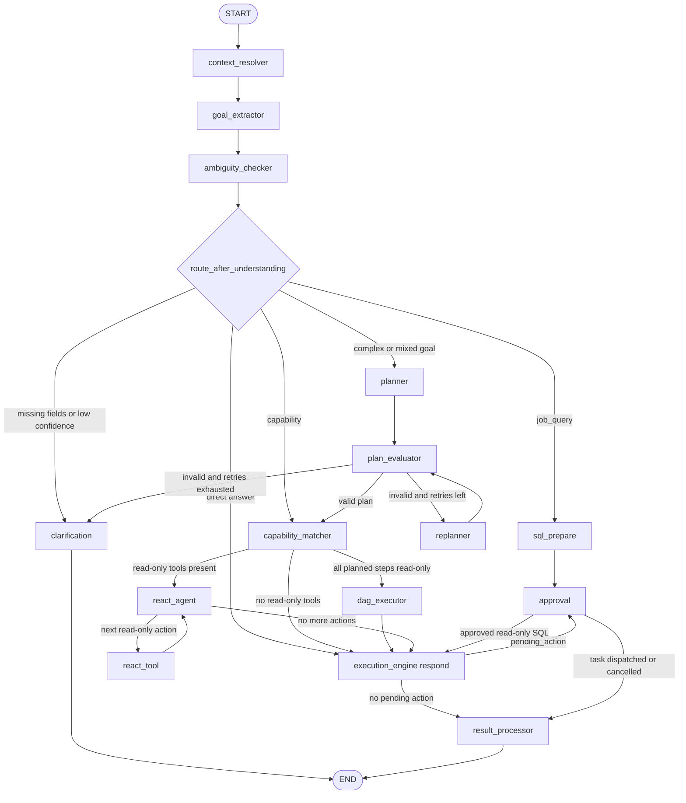
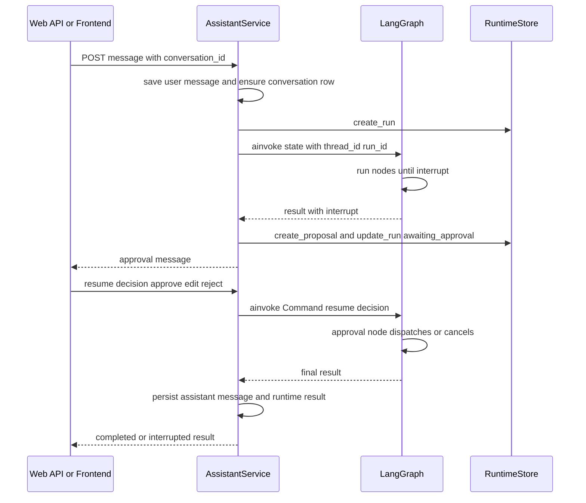

# Controlled Assistant Agent Architecture

The workbench AI assistant is not a single prompt call. It is a controlled general agent built on LangGraph. One user message flows through a fixed node graph that resolves context, extracts a structured goal, checks ambiguity, routes the request to the right execution strategy, runs bounded read-only work, and only ever turns a side effect into an approval proposal that a human must confirm.

The design rule that governs everything else:

> Query, research, analysis, comparison, and content generation run autonomously. Database writes, task launches, message sends, and other external side effects must go through a deterministic approval flow.

The model proposes actions; it never authorizes them. Code — not prompts — enforces user negative constraints, evidence-domain boundaries, and the approval gate.

## Layer responsibilities

The assistant is split into layers so that understanding, decision-making, execution, policy, and persistence stay separable. The modules and their ownership boundaries are:

| Layer | Primary modules | Responsibility |
| --- | --- | --- |
| API and application service | `web/server.py`, `assistant/service.py` | conversation API, SSE, run creation, per-conversation locking, cancellation, resume, result persistence |
| Context layer | `answer_context.py`, `repository.py` | recent messages, current job, conversation summary, long-term memory, compact answer inputs |
| Understanding layer | `understanding.py`, `goal_understanding.py` | intent, interaction mode, entities, constraints, success criteria, unknowns |
| Decision layer | `routing.py`, `capability_retriever.py`, `capabilities.py` | route to clarify / answer / execute / plan, and recall candidate capabilities |
| Planning layer | `planning.py`, `dag_scheduler.py` | build, validate, rebuild, and bounded-parallel execute a dependency graph |
| Autonomous execution layer | `react.py`, `graph.py` | choose read-only tools step by step, record observations, continue or finish |
| Policy and approval layer | `policy.py`, `graph.py` | apply negative constraints, classify side effects, build approval proposals |
| Capability implementation layer | `sql_tool.py`, `company_research.py`, `deep_research.py`, `web_search.py` | query jobs, research companies, read public information, generate analysis material |
| State and audit layer | `models.py`, `observations.py`, `execution_events.py` | stable data contracts, normalized tool results, versioned execution events |
| Infrastructure layer | `infrastructure/` | Run, DAG, Observation, proposal, artifact, distributed lock, and cancellation signal stores |

The shared contracts live in `src/bosshunter/assistant/models.py`: `IntentResult`, `GoalState`, `CapabilitySpec`, `PlanStep`, `ReactObservation`, `EvidenceResult`, and `ExecutionEvent`. The LangGraph session state is `AssistantState` in `src/bosshunter/assistant/graph.py`.

## Entrypoint and run lifecycle

`AssistantService` (`src/bosshunter/assistant/service.py`) is the boundary between the Web API and LangGraph. `send_message()`:

1. Idempotently ensures the conversation row exists and persists the user message.
2. Creates a unique Run in the `RuntimeStore`.
3. Acquires the `conversation:<id>` lock; a second concurrent request for the same conversation fails instead of interleaving state.
4. Sets the token callback, execution-event callback, and cancel-check callback via context variables.
5. Invokes `self.graph.ainvoke(...)` with `thread_id` set to the run ID.
6. Streams tokens and normalized `ExecutionEvent`s to the SSE client.
7. Persists the assistant message and the runtime result: DAG steps, observations, proposals, citations, plan, evidence route, and coverage.

The graph runs inside a dedicated `SelectorEventLoop` because the async PostgreSQL connection does not support Windows Proactor event loop. Cancellation is cooperative: `cancel()` writes a cancel signal and updates the run state; the DAG scheduler stops starting new steps at safe points, and a cancelled partial answer is not persisted as a complete assistant message.

## The LangGraph node graph

`build_assistant_graph()` in `src/bosshunter/assistant/graph.py` registers 15 nodes and their conditional edges. The fixed upstream pipeline is `context_resolver → goal_extractor → ambiguity_checker`; from there the router selects one of `clarification`, `sql_prepare`, `execution_engine` (direct), `capability_matcher`, or `planner`.

- **`context_resolver`** reads recent messages, the current job, web-enabled flag, conversation summary, and retrieved memories. It performs summary compaction of older turns and does not call any external capability.
- **`goal_extractor`** calls the model to produce a structured `IntentResult`, persists explicit memory operations, and raises on model failure so the run fails loudly.
- **`ambiguity_checker`** completes missing slots against the capability registry, builds the `GoalState`, and computes the `EvidenceRoute`.
- **`sql_prepare`** exists only for `job_query` intents: it generates read-only SQL and pauses for approval before any data is read.
- **`clarification`** emits a minimal clarification question and ends the turn, waiting for the next user message.
- **`planner`** splits complex goals into a DAG of `PlanStep`s. For `mixed` evidence routes it builds ordered evidence tasks first.
- **`plan_evaluator`** verifies that every planned capability is registered, dependencies exist and are ordered, and there is no cycle.
- **`replanner`** rebuilds the plan after a failed evaluation, capped at two attempts.
- **`capability_matcher`** recalls capabilities and freezes arguments. Legacy side-effect intents keep a deterministic action mapping; read-only flows use `retrieve_capabilities()` and are filtered by the evidence-domain tool whitelist.
- **`dag_executor`** runs complex read-only plans through the `DagScheduler`.
- **`react_agent` / `react_tool`** form the bounded ReAct loop for simple or exploratory read-only requests.
- **`execution_engine`** (the `respond` function) assembles the answer or builds a pending approval action.
- **`approval`** pauses the graph with LangGraph `interrupt()` and waits for a human decision.
- **`result_processor`** normalizes the final result summary for logging, evaluation, and frontend tracking.



_Figure 1: The assistant node graph and its conditional routes. Read-only work ends at `execution_engine`; side-effect work is diverted to `approval` before any fixed executor runs._

### Routing decisions

`route_after_understanding` sends `job_query` straight to `sql_prepare`; otherwise it calls `decide_route()` (`src/bosshunter/assistant/routing.py`). Missing fields or confidence below 0.6 go to clarification; `answer`/`cancel` interaction modes and `general_question` go directly to the execution engine; high-confidence side-effect intents below 0.85 are re-clarified; complex goals go to the planner; everything else goes to the capability matcher. A `direct` route whose evidence route is `mixed` is promoted to the planner.

## Evidence-domain routing

Before any tool is chosen, the question is classified into a primary evidence domain. `EvidenceDomain` is `direct`, `structured_data`, `private_document`, `public_current`, or `mixed` (`src/bosshunter/assistant/models.py`). `route_evidence()` (`src/bosshunter/assistant/evidence_router.py`) uses deterministic term lists and the intent type:

| Mode | Allowed read-only tools | Typical question |
| --- | --- | --- |
| `direct` | none | "What is a job funnel?" |
| `structured_data` | `job_database` | "How many jobs did I collect recently?" |
| `private_document` | `resume_read` | "Analyze my resume strengths." |
| `public_current` | `web_search`, `company_research` | "Any recent news about this company?" |
| `mixed` | union of the above domains | "Which jobs fit my resume, and how are these companies doing?" |

`allowed_tool_names()` converts the route into a read-only tool whitelist. The `public_current` tools are only available when the user has enabled web search. Definition questions ("what is…", "explain…") default to `direct` even if they contain analytics words such as "funnel".

The evidence route is a boundary on read-only capabilities only. It never grants write, send, or background-task permission; side-effect actions still follow the existing approval chain regardless of the route.

For `mixed` questions, `build_evidence_tasks()` (`src/bosshunter/assistant/evidence_planning.py`) imposes a fixed dependency order so public research is scoped to already-narrowed candidates:

```text
structured_data (query candidate jobs)
    -> private_document (filter against resume, at most 5 jobs or companies)
        -> public_current (research only the shortlisted companies)
```

The results of each executor are normalized into `EvidenceResult` (`src/bosshunter/assistant/evidence.py`), which carries task ID, executor, status, bounded evidence items, summary, missing evidence, and `data_ref`. `evaluate_evidence_coverage()` reports any missing required task, and the final answer prompt must state missing evidence rather than filling it with model knowledge.

## DAG vs ReAct selection

After capability matching, `route_after_capability_match` chooses the execution strategy:

- **`dag_executor`** when an execution plan exists and every step is a registered capability with `side_effect == "none"`. This is for complex, multi-deliverable, or dependency-bound read-only work such as multi-company research.
- **`react_agent`** when there is at least one allowed read-only tool but no read-only DAG. This is the simple or exploratory path.
- **`execution_engine`** when there are no read-only tools to run, so the answer is generated directly or the request becomes a pending action.

`dag_executor_node` builds frozen `DagStep`s and runs them through `DagScheduler` with `max_concurrency=4`, `deadline_seconds=120`, and the cancel check. Its step adapter raises `PermissionError` if any scheduled capability has a non-`none` side effect, so the DAG cannot be abused to execute writes.

The ReAct loop is bounded by `MAX_REACT_ITERATIONS = 4` (`src/bosshunter/assistant/react.py`). Each iteration either selects the first unmatched read-only action, asks the model for the next action within the allowed tool set, or finishes. Repeated tool calls are deduplicated by a stable action signature.

## Approval and resume

Side-effect tool calls from the model are never executed directly. `_build_pending_action()` validates each call against the business database and produces an approval proposal (`collect_jobs`, `score_jobs`, `send_greetings`, `send_hr_reply`, `monitor_replies`, `run_pipeline`, and so on). The `approval` node calls LangGraph `interrupt(action)` to pause the graph and return the proposal to the user.

`AssistantService.resume()` resumes the same checkpoint by invoking `graph.ainvoke(Command(resume=decision), config=config)` with the original run ID as `thread_id`. The `approval` node then:

- Verifies the `action_id` still matches, rejecting stale proposals.
- Handles `edit` for read-only SQL by re-running `validate_readonly_sql` and requiring a second confirm.
- On `approve`, either executes the already-hashed read-only SQL directly, or dispatches the proposal through `action_dispatcher` (the fixed executor path).
- On `reject`, cancels without side effects and marks the plan steps stopped.



_Figure 2: The run, approval, and resume lifecycle across the service, the graph checkpoint, and the runtime store._

## Security invariants

The core invariant is that the model can never authorize its own side effects:

- `policy.py` deterministically extracts negative constraints such as "不要发送" / "不要投递" into `forbidden_actions` and `do_not_send`, then disables conflicting steps.
- `retrieve_capabilities()` drops any capability whose `side_effect` is not `none` in the read-only slice, and additionally filters external side effects when the user says no sending or applying.
- `_enforce_mode_capability_boundary()` keeps `answer`/`cancel` interaction modes to read-only matches only.
- The DAG step adapter refuses non-`none` side-effect capabilities.
- The evidence-domain whitelist only names read-only tools; it is never a grant for writes or sends.
- Approved action dispatch is guarded by `_dispatch_action()`, which raises if the proposal was already consumed, and persists consumption in the `RuntimeStore`.

The semantic SQL path has the same philosophy: the model maps natural language onto whitelisted metrics, dimensions, and filters (`src/bosshunter/assistant/semantic_layer.py`), while SQL is generated deterministically and `validate_readonly_sql()` rejects multiple statements and writes. Generated SQL is hashed, and the approved hash must match before execution.

## Persistence and configuration

`build_assistant_graph()` uses `AsyncPostgresSaver` as its LangGraph checkpointer and therefore requires a configured PostgreSQL `database.url` starting with `postgresql://` or `postgresql+psycopg://`; it fails fast if the URL is missing. The checkpointer is created inside the service's dedicated event loop. Production infrastructure is:

| Facility | Truth boundary |
| --- | --- |
| PostgreSQL | business data, conversations, messages, LangGraph checkpoint, Run, DAG steps, observations, proposals, artifact references |
| Redis | conversation locks, cancel signals, real-time events; not the final source of truth |
| Artifact Store | over-sized tool results and generated artifacts |

Observations larger than 16 KiB are written to the Artifact Store and replaced with a `data_ref` in run state, keeping model context, database rows, and SSE payloads bounded.

## Extension points

- **Capabilities** are added to `CAPABILITY_REGISTRY` in `src/bosshunter/assistant/capabilities.py` with side-effect, risk, approval, and timeout metadata; `retrieve_capabilities()` then makes them discoverable.
- **Read-only executors** live under `src/bosshunter/assistant/executors/` (`analytics`, `private_docs`, `web_research`) and are adapted into both the DAG and ReAct paths.
- **Evidence domains** are extended by adding terms and tool mappings in `evidence_router.py` and `evidence.py`.
- **Policy rules** are deterministic functions in `policy.py`, not prompts, so a new negative constraint must be added as code and covered by a regression test.

## Focused tests

The architecture is locked by pure-function regression tests rather than end-to-end model assertions:

- `tests/test_assistant_architecture.py` covers intent normalization, risk escalation, routing, plan build/validate/rebuild, and ReAct filtering.
- `tests/test_evidence_routing.py` covers each evidence domain, tool whitelists, mixed-task ordering, evidence contracts, and missing-evidence reporting.
- `tests/test_general_agent_architecture.py` covers capability recall without the legacy intent gate and negative-send filtering.
- `tests/test_dag_scheduler.py` covers parallel readiness, dependency result passing, failure propagation, timeout, and cancellation.
- `tests/test_sql_approval.py` verifies SQL is planned but not executed before approval, revalidated on resume, and rejects writes or multi-statement payloads.
- `tests/test_assistant_output_honesty.py` locks frontend assertions so the UI never reports `skipped`, `incomplete`, cancelled, or budget-exhausted states as `completed`.

## Related pages

- [Capabilities and approval](/openwiki/concepts/capabilities-and-approval.md)
- [Job state machine](/openwiki/concepts/job-state-machine.md)
- [Web API](/openwiki/integrations/web-api.md)
- [Data and infrastructure](/openwiki/operations/data-and-infrastructure.md)
- [Assistant QA flow](/openwiki/workflows/assistant-qa-flow.md)
