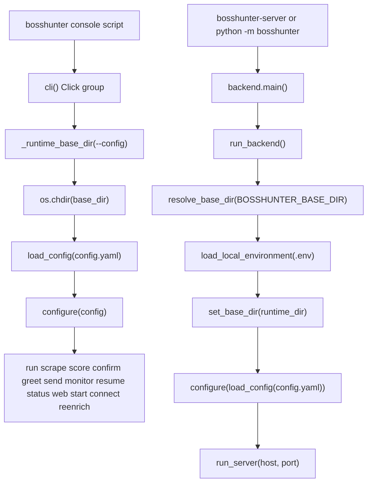

# CLI and Process Entrypoints

BossHunter v2.0 has two process entry layers that converge on the same owned services: a Click command group (`bosshunter`) and a unified web backend (`bosshunter-server`, also reachable as `python -m bosshunter`). Both entrypoints perform the same bootstrap contract — resolve a runtime base directory, load `config.yaml`, and push that configuration into the browser runtime via `configure(...)` — so a command-line run and a dashboard/background-task run cannot disagree about which config or data directory they operate on.

## Entrypoint wiring

The console scripts are declared in `pyproject.toml`, and the module-level `__main__` files define the `python -m` equivalents.

| Invocation | Python target | Purpose |
| --- | --- | --- |
| `bosshunter` | `bosshunter.main:cli` | Click command group for the job-hunt pipeline and local dashboard |
| `bosshunter-server` | `bosshunter.backend:main` | Unified backend process (`run_server`) |
| `python -m bosshunter` | `bosshunter/__main__.py` → `bosshunter.backend.main` | Same backend as `bosshunter-server` |
| `python -m bosshunter.main` | `bosshunter/main.py` `__main__` → `cli()` | Same Click group as `bosshunter` |

`pyproject.toml` maps `bosshunter = "bosshunter.main:cli"` and `bosshunter-server = "bosshunter.backend:main"` (`repo://pyproject.toml#L35-L37`). `src/bosshunter/__main__.py` simply imports and calls the backend `main()`, while `src/bosshunter/main.py` ends with `cli()` under its own `__main__` guard, which is why the Windows launcher can invoke `python -m bosshunter.main start`.

The bootstrap flow below shows how the two layers reach their shared configuration:

_Figure 1: The CLI group and the backend process take different routes but both resolve a base dir, load the same `config.yaml`, and call `configure` before dispatching to commands or the HTTP server._

## The Click CLI group

`src/bosshunter/main.py` defines `cli` as a Click group with `invoke_without_command=True`, a `--version` option sourced from `bosshunter.__version__`, and a single global `--config` option (`repo://src/bosshunter/main.py#L77-L92`). The group callback runs on every invocation, including bare `bosshunter` with no subcommand, and it is where the shared bootstrap lives:

1. `ctx.ensure_object(dict)` then `path = Path(config_path) if config_path else None`.
2. `base_dir = _runtime_base_dir(path)` resolves the runtime directory.
3. If `--config` was not given but `base_dir/config.yaml` exists, `path` becomes that file.
4. `ctx.obj["base_dir"] = base_dir`, then `os.chdir(base_dir)` so every relative path in config (`./data/...`, `./resume.md`, `./data/browser-profile`) resolves against the same root.
5. `ctx.obj["config"] = load_config(path)`, then `from bosshunter.browser import configure; configure(ctx.obj["config"])` pushes the merged config into process-wide browser-runtime settings.

The `os.chdir(base_dir)` step is the reason commands do not each re-resolve the directory: after the callback, config-relative paths and the current working directory are already aligned (`repo://src/bosshunter/main.py#L77-L92`).

### Command surface

Each command delegates to an owned domain function rather than implementing the work inline. The command set and its purposes:

| Command | Purpose |
| --- | --- |
| `run` | One-click full pipeline: scrape → score + greeting generation → confirm → send → monitor, via `run_pipeline` |
| `scrape` | Collect jobs; `--keyword/-k` overrides the configured keyword list, `--limit/-l` caps new jobs |
| `score` | AI-score collected jobs and generate greetings for passing jobs, via `score_jobs` |
| `confirm` | Show the delivery list with greeting preview (press `r` to regenerate), via `show_confirmation` |
| `greet` | Generate or, with `--job-id`, regenerate one job's greeting |
| `send` | Auto-send generated greetings; `--force` skips the random rest-day check |
| `monitor` | Watch HR replies and auto-reply or send resumes; `--once` runs one pass, `--interval` sets the loop minutes |
| `resume` | Generate a tailored resume PDF for `--job-id` |
| `status` | Show delivery-status statistics; `--full` renders the full dashboard |
| `web` | Start the web dashboard/config panel; `--port/-p` (default 8686), `--no-open` suppresses the browser |
| `start` | One-click launch of the isolated browser, the BOSS login page, and the web console; `--browser` (`auto`/`chrome`/`edge`), `--debug-port` |
| `connect` | Run Browser Runtime and Chrome diagnostics and exit non-zero on failure |
| `reenrich` | Backfill missing company info (region/background/registered capital) for already-scraped jobs; `--limit/-l`, `--status/-s` |

These commands live at `repo://src/bosshunter/main.py#L104-L379`. `connect` is the explicit failure-semantics exception: it calls `print_browser_diagnostics` and, when that returns false, raises `SystemExit(1)` (`repo://src/bosshunter/main.py#L104-L117`). `web` and `start` are the two commands that own the HTTP server directly; both call `set_base_dir(ctx.obj["base_dir"])` and then `run_server(host="127.0.0.1", ...)`, so the dashboard always serves from the directory the CLI already resolved (`repo://src/bosshunter/main.py#L307-L379`). `start` additionally resolves a browser executable, computes the isolated `user_data_dir`, and schedules `launch_browser` on a 1-second daemon timer so the browser opens after the HTTP server begins accepting connections (`repo://src/bosshunter/main.py#L323-L379`).

## Base-dir and config resolution

The CLI and the backend resolve their base directory independently but with equivalent precedence.

For the CLI, `_runtime_base_dir(config_path)` (`repo://src/bosshunter/main.py#L22-L36`):

- Explicit `--config` → the resolved parent directory of that config file.
- Otherwise the installed project root (two parents up from `main.py`) if it contains `config.yaml`.
- Otherwise the current working directory if it contains `config.yaml`.
- Otherwise the current working directory.

For the backend, `resolve_base_dir(value)` (`repo://src/bosshunter/backend.py#L16-L32`):

- The explicit `value` argument, if provided.
- Otherwise the `BOSSHUNTER_BASE_DIR` environment variable, expanded and resolved.
- Otherwise the source root (two parents up from `backend.py`) if it contains `config.yaml`.
- Otherwise the resolved current working directory.

The first two tiers differ intentionally: the CLI's explicit signal is `--config`, while the backend process has no command line and instead honors `BOSSHUNTER_BASE_DIR`. Both fall back through the source root and then the working directory using the same `config.yaml` existence test.

`load_config` itself deep-merges `DEFAULTS` with the YAML file (or uses defaults alone when the path is absent) and validates the `ai.provider` value (`repo://src/bosshunter/config.py#L148-L165`). Because the CLI changes directory into `base_dir` before loading, `load_config(None)`'s default of `config.yaml` in the working directory is also anchored to the resolved base dir.

## The backend process entrypoint

`bosshunter.backend.main` reads process configuration only from environment variables and has no subcommands (`repo://src/bosshunter/backend.py#L62-L68`):

- `BOSSHUNTER_HOST` — defaults to `127.0.0.1`.
- `BOSSHUNTER_PORT` — defaults to `8686`.
- `BOSSHUNTER_OPEN_BROWSER` — defaults to `false`; the truthy set is `{"1", "true", "yes"}`.

It then calls `run_backend(host, port, open_browser)` without passing a base dir, so `run_backend` re-resolves the directory from `BOSSHUNTER_BASE_DIR` itself. `run_backend` is the real bootstrap sequence (`repo://src/bosshunter/backend.py#L35-L59`):

1. `runtime_dir = resolve_base_dir(...)`.
2. `load_local_environment(runtime_dir / ".env")` **before** importing the web server, so LangGraph/LangSmith tracing variables exist before those modules read them at import time.
3. Import `run_server, set_base_dir`, compute `config_path = runtime_dir / "config.yaml"`, and call `set_base_dir(runtime_dir)`.
4. `configure(load_config(config_path))` — the backend and the web API read one configuration, mirroring the CLI's contract.
5. `run_server(host=host, port=port, open_browser=open_browser)`.

This ordering is enforced by `tests/test_backend_entry.py`, which asserts that `load_config`, `set_base_dir`, `configure`, and `run_server` are each called exactly once in the right shape (`repo://tests/test_backend_entry.py#L15-L29`).

## Local environment loading

`load_local_environment` (`repo://src/bosshunter/environment.py#L17-L37`) reads a simple `KEY=VALUE` file: it skips blank lines, `#` comments, and lines without `=`, validates that keys are alphanumeric/underscore, strips matching surrounding quotes, and uses `os.environ.setdefault` so a value already present in the process environment always wins. The package root `src/bosshunter/__init__.py` calls it at import time, before other business modules, precisely because LangGraph/LangSmith read tracing variables during import (`repo://src/bosshunter/__init__.py#L6-L10`). The same loader is called again with the resolved instance's `.env` in the backend path, so a non-default base dir loads that instance's secrets rather than the working directory's.

## First-run behavior and the star hint

Bare `bosshunter` with no subcommand is the first-run guidance path (`repo://src/bosshunter/main.py#L94-L101`). `_is_first_run(path)` returns true when `config.yaml` does not yet exist, and the callback then prints `_prompt_setup()`, which points the user at `bosshunter web` on `http://127.0.0.1:8686` and lists the settings the dashboard can configure (`repo://src/bosshunter/main.py#L52-L74`). When a config already exists, bare `bosshunter` prints a ready message and a `--help`/`web` hint instead.

A separate `_hint_star_support` helper prints a GitHub star hint once per local checkout and records that it did so by writing `data/.star_hint_<version>` (`repo://src/bosshunter/main.py#L39-L49`). This marker is keyed to the version and to the resolved base dir, so the hint reappears after an upgrade. Several commands call it after their main work completes (`scrape`, `reenrich`, `score`, `greet`, `send`, `run`, `web`, and `start`).

## Windows and development launchers

Two Windows scripts wrap the console entrypoint, and one Python script drives the development frontend/backend pair.

`start-bosshunter.cmd` (`repo://start-bosshunter.cmd`) is the one-key production launcher. It `cd`s to its own directory, sets `BOSSHUNTER_PORT=8686`, and first runs a `netstat`-based port guard: if something is already `LISTENING` on 8686 it refuses to start and exits `1`, because Windows `SO_REUSEADDR` would otherwise let a second instance bind the same port and produce a "looks started but never responds" zombie. It then sets `BOSSHUNTER_BASE_DIR=%CD%` and runs `start --port 8686` — through `.venv\Scripts\bosshunter.exe` when the venv console script exists, otherwise through `python -m bosshunter.main start` with `PYTHONPATH` pointed at `src`. The file is intentionally ASCII-only because `cmd.exe` renders non-ASCII through the OEM code page and a UTF-8 BOM breaks the first line. `启动BossHunter.bat` is a thin forwarding wrapper: it just calls `start-bosshunter.cmd` with all arguments (`repo://启动BossHunter.bat`).

`run.py` (`repo://run.py`) is the development-only launcher, not the production path. Its argparse surface has `--backend-port` (8686), `--frontend-port` (5174), `--browser` (`auto`/`chrome`/`edge`), and `--no-browser`. It builds a shared child environment with `PYTHONPATH=src`, `BOSSHUNTER_BASE_DIR`, `BOSSHUNTER_HOST=127.0.0.1`, `BOSSHUNTER_PORT`, `BOSSHUNTER_OPEN_BROWSER=false`, and `VITE_BACKEND_URL`, then starts the backend as `python -m bosshunter` and the Vite frontend as `npm run dev`, optionally launching a development browser afterward (`repo://run.py#L55-L73`, `repo://run.py#L144-L189`). Note that `python -m bosshunter` here invokes the backend `__main__`, not the CLI group.

## Invariants, failure modes, and gotchas

- **One config, two entrypoints.** The CLI group and `run_backend` must both call `configure(load_config(...))`; this is the entrypoint-level invariant that keeps the browser runtime and the web API from diverging. The backend additionally must `set_base_dir` before starting the server.
- **Relative paths are base-dir-relative.** Because the CLI performs `os.chdir(base_dir)`, config values such as `resume_path`, `data/resumes`, and `browser.user_data_dir` are interpreted against the resolved base dir, not the directory where the user happened to type the command.
- **Non-loopback web binds require auth.** `run_server` refuses a non-loopback `host` unless `BOSSHUNTER_AUTH_TOKEN` is set; the local `127.0.0.1` bind used by `web`/`start` is tokenless by default. See the web dashboard page for the full auth boundary.
- **`start` fails fast without a browser.** If `find_browser_executable` returns `None`, `start` raises `click.ClickException` telling the user to install Chrome/Edge or set `browser.executable_path` (`repo://src/bosshunter/main.py#L341-L347`).
- **`connect` signals failure by exit code.** `connect` is the only command that raises `SystemExit(1)` on its own diagnostic failure, so scripts can gate on its exit status.
- **Star-hint name is undefined.** `_hint_star_support` interpolates `GITHUB_URL`, but that name is neither imported nor defined anywhere in `src/bosshunter/main.py`. On a checkout where the `data/.star_hint_<version>` marker does not yet exist, any command that reaches the `console.print` line raises `NameError` after completing its main work (`repo://src/bosshunter/main.py#L39-L49`). This is a latent defect to fix or route around when touching the hint path.
- **Source conventions.** Python sources use tab indentation (`ruff` `indent-style = "tab"`) and a 120-column line width (`repo://pyproject.toml#L50-L55`); edits to entrypoint code must match that formatting to pass `ruff`.

## Focused tests

- `tests/test_backend_entry.py` covers `resolve_base_dir` precedence and asserts the `run_backend` bootstrap order and the environment-variable reads in `backend.main` (`repo://tests/test_backend_entry.py`).
- `tests/test_environment.py` verifies that `load_local_environment` honors comments and quotes while never overwriting an already-set process variable (`repo://tests/test_environment.py#L11-L29`).
- `tests/test_run_script.py` regression-tests the development launcher, including that `launch_development_browser` reuses `config.yaml` browser settings and that `run.py` starts the backend, frontend, and optional browser (`repo://tests/test_run_script.py#L15-L61`).
