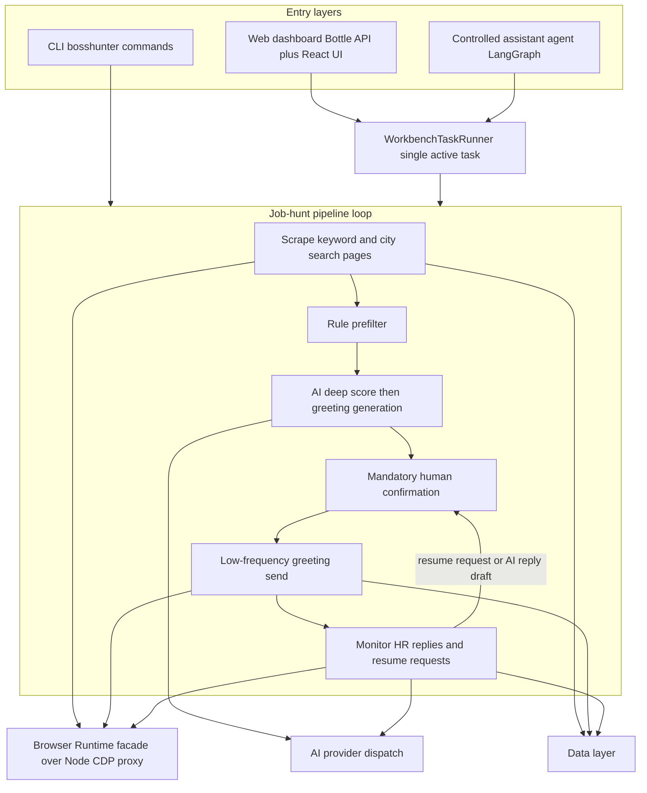

# System Architecture Overview

BossHunter v2.0 is a local, human-in-the-loop job-hunt agent. It automates the BOSS直聘 workflow through AI scoring plus CDP browser automation, but every send and sensitive action passes a mandatory human confirmation gate. The two user-facing entry layers — a Click CLI and a Bottle web dashboard with a React frontend — converge on the same owned domain services (scraping, scoring, greeting, sending, monitoring, resume generation, and a controlled assistant agent), so a safe change plan always starts from the owned systems and their boundaries rather than from the source tree layout.

The canonical stage order is fixed and must not be reordered when editing:

```text
scrape → prefilter → score → confirm → greet → send → monitor
```

## Owned systems and boundaries

| System | Owner modules | Responsibility | Boundary to respect |
| --- | --- | --- | --- |
| CLI and backend entrypoints | `main.py`, `backend.py` | command parsing, first-run guidance, process bootstrap | commands and help text must stay in sync; both entrypoints must load the same config and browser runtime config |
| Pipeline orchestration | `pipeline.py` | end-to-end `run_pipeline` ordering | keep stage order and the human-confirmation point |
| Configuration | `config.py`, `web/config_schema.json` | YAML defaults, deep merge, provider validation, web schema | new fields need defaults, both schemas updated, and secret redaction |
| Data layer | `db.py` | SQLite default + PostgreSQL adapter, schema, status transitions, funnel stats | migrations must be compatible; never skip confirmation by editing DB state |
| AI generation | `ai/` | prefilter, deep scoring, greeting, tailored resume PDF, provider dispatch | provider differences isolated; keys never logged or returned in full |
| Browser runtime | `browser/` | HTTP facade over the local Node CDP proxy, discovery, launcher, diagnostics | `.mjs` artifacts ship with the wheel; no stored platform credentials |
| Scraping | `scraper/jobs.py` | keyword + city search, pagination, detail enrichment, dedup | selector changes need regression tests |
| Execution | `executor/sender.py`, `executor/monitor.py` | low-frequency send, HR reply detection, resume-request classification, follow-up | must not bypass confirmation or throttle |
| Throttling and safety | `throttle.py`, `job_filters.py`, `ui/confirm.py` | send windows, daily limit, backoff, hard filters, confirmation UI | defaults only stay the same or become more conservative |
| Web dashboard and tasks | `web/server.py`, `web/tasks.py`, `web/frontend/` | Bottle API + static React/TS UI, single-active background task runner | no unbounded threads; API keys redacted |
| Controlled assistant agent | `assistant/` | LangGraph understanding, planning, read-only execution, approval gate | side effects always require deterministic approval; see the dedicated agent page |
| Infrastructure | `infrastructure/` | runtime store, coordination/locks, artifacts, worker registry | local defaults must keep working; worker only runs registered tasks |

## The top-level loop

The diagram below shows the owned loop together with the two entry layers that feed it. The assistant never drives the loop directly; it proposes side effects that enter the same workbench/task and confirmation gates as the CLI and dashboard.



_Figure 1: The fixed scrape → prefilter → score → confirm → send → monitor loop, with the CLI, web dashboard, and assistant entry layers. Browser, AI, and data services sit beneath the loop; monitor detections re-enter the loop through human confirmation._

`run_pipeline` in `src/bosshunter/pipeline.py` enforces this order and refuses to proceed when the Browser Runtime is not connected or no BOSS直聘 tab is found. Greeting generation happens inside the scoring stage: passing jobs are set to `ready` and their greetings are batch-generated before confirmation, so the confirmation UI can preview and regenerate them. After sending, the pipeline enters a loop that periodically calls `monitor_and_send_resumes` until interrupted.

## Entrypoints and shared bootstrap

- `bosshunter` resolves to `bosshunter.main:cli`, a Click group with commands `run`, `scrape`, `score`, `confirm`, `greet`, `send`, `monitor`, `resume`, `status`, `web`, `start`, `connect`, and `reenrich` (`pyproject.toml`, `src/bosshunter/main.py`).
- `bosshunter-server` resolves to `bosshunter.backend:main`; `python -m bosshunter` runs the same backend via `src/bosshunter/__main__.py`.
- The CLI group and the backend both resolve a runtime base directory, load `config.yaml` through `load_config`, and call `configure(...)` so the browser runtime and the web API read one consistent configuration.

The web dashboard runs as one Bottle application that serves JSON under `/api/*` and the built React/TypeScript assets from `web/frontend/dist`. `run_server` binds to `127.0.0.1:8686` by default and refuses to start on a non-loopback host unless `BOSSHUNTER_AUTH_TOKEN` is set (`src/bosshunter/web/server.py`).

## Data layer and job state machine

The default runtime data file is `data/bosshunter.db`, but application runs require a PostgreSQL `database.url`: `get_db()` raises when no `postgresql://` URL is configured, and `get_business_db()` is the shared entrypoint used by both the web API and the assistant service so their reads and writes cannot split across two databases. `PostgresConnection` adapts SQLite-style `?` placeholders and dialect expressions to psycopg, while versioned migrations own PostgreSQL schema changes (`src/bosshunter/db.py`).

The schema centers on:

- `jobs` — one row per scraped or shadow job, holding score, greeting, conversation id, and current status.
- `history` — business actions such as `approved`, `sent`, `replied`, `resume_failed`.
- `job_events` — status-change events, written by triggers on `jobs` insert and status update.
- `risk_events` — throttle and anti-ban events.
- `workbench_tasks` — background task status, logs, deadline, and stop reason.

The status flow is:

```text
pending
  ├── filtered
  └── scored → ready → approved → sent
                │         │         ├── replied → needs_resume → resume_sent
                │         │         └── follow_up_sent
                │         └── error ──有限退避重试──→ approved
                └── rejected
```

`error` jobs are re-queued to `approved` (never back to `ready`) after a configurable backoff window so transient send failures get a fresh chance without re-confirmation; jobs that exhaust `send_error_max_retries` stay in `error` until explicitly retried (`src/bosshunter/db.py`). `get_jobs_ready_to_send` is the enforcement point for the "human confirmation is mandatory" rule: it only selects `approved` jobs with a non-empty greeting.

## Browser runtime

Browser automation is deliberately thin on the Python side. `src/bosshunter/browser/__init__.py` exposes a facade (`evaluate`, `click`, `click_at`, `type_text`, `navigate`, `scroll`, `find_boss_tab`, and friends) backed by `RuntimeClient`, a small HTTP client that posts to the local Node.js CDP proxy at `browser/runtime/cdp-proxy.mjs`. The proxy talks to the user's already-logged-in daily Chrome over CDP, so BossHunter never stores platform credentials. `ensure_runtime` auto-starts the bundled Node runtime when needed, guarded by a lock so concurrent tasks cannot spawn orphan proxies.

The `.mjs` runtime artifacts and `site-patterns/*.md` documents are declared as hatch wheel artifacts in `pyproject.toml` and must ship with the wheel; relocating them breaks installed runs. The `browser/launcher.py` one-click path finds Chrome or Edge and starts it with an isolated `--user-data-dir` (default `data/browser-profile/`) so the login session is separate from the user's normal profile.

## AI generation chain

AI access is centralized in `src/bosshunter/ai/credentials.py`, which supports `anthropic` and `openai_compatible` providers, honors a `base_url` for compatible services, probes `/v1/models` for fuzzy model matching, and applies bounded HTTP retry plus configurable timeouts. No internal service name or domain is hardcoded, and the web API masks keys.

Scoring is two-stage. `quick_score` (`ai/prefilter.py`) applies free hard filters — deal-breaker keywords, agency/headhunter company names, internship signals, salary floor, and registered-capital floor — before any API call. `score_jobs` (`ai/scorer.py`) then runs LLM deep scoring with bounded concurrency (default 3, clamped to 5), writes score and reason, moves passing jobs to `ready`, and batch-generates their greetings; greeting failures are non-fatal and failed greetings are rolled back to `approved` so they remain recoverable. Tailored resume PDFs are produced by `ai/resume.py` with modern, business, and ATS templates.

## Web dashboard and workbench tasks

`web/tasks.py` owns `WorkbenchTaskRunner`, the only sanctioned background-task mechanism for the dashboard. It enforces a single active task via a lock, gives each task a stop event, applies deadline timers for send-window modes (`full`, `monitor`, `deliver`), and marks tasks left in a running state on restart as `stopped` rather than auto-resuming them. Only `reply` and `import` are parallel-safe alongside a long task; every task reaches a terminal state of `completed`, `failed`, or `stopped`.

The web config surface (`/api/config`, `/api/config/download`) returns redacted copies — API keys and auth tokens are masked, and blank config posts preserve existing secrets rather than wiping them (`src/bosshunter/web/server.py`).

## Controlled assistant agent

The workbench assistant is a controlled LangGraph agent documented in depth on the architecture page for the assistant. In the system map it is one more entry layer: it can autonomously perform read-only queries, research, and content generation, but every capability that writes, launches a task, or sends a message is classified by side-effect type and must become an approval proposal that a human confirms before the fixed dispatcher runs it. Its capability registry declares `requires_approval` and `side_effect` per capability (`src/bosshunter/assistant/capabilities.py`), so the model can propose but never self-authorize an external action.

## Safety invariants

These invariants are load-bearing and must not be weakened:

- Human confirmation is mandatory before any send or sensitive action. The sender selects only `approved` jobs; the terminal confirmation UI defaults to "n" (not approved); the web deliver endpoint rejects already-sent, rejected, or closed jobs.
- Resume-request cards, rejection detection, and AI reply suggestions only classify and generate. They never auto-click agree, refuse, or send.
- The web task system allows a single active background task (except the two explicit parallel-safe short modes) and never spawns unbounded threads.
- Browser runtime `.mjs` artifacts and `site-patterns/*.md` files ship with the wheel.
- Throttle defaults (daily limit, randomized intervals, send windows, day-off probability, progressive backoff) may only stay the same or become more conservative.
- API keys and auth tokens are redacted from web responses and downloads; no platform credentials are stored.
- Selector fixes belong in `scraper/`, `executor/`, or site patterns and require deterministic regression tests.

## Extension points and testing

The primary extension points are `config.example.yaml` (canonical field semantics) and `web/config_schema.json` (dashboard validation). New config fields must backfill defaults, update both documents, keep web read/write types consistent, and add focused tests. Tests are flat `tests/test_*.py` modules that mock the network, CDP/browser, and AI-provider boundaries; high-value regression areas are browser lifecycle and launcher behavior, web API routes and redaction, config compatibility, job selection and enrichment, city codes, resume templates, greeter quality, and send-throttle/idempotency behavior.
