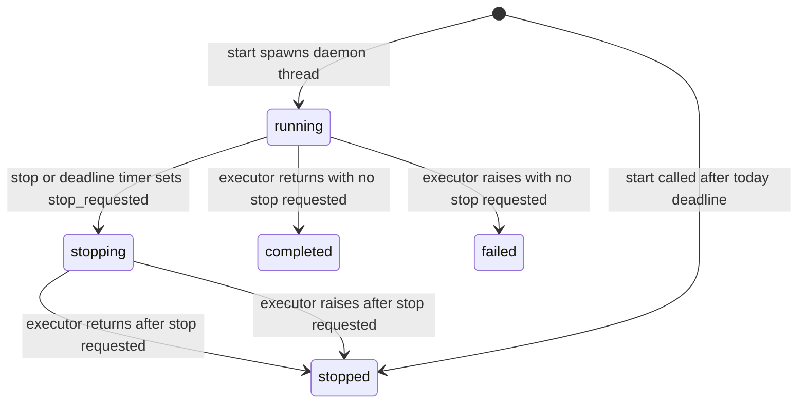
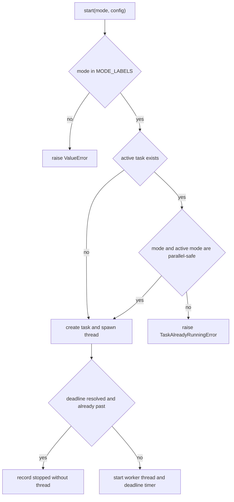
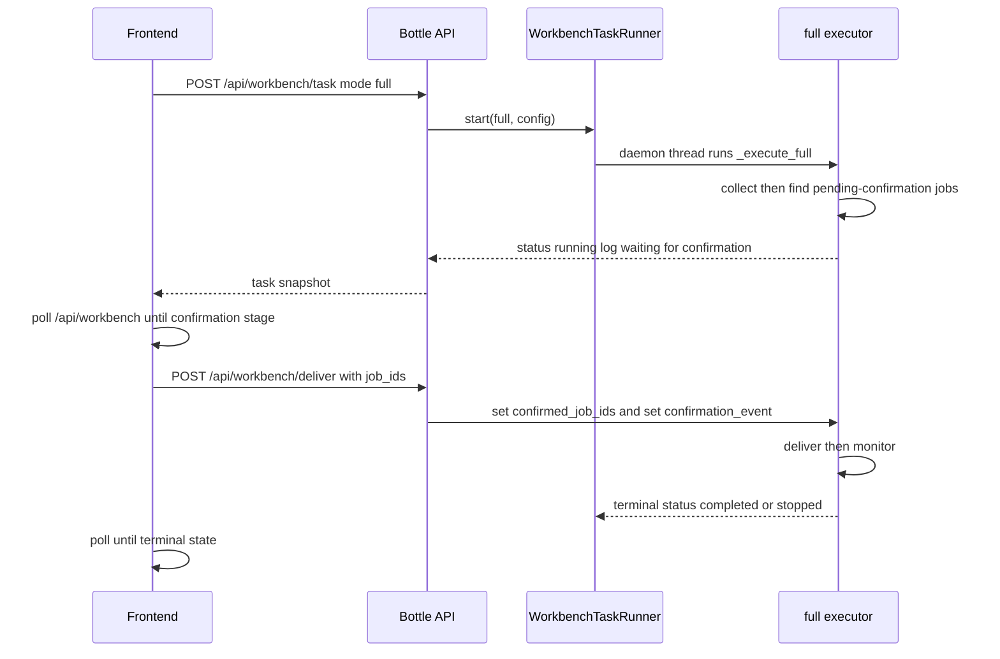

# Web Dashboard and Background Tasks

The web dashboard is one owned system with three cooperating halves: a Bottle application that serves JSON under `/api/*` and the built frontend under `/*`, a static React/TypeScript single-page application, and `WorkbenchTaskRunner`, the only sanctioned mechanism for running background work from the browser. Everything the dashboard does — starting a full pipeline, sending a confirmed greeting, replying to an HR message, importing one job, or streaming the assistant answer — funnels through these three layers, so a safe change plan starts from the route surface, the task runner invariants, and the confirmation gates rather than from individual UI components.

The server is defined in `src/bosshunter/web/server.py`; the task runner lives in `src/bosshunter/web/tasks.py`; the frontend source lives under `src/bosshunter/web/frontend/src`.

## System shape and entrypoints

`src/bosshunter/web/server.py` builds a single Bottle `app`, a single module-level `task_runner = WorkbenchTaskRunner()`, and resolves `FRONTEND_DIR` to `web/frontend/dist` and `SCHEMA_PATH` to `web/config_schema.json`. The executors that turn task modes into actual work are registered on that one runner at import time, mapping `full`, `collect`, `score`, `reenrich`, `monitor`, `deliver`, `greeting`, `reply`, and `import` to their `_execute_*` functions (`src/bosshunter/web/server.py#L45-L50`, `src/bosshunter/web/server.py#L743-L755`).

`run_server(host="127.0.0.1", port=8686)` is the process entrypoint. It refuses to start when `host` is non-loopback and `BOSSHUNTER_AUTH_TOKEN` is unset, registers `_check_web_auth` as a `before_request` hook, and runs the app through `ThreadedWSGIRefServer` (`src/bosshunter/web/server.py#L2170-L2193`). That custom adapter wraps `wsgiref` in `ThreadingMixIn` so each request is served in its own thread; this matters because the assistant SSE stream holds a connection open for the lifetime of an agent run, and a single-threaded `wsgiref` server would starve every other endpoint (including the pause/resume that unblocks that very stream) (`src/bosshunter/web/server.py#L2129-L2167`).

Static files are served from `dist/`: `/assets/<filepath:path>` maps to `dist/assets`, and `/` plus any non-API path falls back to `index.html` for client-side routing. Unknown `/api/*` routes return a JSON 404 rather than the SPA shell (`src/bosshunter/web/server.py#L2089-L2117`).

## HTTP API surface

The route set is the dashboard's contract with the browser. It groups into a few coherent families:

- **Health** — `GET /api/health` returns `status` and the package version; the header's online indicator polls it.
- **Dashboard reads** — `GET /api/workbench` returns the funnel, confirmation/greeting/send-error/resume queues, and the active, last, and full task list; `GET /api/jobs` returns a paginated envelope with status filtering, company search, and global counts; `GET /api/funnel`, `/api/stats`, `/api/activity`, `/api/top-companies`, and `GET /api/history` feed the dashboard cards, tables, and activity/trend panels.
- **Workbench task control** — `GET/POST /api/workbench/preflight`, `POST /api/workbench/task`, `POST /api/workbench/task/<id>/stop`, `GET /api/workbench/task/<id>`, `POST /api/workbench/deliver`, `POST /api/workbench/greetings/regenerate`, and `POST /api/workbench/reject`.
- **Targeted import** — `POST /api/jobs/import`, `POST /api/jobs/import/select`, and `GET /api/jobs/import/<task_id>/candidates`.
- **HR reply workflow** — `POST /api/history/<id>/reply`, `/refine`, `/dismiss`, and `POST /api/replies/generate` plus `POST /api/greetings/generate` for pasted-content generation that writes nothing.
- **Assistant** — conversation CRUD, message send, SSE stream, stream pause/resume, partial-message save, run cancel, approval resume, memories, bad cases, and message ratings.
- **Config, resume, avatar** — `GET/POST /api/config`, `GET /api/config/schema`, `GET /api/config/download`, `GET /api/config/cities`, and the resume/avatar upload/delete endpoints.

Read endpoints open a business database connection through `_get_web_db()` (which calls `get_business_db`) and close it in a `finally`, so web reads and assistant/service writes cannot split across two databases (`src/bosshunter/web/server.py#L107-L111`).

## Authentication boundary

The dashboard is a local management plane, but it can be bound to a LAN address. `run_server` enforces the rule at startup: binding to `127.0.0.1`, `localhost`, or `::1` needs no token, while any non-loopback bind without `BOSSHUNTER_AUTH_TOKEN` raises and refuses to serve (`src/bosshunter/web/server.py#L114-L126`, `src/bosshunter/web/server.py#L2170-L2180`).

When a token is set, `_check_web_auth` protects only `/api/*` routes — the static shell must load so the user can present a token — and requires a `Bearer` token in the `Authorization` header. Comparison uses `hmac.compare_digest` to avoid a timing side channel (`src/bosshunter/web/server.py#L133-L159`). Secrets in config responses are handled separately: `_redact_config_dict` replaces `ai.api_key` and `ai.auth_token` with masked markers before any `/api/config` or `/api/config/download` response leaves the process (`src/bosshunter/web/server.py#L221-L235`).

## The React single-page application

The frontend is a TypeScript/React SPA whose top-level routes are registered in `src/bosshunter/web/frontend/src/App.tsx#L1-L43`:

- `/` renders `DashboardPage` (the workbench view), `/jobs` and `/monitor` render the same page in `jobs` and `monitor` views, `/assistant` renders `AIAssistantPage`, and `/config` renders `ConfigPage`.
- A `Sidebar` exposes those five destinations and a `Header` shows the backend online status and theme toggle.

Three hooks carry the dashboard's client-side state:

- `useDashboard` polls `/api/workbench`, `/api/jobs`, and `/api/history` together, refreshes every 2 seconds while a task is active (otherwise every 30 seconds), and exposes `startTask`/`stopTask` wrappers around the workbench task endpoints (`src/bosshunter/web/frontend/src/hooks/useDashboard.ts#L122-L245`).
- `useConfig` loads `/api/config` and `/api/config/schema` together and drives a schema-rendered form; the backend exclusively owns YAML serialization, while the client renders field types declared in `config_schema.json` (`src/bosshunter/web/frontend/src/hooks/useConfig.ts#L1-L86`).
- `useBackendHealth` polls `/api/health` every 30 seconds and derives the online/offline indicator from a real request rather than a hardcoded green dot (`src/bosshunter/web/frontend/src/hooks/useBackendHealth.ts#L1-L37`).

The Config page is schema-driven: `web/config_schema.json` declares sections (`profile`, `search`, `scoring`, `throttle`, `ai`, `resume`, `monitor`, `follow_up`, `dedup`) and per-field types such as tags, multi-select from cities, slider, switch, password, and file, and the page renders them from the fetched schema rather than duplicating field knowledge in React (`src/bosshunter/web/config_schema.json`).

## WorkbenchTaskRunner

`WorkbenchTaskRunner` is the dashboard's background-execution boundary. It is deliberately small and disciplined: a lock, an in-memory task table, daemon threads, deadline timers, and SQLite persistence. There is no thread pool and no unbounded spawn site; every started task is exactly one daemon `Thread` plus, for deadline modes, one daemon `Timer`.

### Modes, statuses, and concurrency

```python
MODE_LABELS = {"full", "collect", "score", "reenrich", "greeting",
               "monitor", "deliver", "reply", "import"}
TERMINAL_STATUSES = {"completed", "failed", "stopped"}
ACTIVE_STATUSES  = {"running", "stopping"}
DEADLINE_MODES   = {"full", "monitor", "deliver"}
PARALLEL_SAFE_MODES = {"reply", "import"}
```

These constants (`src/bosshunter/web/tasks.py#L16-L34`) encode the concurrency policy. At most one task in a non-parallel-safe mode runs at a time. `reply` and `import` are short tasks that open independent BOSS tabs or pages and touch only their own conversation/detail/search page, so they may start while a long task such as `monitor` or `full` is active; two short tasks of the same type are still mutually exclusive, and a long task cannot start while a short task is active (`src/bosshunter/web/tasks.py#L88-L96`).

### Task state and start/stop control

`WorkbenchTask` is a dataclass carrying id, mode, label, status, logs, error, timestamps, deadline, stop reason, a `threading.Event stop_requested`, and a free-form `context` dict used for confirmation handoff and import candidates. `snapshot()` is what the API serializes (`src/bosshunter/web/tasks.py#L41-L69`).

`start()` validates the mode, holds the lock while checking the active task, applies the parallel-safe rule (raising `TaskAlreadyRunningError` otherwise), resolves a deadline for `DEADLINE_MODES`, persists the new task, and — unless the deadline is already past — starts a daemon worker thread and a deadline timer (`src/bosshunter/web/tasks.py#L84-L122`). If the send window has already closed, the task is recorded as `stopped` with reason "今日发送时间窗口已截止，后台未启动" and no thread is spawned.

`stop()` is cooperative. It sets `stop_requested`, transitions a non-terminal task to `stopping`, appends the stop reason, persists, and also sets any `confirmation_event` stored in `task.context` so a task parked at the confirmation gate wakes up instead of hanging (`src/bosshunter/web/tasks.py#L134-L151`). The active slot is not released at `stop()` time; `_run()` holds the thread entry until the executor actually returns, then assigns the terminal status (`stopped` when stop was requested, otherwise `completed`, or `failed` on an exception with no stop request) and removes the thread and timer from the live tables. Task rows stay in `_tasks` for history (`src/bosshunter/web/tasks.py#L158-L187`).



_Figure 1: WorkbenchTask lifecycle. `stopping` is an active state that still occupies the single-task slot until the executor truly returns._



_Figure 2: The start-time concurrency and deadline decision. Only `reply` and `import` may bypass the single-active-task rule alongside a long task._

### Deadline timer

`_deadline_from_config` returns a `datetime` only for `full`, `monitor`, and `deliver`; it reads `throttle.send_windows` and asks `SendWindowChecker.latest_end_datetime()` for the end of the last window (`src/bosshunter/web/tasks.py#L247-L255`). The runner schedules a `Timer` for that moment; when it fires, `_stop_at_deadline` calls `stop()` with the reason "已到发送时间窗口截止时间，后台自动停止" (`src/bosshunter/web/tasks.py#L189-L193`). This is an automatic, cooperative stop — it does not kill the thread.

### Persistence and restart

Every status change is upserted into the `workbench_tasks` table (id, mode, label, status, logs, error, timestamps, deadline, stop reason), so task history survives restarts (`src/bosshunter/web/tasks.py#L201-L217`). On construction, `_restore_tasks()` loads those rows; any row left in `running` or `stopping` by a previous process is rewritten to `stopped` with reason "服务重启，任务未自动恢复" and an appended log line. The dashboard never auto-resumes interrupted tasks (`src/bosshunter/web/tasks.py#L219-L244`).

## Executors and the confirmation gate

Each `_execute_*` function in `server.py` is a thin adapter from a task mode to an owned domain service. The load-bearing ones for the dashboard are:

- **`full`** composes the pipeline. It runs `_execute_collect`, then reads `get_jobs_pending_confirmation` and keeps the jobs at or above the configured scoring threshold. With none, it logs "没有待确认岗位，流程结束" and completes. Otherwise it parks: it sets `task.context["waiting_confirmation"] = True`, stores a `confirmation_event`, logs "等待前端确认投递", and loops until either stop is requested or the event fires. Once the frontend supplies confirmed job ids, it runs `_execute_deliver` and then `_execute_monitor` (`src/bosshunter/web/server.py#L490-L529`).
- **`monitor`** loops indefinitely on `monitor_and_send_resumes`, isolating per-cycle exceptions so a single DB or page-structure error does not kill the long task; it writes unmatched conversation replies into the task log and waits the configured interval between cycles (`src/bosshunter/web/server.py#L458-L487`).
- **`deliver`** regenerates greetings if not skipped, then calls `send_greetings(force=True)` for the selected job ids (`src/bosshunter/web/server.py#L532-L549`).
- **`reply`** is the human-confirmed HR reply path: it re-validates the history row is still `reply_pending`, opens the matching BOSS conversation, sends the message, closes the tab, then records `replied` history and sets the job status (`src/bosshunter/web/server.py#L563-L610`).
- **`import`** supports three sub-modes selected by `config["_import_params"]`: `url` collects one detail URL and generates its greeting; `search` collects a candidate list into `task.context["candidates"]` and stops for the user to choose; `select` collects the chosen candidate and generates its greeting. Imported jobs bypass AI scoring/filtering and land in the existing pending-confirmation flow (`src/bosshunter/web/server.py#L669-L740`).

The confirmation handoff between the full task and the browser is the dashboard's central control-flow moment:



_Figure 3: The full-pipeline confirmation handoff. The executor parks on an in-process Event; the deliver endpoint wakes it by writing the confirmed ids into the task context._

### The deliver confirmation rule

`POST /api/workbench/deliver` has two modes that together enforce human confirmation (`src/bosshunter/web/server.py#L990-L1069`):

- **Confirm mode** (`direct_send` false) rejects jobs whose status is already terminal (`rejected`, `closed`, `sent`, `replied`, `resume_sent`, `follow_up_sent`, `needs_resume`), marks the rest `approved`, and adds `approved` history. If a `full` task is currently waiting at its confirmation gate, the selected ids are handed to that task via `confirmed_job_ids` and the event; otherwise the endpoint returns a "已确认" acknowledgement and the user sends later from the "待发送招呼语" queue.
- **Direct-send mode** (`direct_send` true) is the manual send action from that queue. It only starts a `deliver` task for jobs already in `approved`; unapproved jobs are rejected with a 409 so an AI-imported `ready` job cannot bypass the confirmation step.

`_preflight_messages` is the other guardrail before any task start. It requires an uploaded Markdown resume, requires search keywords for `full`/`collect`, and requires an AI key (config `ai.api_key`/`ai.auth_token` or the `ANTHROPIC_API_KEY`/`ANTHROPIC_AUTH_TOKEN` env var) for `full`, `collect`, `score`, and `import`; `import` intentionally skips the keyword check because it is URL- or company+title-driven (`src/bosshunter/web/server.py#L289-L316`).

## Assistant integration

The dashboard is one of the two surfaces that front the controlled assistant agent. Its conversation, message, approval-resume, memory, bad-case, and rating endpoints delegate to `AssistantService`, which is lazily created per base directory (`src/bosshunter/web/server.py#L162-L169`). The SSE endpoint `/api/assistant/conversations/<id>/messages/stream` runs the blocking `send_message` in a daemon worker thread, forwards `start`/`delta`/`trace`/`done`/`error` events to the browser, and emits `ping` keepalives while waiting. A per-conversation `Event` gate supports pause/resume without cancelling the run: paused streams stop forwarding but keep the generation alive, then catch up on resume (`src/bosshunter/web/server.py#L1530-L1625`). The agent's approval and side-effect dispatch are documented on the dedicated assistant page; the dashboard's `_start_assistant_action` simply maps an already-approved proposal onto `task_runner.start(...)` so agent-initiated side effects enter the same single-task boundary as dashboard clicks (`src/bosshunter/web/server.py#L360-L444`).

## Invariants and failure semantics

- New web actions must respect the single-active-background-task constraint and must not spawn unbounded threads. The only concurrency exception is the pair `reply`/`import` alongside a long task, and same-type short tasks remain mutually exclusive.
- Every task reaches exactly one terminal state — `completed`, `failed`, or `stopped` — and the active slot is released only when the executor actually returns, so a "停止中" task still blocks conflicting starts.
- Deadline stops are cooperative, not preemptive; executors receive the same `stop_requested` event and are expected to check it between iterations.
- Interrupted tasks are never auto-resumed: restart marks them `stopped` with an explicit reason.
- Human confirmation is mandatory before sending. The deliver endpoint rejects terminal jobs on confirm and rejects unapproved jobs on direct send.
- Config responses and downloads never expose raw API keys or auth tokens; blank or masked posts preserve existing secrets instead of wiping them.

## Focused tests

The behavior is locked by regression tests rather than end-to-end browser assertions:

- `tests/test_web_api_routes.py` covers the JSON 404 for unknown API routes, workbench preflight requirements, pending-confirmation selection including unscored imported jobs, the full-task confirmation wait and handoff, the active slot staying occupied until the executor returns, deadline auto-stop, the reply/import parallel-safe rule, past-deadline refusal, deliver/reject semantics, resume/avatar detach-only behavior, HR reply/dismiss, unresolved-history counting, and pasted reply/greeting generation.
- `tests/test_web_config_api.py` locks secret redaction and the sanitize/preserve rules for API keys and auth tokens across both providers.
- `tests/test_workbench_reply_task.py` and `tests/test_import_job.py` verify the dashboard-confirmed reply and targeted-import executors run through the single-task runner.

## Related pages

- [System Architecture Overview](/openwiki/architecture/overview.md)
- [Controlled Assistant Agent Architecture](/openwiki/architecture/assistant-agent.md)
- [Web API](/openwiki/integrations/web-api.md)
- [Configuration](/openwiki/operations/configuration.md)
- [Testing strategy](/openwiki/testing/strategy.md)
- [Assistant QA flow](/openwiki/workflows/assistant-qa-flow.md)
