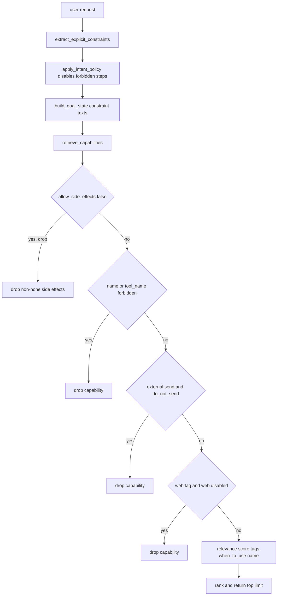
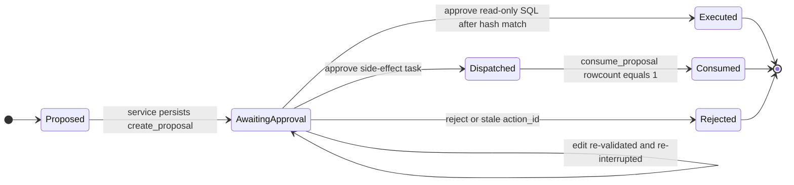

# Capability Registry and Approval Boundary

The assistant never hands the model an open toolbox. Every tool the agent may invoke is described in one place — `CAPABILITY_REGISTRY` — and every description carries enough metadata for the deterministic policy layer to decide whether that capability may run autonomously, must be filtered out, or must become a human approval proposal. The model proposes; code decides.

This page focuses on the two halves of that contract: the **capability registry** (what can run and under which conditions) and the **approval boundary** (how a side effect becomes a persisted proposal, is resumed and re-validated, and is dispatched at most once).

## The capability registry is the authority

`CAPABILITY_REGISTRY` (`src/bosshunter/assistant/capabilities.py`) is a `dict[str, CapabilitySpec]` keyed by capability name. The `CapabilitySpec` contract in `src/bosshunter/assistant/models.py` defines the fields that matter:

| Field | Meaning |
| --- | --- |
| `name` | Stable capability key used by planners, matchers, and the runtime store |
| `description` | Human and model-readable summary of what the capability does |
| `tool_name` | The concrete tool/executor invoked; `None` for pure generation capabilities such as `reply_draft` |
| `intents` | Legacy intent tags for the old deterministic route; empty for the newer general capabilities |
| `required_fields` | Entity slots that must be present before the capability may proceed |
| `risk_level` | `low` / `medium` / `high`; used to escalate understated model risk and for display |
| `read_only` | Whether the capability performs no mutation (the registry's own flag) |
| `requires_approval` | Whether execution must be gated behind a human approval proposal |
| `side_effect` | `none` / `local_reversible` / `local_persistent` / `external` (see below) |
| `tags` | Retrievable category tags such as `jobs`, `send`, `web`, `resume` |
| `when_to_use` / `when_not_to_use` | Retrieval hints for the general capability retriever |
| `input_schema` / `output_schema` | JSON-schema-shaped contracts for model-facing tool boundaries |
| `timeout_seconds` | Per-capability step timeout used by the DAG scheduler |
| `cost_level` | Coarse cost signal (`low` if read-only, otherwise `medium`) |

The registry is assembled in two passes. The ten legacy business capabilities (`job_collect`, `job_score`, `job_query`, `company_analysis`, `greeting_generate`, `greeting_send`, `reply_draft`, `reply_send`, `reply_monitor`, `pipeline`) are declared with their intent routing and then enriched with `tags`, `side_effect`, schemas, and timeouts from `_CAPABILITY_METADATA` (`src/bosshunter/assistant/capabilities.py#L113-L138`). Two additional read-only general capabilities, `resume_read` and `web_search`, are added with empty `intents` because they are discovered through goal recall rather than the legacy intent router (`src/bosshunter/assistant/capabilities.py#L140-L160`).

`entity_contracts_by_intent()` derives each intent's required entity list from the registry, so prompt contracts and completeness checks cannot drift from the registry (`src/bosshunter/assistant/capabilities.py#L188-L198`).

## Side-effect classes

`SideEffect` is an independent axis from `risk_level` (`src/bosshunter/assistant/models.py#L42-L43`). It records *what kind* of change a capability makes, which is what the policy layer can enforce mechanically:

| Class | Meaning | Capabilities |
| --- | --- | --- |
| `none` | No mutation; safe for autonomous read-only execution | `job_query`, `company_analysis`, `resume_read`, `web_search` |
| `local_reversible` | Local state that can be undone or replaced without an external effect | `reply_draft` |
| `local_persistent` | A durable local write (collected jobs, scores, generated greetings) | `job_collect`, `job_score`, `greeting_generate` |
| `external` | An irreversible effect outside the local system (sending, monitoring, full pipeline) | `greeting_send`, `reply_send`, `reply_monitor`, `pipeline` |

Two derivation paths expose `read_only` differently, and both matter. The legacy `match_capabilities()` copies the registry's stored `read_only` flag, while the general retriever `_to_match()` derives `read_only` from `side_effect == "none"` (`src/bosshunter/assistant/capability_retriever.py#L76-L88`). The DAG executor and the ReAct loop both hard-fail on any non-`none` side effect rather than trusting a flag alone.

## Two capability resolution paths

### Deterministic action mapping (legacy side-effect intents)

When the understanding layer produces a known action intent, `capabilities_for_intent()` resolves it deterministically. It applies `apply_intent_policy()`, takes `enabled_steps()`, and maps each step's `action` to a capability through `ACTION_TO_CAPABILITY` (`src/bosshunter/assistant/policy.py#L8-L19`, `src/bosshunter/assistant/capabilities.py#L232-L262`). `match_capabilities()` then freezes each match's arguments from a single merged source: the matching step's arguments, non-policy constraints, and finally the confirmed entities, with entities winning any conflict (`src/bosshunter/assistant/capabilities.py#L163-L185`, `src/bosshunter/assistant/capabilities.py#L289-L312`).

`canonicalize_capability_entities()` keeps entities and step arguments consistent: it recycles required fields that the model placed only in `steps.arguments` back into `entities`, then synchronizes the authoritative entity value back into the step (`src/bosshunter/assistant/capabilities.py#L201-L229`). `complete_missing_fields()` uses the same registry to decide which slots are genuinely missing and to raise the intent's risk to at least the capability's declared level (`src/bosshunter/assistant/capabilities.py#L265-L286`).

### Goal recall (general read-only slice)

For the general read-only path, `retrieve_capabilities()` (`src/bosshunter/assistant/capability_retriever.py`) ranks the whole registry against `goal_search_text(goal)` using an auditable relevance score over `tags`, `when_to_use`, and the capability name, then returns the top `limit` matches. Its filters are deterministic:

1. `allow_side_effects` defaults to `False`, dropping every capability whose `side_effect` is not `none` — the read-only migration slice is opt-in.
2. `_is_forbidden()` drops a capability whose name or `tool_name` literally appears in the constraints, and drops any `external` capability when the constraint text contains `"禁止发送或投递"`.
3. Any `web`-tagged capability is dropped when `web_enabled` is false.

`capability_matcher_node` chooses between the two paths: if the legacy matches contain any non-read-only capability, the legacy path wins; otherwise it runs the general retriever, falls back to legacy matches when the retriever returns nothing, then intersects results with the evidence-domain tool whitelist and re-adds any planned read-only registry capabilities (`src/bosshunter/assistant/graph.py#L1071-L1113`).

_Figure 1: The deterministic pipeline from a user constraint to the set of capabilities the retriever may return._

## User constraints are enforced by code, not by the model

The policy layer (`src/bosshunter/assistant/policy.py`) is intentionally prompt-independent. `extract_explicit_constraints()` scans the raw user text for negative send terms such as `"不要发送"`, `"别发送"`, `"禁止发送"`, `"只生成"`, `"不要投递"`, and HR-reply/打招呼 variants, and returns `forbidden_actions` plus `do_not_send: True` (`src/bosshunter/assistant/policy.py#L25-L48`). `apply_intent_policy()` merges these with any model-declared constraints and sets `enabled: False` on conflicting steps (`src/bosshunter/assistant/policy.py#L51-L87`); `enabled_steps()` then excludes them from planning and matching.

Two further layers make the constraint binding rather than advisory:

- `tool_constraints()` strips the policy-only fields (`forbidden_actions`, `requires_confirmation`, `do_not_send`) from anything passed as tool arguments, so control constraints never leak into an executor (`src/bosshunter/assistant/policy.py#L100-L106`).
- `build_goal_state()` converts `do_not_send` into the readable text `"禁止发送或投递"` (`src/bosshunter/assistant/goal_understanding.py#L44-L54`), which is exactly the string `_is_forbidden()` matches to remove all `external` capabilities from recall.

`_enforce_mode_capability_boundary()` adds a last guard at the matching node: in `answer` or `cancel` interaction modes it keeps only `read_only` matches, so a misclassified action intent cannot slip a side effect into a consultation (`src/bosshunter/assistant/graph.py#L419-L434`).

## Approval proposal lifecycle

A side effect is never dispatched from a model tool call. It first becomes a **proposal** with frozen parameters.

### Freeze and persist

`_build_pending_action()` validates the model's proposed tool call against the business database and produces an action dictionary with a fresh `action_id` (`uuid4`), a concrete `type`, a frozen `parameters` object, `affected_items`, and an `allowed_actions` list (`src/bosshunter/assistant/graph.py#L451-L616`). The read-only SQL path builds its own proposal in `sql_prepare_node` with a `sql_hash` over the validated SQL and params (`src/bosshunter/assistant/graph.py#L943-L983`).

The `approval` node calls LangGraph `interrupt(action)`, which pauses the graph (`src/bosshunter/assistant/graph.py#L1836-L1839`). `AssistantService._persist_runtime_result()` detects the `__interrupt__` in the result, calls `create_proposal()`, and marks the run `awaiting_approval` (`src/bosshunter/assistant/service.py#L252-L256`). `create_proposal()` is idempotent — SQLite uses `INSERT OR IGNORE` and PostgreSQL uses `ON CONFLICT(id) DO NOTHING` — so re-persisting the same run cannot duplicate the proposal (`src/bosshunter/infrastructure/runtime_store.py#L172-L184`, `src/bosshunter/infrastructure/runtime_store.py#L295-L307`).

### Resume and re-validate

The Web API validates the decision payload (`action` must be `approve`, `edit`, or `reject`, plus `action_id`, `sql_hash`, and optional `selected_item_ids` / `edited_reply`) and hands it to `AssistantService.resume()` (`src/bosshunter/web/server.py#L1679-L1700`). `resume()` looks up the conversation's latest run and re-invokes the graph with `Command(resume=decision)` and the same `thread_id` (`src/bosshunter/assistant/service.py#L205-L226`).

Inside the resumed `approval` node, the proposal is re-validated before anything runs (`src/bosshunter/assistant/graph.py#L1840-L1901`):

- The returned `action_id` must match the paused proposal's `action_id`; a stale or missing match is rejected with no side effect.
- For read-only SQL, an `edit` re-runs `validate_readonly_sql()`, recomputes the `sql_hash`, and calls `interrupt()` a second time so the edited SQL requires a fresh confirmation.
- On `approve` of SQL, the hash supplied by the client must match the current hash; only then is `execute_database_query()` called, which re-validates read-only-ness one more time before executing.
- A `reject` cancels without side effects and marks the plan's approve/execute steps `stopped`.

### Dispatch once, consume exactly once

For side-effect capabilities, the approved proposal is handed to `action_dispatcher` (the fixed executor path). The dispatch guard lives in `AssistantService._dispatch_action()` (`src/bosshunter/assistant/service.py#L66-L79`):

1. It refuses an empty, already-consumed `action_id` with `ValueError`.
2. It requires the dispatcher to be available.
3. It runs the dispatcher **first**; if dispatch raises (for example, a missing resume), the proposal stays `pending` so the user can fix and re-approve instead of losing the proposal to a permanent `consumed` mark.
4. Only after a successful dispatch does it call `consume_proposal()` and record the action ID in the in-memory `_consumed_actions` set.

`consume_proposal()` is the persistent exactly-once primitive. Both stores atomically transition only a `pending` proposal to `consumed` and return whether exactly one row changed; a second consume returns `False` (`src/bosshunter/infrastructure/runtime_store.py#L186-L194`, `src/bosshunter/infrastructure/runtime_store.py#L309-L317`). The `action_proposals` table records the frozen arguments, the approved arguments, an `expires_at`, and a `consumed_at` timestamp for audit (`src/bosshunter/infrastructure/runtime_store.py#L99-L110`).

_Figure 2: The approval proposal state machine from freeze through exactly-once consumption._

## Invariants and failure semantics

- **The model cannot authorize itself.** Every side-effect path terminates in `interrupt()`, a persisted `action_proposals` row, or a `requires_approval` step that is only marked `awaiting_approval` — never executed — by `DagScheduler` (`src/bosshunter/assistant/dag_scheduler.py#L113-L118`).
- **Autonomous executors are read-only.** The DAG step adapter raises `PermissionError` if a scheduled capability has a non-`none` side effect, and `allowed_read_tools()` admits only `read_only` and `not requires_approval` matches into ReAct (`src/bosshunter/assistant/graph.py#L1147-L1151`, `src/bosshunter/assistant/react.py#L25-L38`).
- **Proposals are re-validated on resume, not trusted from storage.** `action_id` must match, edited SQL is re-validated and re-confirmed, and the approved SQL hash must match before execution.
- **Exactly-once dispatch is transactional.** `consume_proposal()` uses a conditional `UPDATE ... WHERE status = 'pending'` and checks `rowcount == 1`; the in-memory set is a secondary guard, not the source of truth.
- **A failed dispatch preserves the proposal.** Because consumption happens after a successful dispatch, a transient or validation failure leaves the proposal `pending` for correction rather than silently marking it consumed.

## Extension, configuration, and operations

- New capabilities are added to `CAPABILITY_REGISTRY` with the full `CapabilitySpec` metadata; the retriever and planner pick them up automatically. A `side_effect` must be chosen deliberately — `external` capabilities are the ones stripped by `do_not_send` constraints and by the read-only recall slice.
- The proposal table, run table, plan-step table, observation table, and artifact table are created by `SQLiteRuntimeStore._init_schema()` and, in production, are managed by PostgreSQL migrations rather than implicit startup DDL (`src/bosshunter/infrastructure/runtime_store.py#L62-L120`, `src/bosshunter/infrastructure/runtime_store.py#L228-L233`).
- Runtime infrastructure requires a PostgreSQL `database.url`; `create_runtime_store()` fails fast instead of silently downgrading to SQLite, and `build_assistant_graph()` uses `AsyncPostgresSaver` for the checkpoint that makes resume possible (`src/bosshunter/infrastructure/runtime_store.py#L355-L361`, `src/bosshunter/assistant/graph.py#L2029-L2045`).
- Policy rules are code, not prompts. Adding a new negative constraint means extending `extract_explicit_constraints()` (or `_is_forbidden()`) and covering it with a regression test.

## Focused tests

- `tests/test_general_agent_architecture.py` locks general goal recall without the legacy intent gate and verifies a negative-send constraint removes every `external` capability from the retriever result (`repo://tests/test_general_agent_architecture.py#L28-L48`).
- `tests/test_assistant_architecture.py` covers entity canonicalization, risk escalation from registry metadata, registry-generated entity contracts, policy-constraint isolation from tool arguments, and read-only ReAct selection (`repo://tests/test_assistant_architecture.py#L282-L292`, `repo://tests/test_assistant_architecture.py#L493-L560`).
- `tests/test_agent_infrastructure.py` proves a proposal is persisted idempotently and can be consumed exactly once (`repo://tests/test_agent_infrastructure.py#L13-L33`).
- `tests/test_sql_approval.py` verifies SQL is planned but not executed before approval, is re-validated on the resume path, and rejects writes and multi-statement payloads (`repo://tests/test_sql_approval.py#L14-L46`).
- `tests/test_dag_scheduler.py` covers the scheduler behavior that keeps `requires_approval` steps in `awaiting_approval` instead of running them.

## Related pages

- [Controlled Assistant Agent Architecture](/openwiki/architecture/assistant-agent.md)
- [Throttling and safety](/openwiki/concepts/throttling-and-safety.md)
- [Web API](/openwiki/integrations/web-api.md)
- [Data and infrastructure](/openwiki/operations/data-and-infrastructure.md)
- [Assistant QA flow](/openwiki/workflows/assistant-qa-flow.md)
