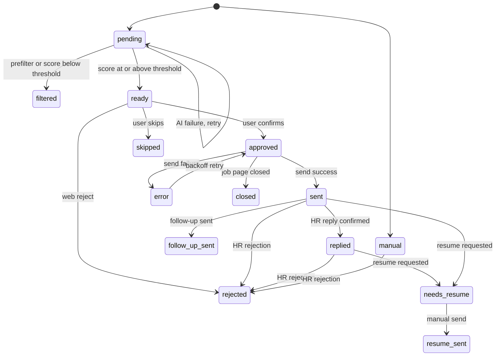

# Job State Machine and Funnel

A job in BossHunter is one row in `jobs`, and its current phase is the `status`
column (default `pending`). Status changes are the single source of truth for
what the CLI `status`/dashboard show, which jobs the sender may touch, and what
the assistant's read-only analytics can count. This page defines the status
vocabulary, the legal transitions, the event record that makes transitions
queryable, and the funnel metrics built on top of them.

## Status vocabulary

The canonical labels and colors are defined in
`src/bosshunter/tracker/status.py` (CLI) and
`src/bosshunter/web/frontend/src/lib/status.ts` (web). The semantic layer adds
the human-readable dictionary used by the assistant in
`src/bosshunter/assistant/semantic_layer.py`.

| Status | Label | Meaning |
|---|---|---|
| `pending` | 待评分 | Collected but not yet scored; the initial state written at insert. |
| `scored` | 已评分 | Deep scoring completed. Retained in the vocabulary, event mapping, and funnel buckets; the current scorer writes `ready`/`filtered` directly. |
| `filtered` | 已过滤 | Rejected by the keyword pre-filter or scored below the threshold. |
| `ready` | 待确认 | Greeting generated and awaiting human confirmation. |
| `approved` | 已确认 | Human-confirmed and queued for send. |
| `skipped` | 已跳过 | Human chose not to send during confirmation. |
| `sent` | 已发送 | Greeting successfully sent to HR. |
| `replied` | 已回复 | HR replied, or the conversation entered a post-reply stage. |
| `needs_resume` | 待手动发简历 | HR requested a resume; a tailored resume is waiting to be sent manually. |
| `resume_sent` | 简历已发 | Tailored resume has been sent. |
| `follow_up_sent` | 已跟进 | Follow-up message sent after no HR reply. |
| `rejected` | 已拒绝 | Rejected by the human, or HR rejected in conversation. |
| `error` | 发送失败 | Last send attempt failed. |
| `closed` | 已关闭 | Job page was closed/unavailable when the send was attempted. |
| `manual` | (shadow job) | Shadow job created for an unmatched HR conversation; tracked but never auto-confirmed. |

`closed` and `manual` are additional runtime statuses beyond the base
vocabulary: `closed` is written by the sender
(`src/bosshunter/executor/sender.py`), and `manual` is written when the monitor
creates a shadow job for a conversation it cannot match to a scraped job
(`src/bosshunter/executor/monitor.py`). The web status labels include `closed`;
`manual` jobs are filtered out of most selectable job lists by their `manual_`
id prefix rather than by label.

## State diagram

The resume branch `needs_resume` is part of the status vocabulary and event
mapping, but no current Python write path transitions a job *into* it; it is
read by the funnel, the monitor's tracked-job list, and the web "HR 要简历"
queue. `resume_sent` is written by the web endpoint that marks a tailored resume
as sent. See the resume section below.

## Legal transitions

There is no single transition table in code; legality is enforced by the write
paths themselves. Each phase below lists the transitions the code actually
performs.

### Collection

- New scraped or imported jobs are inserted with `status = 'pending'`
  (`src/bosshunter/db.py`, `insert_job`), including targeted imports, which
  deliberately skip AI scoring and go straight to `pending`
  (`src/bosshunter/web/server.py`, `_upsert_imported_job`).

### Scoring

`score_jobs` processes only `pending` jobs and performs a free keyword
pre-filter (`quick_score`) followed by bounded concurrent LLM deep scoring
(`src/bosshunter/ai/scorer.py`):

- `pending -> filtered` when the pre-filter score is 0, or when the deep score
  is below the configured `scoring.threshold` (default 60).
- `pending -> ready` when the deep score is at or above the threshold; the
  greeting is then batch-generated for these passed jobs.
- `pending -> pending` (unchanged) when the AI call or JSON parse fails, so the
  job remains retryable after an AI configuration fix.

Greeting generation is non-fatal to scoring: if a passed `ready` job ends up
with an empty greeting (AI returned empty or raised), it is rolled back
`ready -> approved` so it remains visible to the regenerate path
(`src/bosshunter/ai/scorer.py`, `_recover_jobs_with_failed_greetings`).

### Greeting generation and regeneration

- `approved`/`ready` jobs with an empty greeting are selected by
  `get_jobs_needing_greeting` and moved to `ready` after a greeting is written
  (`src/bosshunter/ai/greeter.py`).
- `reset_job_greeting` clears the greeting and sets status back to `approved`
  so a regeneration request can never leave a stale greeting in the send queue
  (`src/bosshunter/db.py`).

### Human confirmation

- `ready -> approved` when the user confirms (batch or individual) in the CLI
  confirmation UI (`src/bosshunter/ui/confirm.py`).
- `ready -> skipped` when the user declines an individual job during
  confirmation. The UI defaults to "n" (not approved), so a blind Enter or empty
  scripted input can never approve a sensitive send.
- `ready -> rejected` via the web workbench reject endpoint, which also records
  an `approved`-then-`rejected` history (`src/bosshunter/web/server.py`).
- The web workbench confirm path (`direct_send` false) marks any non-terminal
  job `approved`; it blocks `rejected`, `closed`, `sent`, `replied`,
  `resume_sent`, `follow_up_sent`, and `needs_resume`.

### Sending

`send_greetings` selects jobs via `get_jobs_ready_to_send` and applies the
following per job (`src/bosshunter/executor/sender.py`):

- `approved -> sent` on a successful send; a `history(action='sent')` row is
  written *before* the status update to keep the daily quota accurate across
  crashes.
- `approved -> error` on failure, with `error_retry_count` incremented.
- `approved -> closed` when the job page is closed or unavailable
  (`job_closed` / `job_page_unavailable`).
- `approved -> sent` for the `already_sent` idempotency guard: if the
  conversation already has a record of the greeting, the job is converged to
  `sent` instead of being re-sent or marked failed.
- A job reaching the sender with an empty greeting is moved to `error` rather
  than being sent blank.

### Error recovery

`recover_send_errors` re-queues `error` jobs whose `error_retry_count` is below
the configured maximum back to **`approved`** (never `ready`) after a backoff
window has elapsed since `updated_at`. This preserves the fact that they were
already human-confirmed before the failed send; reverting to `ready` would force
re-confirmation and hide them from the sender
(`src/bosshunter/db.py`). Jobs that exhaust the retry count stay in `error`
until explicitly retried from the workbench.

### Monitoring, replies, and follow-up

`monitor_and_send_resumes` and its helpers (`src/bosshunter/executor/monitor.py`):

- `sent -> replied` only after the full conversation is opened and an
  actionable HR message is confirmed. The transition requires the per-job
  action to be `reply_pending` or `auto_replied` **and** the prior status to be
  `sent`; a message the user themselves sent is not counted as an HR reply.
- `sent -> rejected` or `replied -> rejected` when HR rejection is detected.
- `sent -> follow_up_sent` when a follow-up message is sent after the
  configured no-reply interval and no follow-up history exists yet.
- Shadow `manual` jobs can transition to `rejected` on HR rejection, but their
  `reply_pending`/`auto_replied` actions do not advance them to `replied`
  because the prior status is not `sent`.

### Resume handling

- Tailored resume generation writes `resume_path` (PDF or Markdown fallback)
  without changing `status` (`src/bosshunter/ai/resume.py`).
- `resume_sent` is written by the web `POST /api/jobs/<job_id>/mark-resume-sent`
  endpoint, which also records `history(action='resume_sent')`
  (`src/bosshunter/web/server.py`).
- `needs_resume` is a defined status mapped to the `resume_requested` event and
  included in the funnel and monitor job list, but no current Python writer
  transitions into it; the monitor instead records `resume_requested` as a flag
  inside the structured reply history detail
  (`src/bosshunter/executor/monitor.py`, `_build_reply_detail`).

## Human confirmation invariant

**Direct DB writes must not be used to skip human confirmation.** The
enforcement is not just a convention; it is a load-bearing guard in the send
path:

- `get_jobs_ready_to_send` returns only `approved` jobs with a non-empty
  greeting, so `ready` jobs (greeting generated but unreviewed) are invisible to
  the sender (`src/bosshunter/db.py`).
- The web `direct_send` endpoint re-checks that every selected job is already
  `approved` before starting the deliver task
  (`src/bosshunter/web/server.py`).
- The CLI confirmation prompt defaults to "n" (`src/bosshunter/ui/confirm.py`).

Editing `jobs.status` to `approved` in the database bypasses the human review
step and violates this invariant; the same rule is documented in the technical
manual (`docs/技术手册.md`).

## Event records: `job_events` and the trigger

`job_events` is the append-only fact table for status transitions. It stores
`job_id`, `event_type`, `event_time`, `source`, `from_status`, `to_status`, and
`attributes_json` (`migrations/postgresql/003_semantic_layer.sql`). Two indexes
support the common queries: `(job_id, event_time)` and `(event_type,
event_time)`.

A database trigger (`record_job_status_event`) writes the events automatically
so application code cannot forget or misrecord a transition:

- On `INSERT` of a job it records `job_collected` with `to_status = NEW.status`
  and `event_time = NEW.created_at`.
- On `UPDATE OF status` it skips no-op updates, then maps the new status to an
  event type and records `from_status`/`to_status`.

The status-to-event mapping is:

| New status | Event type |
|---|---|
| `filtered` | `prefilter_rejected` |
| `scored` | `ai_scored` |
| `ready` | `greeting_generated` |
| `approved` | `user_approved` |
| `rejected` | `user_rejected` |
| `sent` | `greeting_sent` |
| `replied` | `hr_replied` |
| `needs_resume` | `resume_requested` |
| `resume_sent` | `resume_sent` |
| `follow_up_sent` | `follow_up_sent` |
| `error` | `send_failed` |
| anything else | `status_changed` |

All trigger-written rows use `source = 'database_trigger'`; application rows
default to `source = 'application'`.

The SQLite development schema mirrors the same trigger and views in
`src/bosshunter/db.py`, `_init_tables`.

## Semantic views

Two PostgreSQL views turn `jobs` plus `job_events` into one-row-per-job
analytics surfaces (`migrations/postgresql/003_semantic_layer.sql`):

- `semantic_job_current` — one row per job with `title`, `company`, location and
  company metadata, `score AS ai_score`, `quick_score`, `status AS
  current_status`, an `is_formal_job` flag (non-empty title, non-empty JD, and
  title not equal to the `HR主动沟通` placeholder), and `created_at AS
  collected_at`.
- `semantic_job_funnel` — one row per job with `collected_at` plus the
  **first arrival time** for each stage, computed with `MIN(event_time) FILTER`
  over the mapped event types:
  - `scored_at` (`ai_scored`)
  - `approved_at` (`user_approved`)
  - `sent_at` (`greeting_sent`)
  - `first_replied_at` (`hr_replied`)
  - `resume_requested_at` (`resume_requested`)
  - `resume_sent_at` (`resume_sent`)
  - `follow_up_at` (`follow_up_sent`)

## Funnel metrics

Two independent funnel definitions exist and must stay consistent when a new
status is added.

### Dashboard funnel (`get_funnel_stats`)

The CLI/terminal dashboard derives cumulative stage counts from current status
membership (`src/bosshunter/db.py`):

- 采集总数 (total collected): all jobs.
- 初筛通过 (pre-filter passed): not `filtered`, or `filtered` with a non-zero
  score.
- AI评分 (AI scored): `scored`, `ready`, `approved`, `rejected`, `sent`,
  `replied`, `resume_sent`, `needs_resume`, `follow_up_sent`.
- 人工确认 (confirmed): `approved` plus all downstream send/reply/resume/follow-up
  statuses.
- 发送 (sent): `sent`, `replied`, `resume_sent`, `needs_resume`, `follow_up_sent`.
- 回复 (replied): `replied`, `resume_sent`, `needs_resume`.
- Plus `resume_sent`, `needs_resume`, `resume_generated` (non-empty
  `resume_path`), `follow_up_sent`, and `rejected` buckets.

The reply rate shown by the status tracker is `replied / sent` computed from the
same status buckets (`src/bosshunter/tracker/status.py`).

### Semantic layer metrics (`METRICS`)

The assistant's controlled analytics define the same concepts as deterministic
SQL (`src/bosshunter/assistant/semantic_layer.py`):

- `SENT_STATUSES` = `sent`, `replied`, `needs_resume`, `resume_sent`,
  `follow_up_sent`.
- `REPLIED_STATUSES` = `replied`, `needs_resume`, `resume_sent`, `follow_up_sent`.
- `sent_job_count` counts `DISTINCT` jobs in `SENT_STATUSES`.
- `replied_job_count` counts `DISTINCT` jobs in `REPLIED_STATUSES`.
- `reply_rate` is `100 * replied / NULLIF(sent, 0)`.
- Time-window event metrics (`dataset="events"`) count distinct jobs by
  `job_events.event_type`: `job_collected`, `ai_scored`, `greeting_sent`,
  `hr_replied`, each filtered to formal jobs and an optional time preset.

The status and event value dictionaries (`STATUS_VALUES`,
`EVENT_TYPE_VALUES`) are exposed to the model through `semantic_catalog()` so it
can map natural-language status questions to the same vocabulary without
generating SQL.

## Relationships

- `/openwiki/architecture/overview.md` — system map, the send-path safety
  invariant, and the shared database entrypoint.
- `/openwiki/workflows/job-hunt-pipeline.md` and
  `/openwiki/workflows/sending-and-monitoring.md` — the pipeline and send/monitor
  flows that perform the transitions.
- `/openwiki/concepts/throttling-and-safety.md` — throttle windows, retries, and
  anti-ban behavior that wrap the send phase.
- `/openwiki/operations/data-and-infrastructure.md` — PostgreSQL migrations and
  the `job_events` semantic layer deployment.
