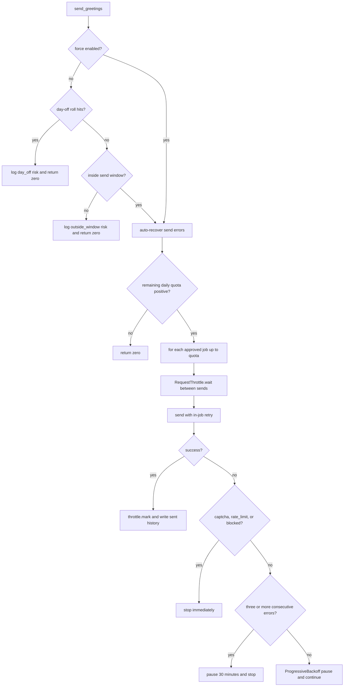

# Throttling, Send Windows, and Human Confirmation

BossHunter's outbound behavior toward BOSS直聘 is deliberately slowed and
gated. The protections live in a small, single-purpose throttle module
(`src/bosshunter/throttle.py`) plus the enforcement points in the sender,
monitor, confirmation UI, and the database's ready-to-send query. This page
describes each mechanism, the order in which they run, and the invariants that
must not be weakened when changing them.

## Safety layers at a glance

| Layer | Component | Where enforced | Purpose |
|---|---|---|---|
| Gaussian request delay + burst penalty | `RequestThrottle` | `executor/sender.py`, `executor/monitor.py` | Randomize the pause between outbound messages |
| Page-navigation throttle | `PageThrottle` | `scraper/jobs.py` | Slow page scraping and enrichment |
| Send time windows | `SendWindowChecker` | `executor/sender.py`, `executor/monitor.py`, `web/tasks.py` | Only act during human-like working hours |
| Random whole-day skip | `should_take_day_off` | `executor/sender.py` | Occasionally do nothing to avoid patterns |
| Daily send quota | `daily_limit` | `executor/sender.py` | Hard cap on greetings per calendar day |
| Browse-before-greet | `_send_greeting_once` | `executor/sender.py` | Simulate reading the job page before contacting HR |
| Progressive error backoff | `ProgressiveBackoff` | `executor/sender.py` | Escalate pauses on consecutive send failures |
| Mandatory human confirmation | `ui/confirm.py` + `get_jobs_ready_to_send` | `db.py` | Nothing is sent until a human approves it |

## RequestThrottle: Gaussian delay and burst penalty

`RequestThrottle` (`src/bosshunter/throttle.py`) is the main outbound rate
limiter. It is constructed with `delay_min` and `delay_max` (defaults `60.0`
and `180.0` seconds, but the sender supplies the configured
`throttle.interval_min`/`interval_max` values). Each `wait()` call computes a
Gaussian-distributed base sleep whose mean is the midpoint of the interval and
whose standard deviation is one quarter of the interval width, then subtracts
the time already elapsed since the last `mark()` so bursts do not double-count.

On top of the base delay, `wait()` adds two anti-pattern elements:

- A 5% chance of an extra 2-5 second "human hesitation" pause.
- A `_burst_penalty()` that inspects a deque of the last 12 request timestamps:
  3+ requests in the last 15 seconds add 1.2-2.8 seconds, and 6+ in the last
  45 seconds add 4-7 seconds.

`mark()` records that a request was actually sent and must be called by the
caller after a successful send. The sender calls it only on verified successes,
and the monitor reuses the same throttle between reply handling and follow-ups.

`wait()` accepts an optional `threading.Event` and returns `True` when the stop
event is set, allowing the workbench to interrupt a long sleep cleanly.

## PageThrottle: lighter navigation delay

`PageThrottle` is deliberately separate and lighter than `RequestThrottle`. It
sleeps a uniform random `delay_min`-`delay_max` (hard-coded 2.0-5.0 seconds at
the scrape call sites) and has no burst tracking. It is used for page
navigation during job scraping and company re-enrichment
(`src/bosshunter/scraper/jobs.py`), not for sending greetings to HR.

## SendWindowChecker: working-hour windows

`SendWindowChecker` parses window strings of the form `"HH:MM-HH:MM"` and
answers whether the current local time is inside any of them.

- `is_active()` returns `True` when no windows are configured (always active),
  or when `start <= now < end` for at least one window.
- `latest_end_datetime()` returns today's latest window end; the workbench task
  scheduler uses it to compute an automatic stop deadline for send tasks
  (`src/bosshunter/web/tasks.py`).
- `next_window_info()` renders a Chinese-language hint for the CLI about when
  the next window opens.

Windows are simple same-day intervals; a window that would cross midnight is
not represented by this parser.

## ProgressiveBackoff: error-based escalation

`ProgressiveBackoff` tracks consecutive send errors separately from the
Gaussian inter-request delay. `record_error()` returns the recommended pause:
60 seconds for the first error, 120 seconds for the second, and 1800 seconds
(30 minutes) once three or more consecutive errors have accumulated.
`record_success()` resets the counter, and `should_pause_long` becomes `True`
at the three-error threshold. The sender pauses on the returned duration and,
at the long threshold, stops the batch entirely.

## Day off and daily limit

Two coarse-grained anti-pattern controls bound the batch as a whole:

- `should_take_day_off(probability)` is a random roll (default 0.05) that makes
  the sender skip the whole day. When it triggers, `send_greetings` logs a
  `day_off` risk event and returns 0 without touching any job.
- `daily_limit` (default 30) is a hard cap computed against the database:
  `send_greetings` counts rows in `history` where `action='sent'` and
  `date(created_at)=date('now')`, then slices the ready queue to
  `daily_limit - already_sent`. The quota is therefore enforced against actual
  recorded sends, not against in-memory attempts.

## Browse-before-greet and HR-online gating

Before the sender clicks "立即沟通", `_send_greeting_once` performs two page-level
safety checks:

- When `browse_before_greet` is enabled (default), it waits a uniform random
  `browse_duration_min`-`browse_duration_max` (defaults 15-30 seconds) after
  opening the job page, simulating a human reading the posting.
- When `only_send_when_hr_online` is enabled (default off), it inspects the
  page for HR activity signals and, if the recruiter is not "在线"/"刚刚活跃",
  skips the job with `preserve_status` before opening any chat.

The page check also detects closed/removed job pages (`job_closed`,
`job_page_unavailable`) before attempting a send, and the sender treats those
as terminal conditions.

## Error classification and in-job retry

Send failures are split into three buckets in `executor/sender.py`:

- **Retryable** (`runtime_not_ready`, `no_response`, `open_page_failed`,
  `chat_navigation_timeout`, `no_chat_button`, `no_chat_input`,
  `no_send_button`): transient infrastructure or page-timing hiccups.
- **Permanent** (`job_closed`, `job_page_unavailable`, `send_button_disabled`,
  `captcha`, `rate_limit`, `blocked`, `send_verify_failed`): real page/business
  or risk-control states that must not be retried blindly.
- **Stopped**: the user requested a stop.

`_send_greeting_with_retry` wraps one send attempt and retries only retryable
errors up to `send_max_retries` (default 2) with a random
`send_retry_backoff_min`-`send_retry_backoff_max` backoff. Permanent errors
short-circuit immediately. `send_verify_failed` is permanent because a message
may have been delivered but unverifiable; retrying it could send the same
greeting to the same HR twice.

## Send batch control flow



The order matters: day-off and window checks come first, then the daily quota,
then the per-job loop. The `--force` CLI flag (`main.py send`) and the workbench
deliver task pass `force=True`, which bypasses only the day-off roll and the
window gate; it does not bypass the daily quota and it does not bypass human
confirmation.

## Mandatory human confirmation

The confirmation UI (`src/bosshunter/ui/confirm.py`) is the single place where
a human turns `ready` jobs into `approved` jobs. It renders a Rich table of
`get_jobs_pending_confirmation` results and offers a summary action
(`a` approve all, `s` select individually, `q` cancel), then a per-job prompt
with `y`/`n`/`e`/`r`/`q`.

The default-deny behavior is deliberate: the per-job prompt defaults to `n`,
so pressing Enter or feeding scripted empty input never approves a sensitive
send. Only an explicit `y` (or an explicit edit/regenerate followed by `y`)
updates the job to `approved`.

The hard enforcement point is in the data layer, not just the UI:
`get_jobs_ready_to_send` selects only jobs whose status is `approved` (plus
`error` jobs when explicitly included for a manual retry) and whose greeting is
non-empty. A `ready` job — even one that already has a generated greeting —
is never visible to the sender. Writing `approved` directly to the database
without human review is therefore the only way around confirmation, and there
is no normal send path that does so.

## Accounting order and idempotency

Two ordering details make the quota and duplicate-send invariants robust to
crashes:

- On a verified send, the sender writes `history(action='sent')` **before**
  updating job status and `conversation_id`. Because the daily quota counts
  `history.action='sent'`, writing history first narrows the window where a
  crash after a status update would leave the quota under-counted.
- At the start of `_send_greeting_once`, a job with an existing
  `conversation_id` is immediately returned as `already_sent` without opening a
  page. This is the idempotent guard that closes the "send succeeded but
  accounting crashed" window: even if the job is still `approved`, the next run
  will not send a duplicate greeting to the same HR.

## Monitor integration

The monitor reuses the same safety primitives rather than reimplementing them.
`monitor_and_send_resumes` builds a `SendWindowChecker` from
`throttle.send_windows` and a `RequestThrottle` from the configured intervals,
then honors the workbench stop event between reply handling and follow-up
sends. Follow-ups (`_check_follow_ups`) skip jobs that already had an HR reply
this cycle, skip weekends when configured, and call `throttle.wait()` between
messages.

## Configuration and operations

Defaults live in `src/bosshunter/config.py` under `throttle` and are documented
in `config.example.yaml`:

```yaml
throttle:
  daily_limit: 30
  interval_min: 60
  interval_max: 180
  browse_before_greet: true
  only_send_when_hr_online: false
  browse_duration_min: 15
  browse_duration_max: 30
  send_windows: ["09:00-16:00"]
  day_off_probability: 0.05
  send_max_retries: 2
  send_retry_backoff_min: 5
  send_retry_backoff_max: 10
  auto_recover_send_errors: true
  send_error_recover_seconds: 600
  send_error_max_retries: 3
```

When `auto_recover_send_errors` is enabled, jobs whose transient send failures
have aged past `send_error_recover_seconds` are moved back into the ready queue
(`recover_send_errors`), bounded by `send_error_max_retries`; beyond that they
stay in `error` for an explicit workbench retry. Normal batch sends never
auto-retry prior `error` jobs — only a workbench-selected retry does.

Default throttle values may only stay the same or become more conservative.
Confirmation, throttling, and platform-safety checks must never be weakened:
any change that would reduce the inter-send delay, raise the daily quota,
widen the send windows, disable the day-off roll, turn off browse-before-greet,
or allow unconfirmed jobs into the sender is a safety regression.

## Focused tests

- `tests/test_send_retry.py` covers error classification, in-job retry for
  transient failures, permanent-failure short-circuiting, stop-event abort,
  disabled-send-button detection, anti-fake-success verification, and
  `recover_send_errors` behavior.
- `tests/test_job_selection.py` covers the `approved`-only send queue, the
  `force` flag bypassing the window without bypassing confirmation, the
  daily-limit slicing, closed-job terminal status, and the existing-conversation
  idempotency guard.
- `tests/test_web_api_routes.py` exercises `SendWindowChecker` through monitor
  task scheduling.

## Relationships

- `/openwiki/concepts/job-state-machine.md` defines the `ready` → `approved` →
  `sent` lifecycle that the confirmation gate and send queue enforce.
- `/openwiki/operations/configuration.md` documents the full config surface.
- `/openwiki/workflows/job-hunt-pipeline.md` places confirmation between
  scoring and sending.
- `/openwiki/workflows/sending-and-monitoring.md` covers the end-to-end send and
  reply/follow-up flows that reuse these throttles.
