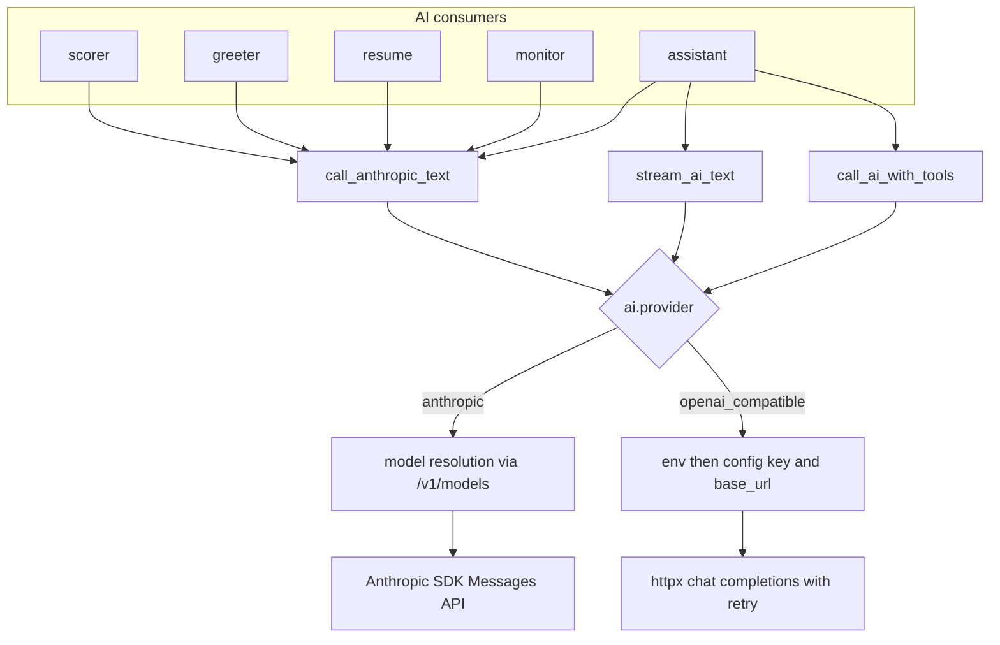

# AI Provider Integration and Credentials

BossHunter treats every LLM dependency as a provider-agnostic service behind one
owned module, `src/bosshunter/ai/credentials.py`. The scorer, greeter, tailored
resume generator, HR reply monitor, and the assistant all call the same text
helpers, so a provider change or a gateway URL switch is localized to the
credentials layer and the `ai` section of `config.yaml` rather than scattered
through the pipeline.

The supported providers are fixed. `load_config` validates `ai.provider` against
`SUPPORTED_AI_PROVIDERS = {"anthropic", "openai_compatible"}` and raises
`ValueError` for anything else, so an unsupported value fails at startup instead
of silently misbehaving at request time.

## Provider dispatch

The central dispatch happens in `call_anthropic_text` and `stream_ai_text`. Both
read `ai.provider`:

- `anthropic` uses the Anthropic SDK `Messages API`
  (`anthropic.Anthropic(...).messages.create` / `.stream`).
- `openai_compatible` performs an `httpx` `POST` to
  `{base_url}/chat/completions` with a Bearer token.

_Figure 1: All AI text consumers converge on the shared credentials helpers, which branch on `ai.provider`. The `openai_compatible` branch resolves its own key/base URL and talks to a chat-completions endpoint over `httpx`._

## Credential and base URL resolution

Resolution order is always **environment first, then `config.yaml`**, and the
Anthropic and OpenAI-compatible paths read different variable sets.

Anthropic keys resolve in `get_anthropic_api_key` as:

1. `ANTHROPIC_API_KEY`
2. `ANTHROPIC_AUTH_TOKEN`
3. `ai.api_key`
4. `ai.auth_token`

`build_anthropic_client_kwargs` keeps the two credential kinds separate: it only
sets `api_key` from `ANTHROPIC_API_KEY` or `ai.api_key`, and only sets
`auth_token` from `ANTHROPIC_AUTH_TOKEN` or `ai.auth_token`. It never promotes an
auth token into the `api_key` field.

The `openai_compatible` helpers use:

- key: `OPENAI_API_KEY` → `ANTHROPIC_API_KEY` → `ai.api_key`
- base URL: `OPENAI_BASE_URL` → `ANTHROPIC_BASE_URL` → `ai.base_url`

The Anthropic path uses `ANTHROPIC_BASE_URL` → `ai.base_url`. No compatible
service domain is hardcoded anywhere in the AI dispatch code: `base_url` always
comes from an environment variable or `ai.base_url`. Model defaults such as
`claude-sonnet-4-6` and `deepseek-chat` are identifiers only, not endpoints.

## Anthropic-compatible model resolution

When an Anthropic `base_url` is configured (for example an API gateway that
proxies the Anthropic protocol), `resolve_anthropic_model` probes
`GET {base_url}/v1/models` and fuzzy-matches the configured model name against the
returned `data[].id` values. Matching goes from exact, to normalized
(whitespace, `._-` removed, lowercased), to substring containment, to token-set
containment. If no match is found, or if the probe fails, the original configured
model name is returned unchanged.

The probe result is cached in a process-level dict keyed by
`(base_url, model, credential_fingerprint)`. The fingerprint is a SHA-256 hash of
the credential rather than the raw secret, so raw tokens never appear as cache
keys. A `threading.Lock` wraps the probe with a lock-free fast path plus a
re-check inside the lock, preventing concurrent threads from stampeding
`/v1/models`. Only successful probes are cached: failures are deliberately not
cached, because a single transient outage must not pin a wrong model name for the
rest of the process lifetime.

## Timeouts and output limits

Single-request timeout defaults to `DEFAULT_REQUEST_TIMEOUT = 180` seconds and is
clamped to `[10, 600]` by `_request_timeout`; invalid values fall back to the
default. The long default exists because reasoning models (for example
`deepseek-v4-flash`) emit long chains of thought before any content.

The Anthropic SDK client is always built with `timeout` and `max_retries`
injected via `_anthropic_client`, so a hung call cannot occupy a worker for the
SDK's ~10-minute default. The separate `build_anthropic_client_kwargs` helper
only adds `timeout` when `ai.request_timeout` is explicitly present, preserving
SDK defaults for legacy callers.

Output-limit semantics differ by protocol. Anthropic's Messages API requires
`max_tokens`, so the Anthropic path always sends one, defaulting to
`DEFAULT_ANTHROPIC_MAX_TOKENS = 8192` when neither `ai.anthropic_max_tokens` nor
a caller limit is set. OpenAI-compatible chat-completions requests deliberately
omit `max_tokens` and `max_completion_tokens`, leaving the provider default in
charge.

## HTTP retry and backoff

The OpenAI-compatible HTTP path wraps each request in `_request_with_retry`.
Retryable conditions are:

- HTTP status `429`, `500`, `502`, `503`, or `504`
- `httpx.TransportError` and `httpx.TimeoutException` (network-level transients)

`http_max_retries` defaults to 3 and is clamped to `[0, 5]`; `0` disables
retries. Backoff is exponential with jitter:
`min(30s, 2s * 2**attempt) + uniform(0, 2s)`. Non-retryable statuses such as
`404`, `401`, and `403` are re-raised immediately because retrying them cannot
change the result and would mask a real protocol or credential problem. This is
the reason a `404` on the `openai_compatible` path surfaces instead of being
silently swallowed.

Streaming adds two special rules in `_stream_openai_compatible_text`. A stream
that has already emitted content is never replayed after a mid-stream error,
because that would duplicate paragraphs to the user. A stream that completes with
an empty body is retried once, because reasoning models occasionally finish
without a content delta.

## Streaming and tool calls

`stream_ai_text` yields text increments to the caller as they arrive. On the
`openai_compatible` branch it parses the SSE stream, forwards each
`choices[0].delta.content` immediately (rather than buffering to the end), and
counts `reasoning_content` separately for observability. On the `anthropic`
branch it delegates to the SDK's `text_stream`.

`call_ai_with_tools` exposes native tool calls only on the `openai_compatible`
path, where it normalizes each `tool_calls` entry into `{id, name, arguments}`.
On the Anthropic path it returns the plain text result with an empty
`tool_calls` list, letting callers degrade safely to no tool execution.

## Consumer entrypoints

All three pipeline AI stages funnel through `call_anthropic_text`:

- **Scorer** (`src/bosshunter/ai/scorer.py`): the cheap keyword prefilter runs
  on the caller thread, then only independent deep-scoring calls run in a
  `ThreadPoolExecutor` sized by `scoring.concurrency` clamped to `[1, 5]`
  (default 3). `_call_claude_with_retry` adds one application-level retry with a
  2-second backoff on API failure; JSON parse failures are not retried.
- **Greeter** (`src/bosshunter/ai/greeter.py`): `generate_greetings_batch` is the
  shared concurrent entry for both scoring-stage and self-review generation. Only
  the blocking AI I/O runs in the pool (`ai.greeting_concurrency`, default 4,
  minimum 1); SQLite writes and progress updates stay on the caller thread.
- **Resume** (`src/bosshunter/ai/resume.py`): `generate_tailored_resume` makes up
  to two generation attempts. If the first result is overlong or fails the
  fact-integrity checks, a retry prompt carries the detected issues; blocking
  integrity problems still fail the job rather than being delivered.

The monitor (`src/bosshunter/executor/monitor.py`) and the assistant also reuse
`call_anthropic_text`, `stream_ai_text`, or `call_ai_with_tools`, so no consumer
implements its own provider transport.

## Secret handling and logging

The web dashboard never returns raw secrets. `_redact_config_dict` deep-copies the
loaded config, removes `ai.api_key` and `ai.auth_token`, and replaces them with
`api_key_masked` / `auth_token_masked` via `_mask_api_key`, which shows only
`first4***last4` for keys longer than 8 characters and `***` otherwise. Both
`GET /api/config` and `GET /api/config/download` use this redaction, so even the
download endpoint exports a masked copy.

Writes are equally protective. `_sanitize_config_for_write` strips the
browser-only masked/has-key fields, normalizes `ai.provider` to one of the two
supported values, and preserves the existing stored secret when the client posts
a blank or already-masked value, so an empty field in the UI does not erase a
configured key.

Logging follows the same boundary: streaming request logs emit only the model
name, attempt number, and emitted/reasoning character counts, never API keys or
full request headers. Consumer error handlers print status codes or provider
names, not credentials, and prompts truncate resume text to what a stage needs
rather than logging it.

## Focused tests

`tests/test_ai_credentials.py` exercises the credentials layer without any real
network or real secret. It patches `os.environ`, `httpx.get` / `httpx.post` /
`httpx.stream`, and the `anthropic.Anthropic` client, and covers:

- env-over-config key precedence and auth-token backward compatibility
- separation of `api_key` and `auth_token` in the SDK kwargs
- `/v1/models` fuzzy matching, credential-fingerprinted cache keys, and the
  no-negative-cache behavior
- timeout defaulting and clamping
- retry on `503`/`429`, exhaustion on persistent `503`, and immediate failure on
  `404`
- streaming that forwards deltas before the response ends and does not retry
  after partial output
- normalized OpenAI-compatible tool calls

`tests/test_web_config_api.py` independently verifies that `/api/config`
redaction removes raw keys/tokens and that config writes preserve blank or masked
secrets.
