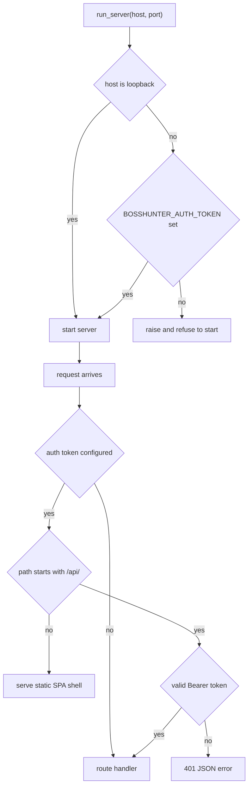
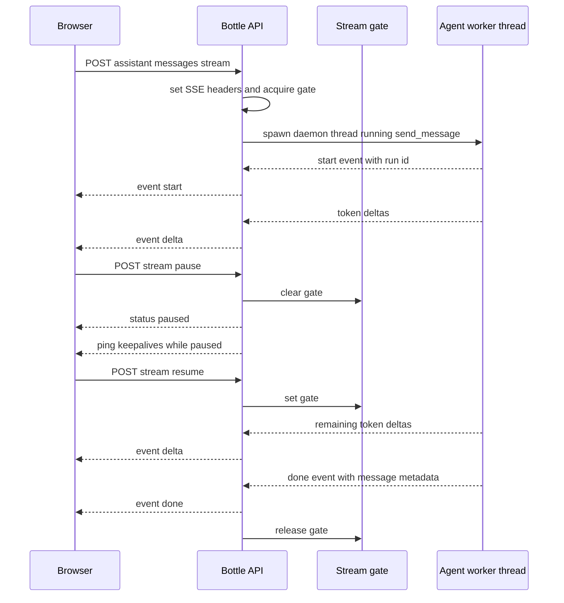

# Web API Surface and Local Access

BossHunter's web backend is a single Bottle application in `src/bosshunter/web/server.py`. It serves JSON data under `/api/*` and the built React frontend under `/*`, and it is the only HTTP surface through which the dashboard, the config page, and the assistant chat talk to the system. This page documents the API contract itself: the route families, the local-access authentication boundary, the response and streaming conventions, and the rules that keep credentials and files safe when the service is reachable beyond `localhost`.

The process entrypoint is `run_server(host="127.0.0.1", port=8686)` (`src/bosshunter/web/server.py#L2170-L2193`), invoked from `run_backend()` in `src/bosshunter/backend.py`, which resolves the runtime directory and loads the local environment first. The dashboard's background-task semantics are covered on the [Web Dashboard page](/openwiki/architecture/web-dashboard.md); the assistant's approval and side-effect model lives on the [Assistant page](/openwiki/architecture/assistant-agent.md).

## Local binding and process entrypoint

`run_server` enforces a local-access policy at startup rather than relying on the router alone. A bind address is considered loopback only when it is one of `127.0.0.1`, `localhost`, `::1`, or `[::1]`; any other address is a LAN exposure (`src/bosshunter/web/server.py#L114-L121`). If the host is non-loopback and the `BOSSHUNTER_AUTH_TOKEN` environment variable is empty, `run_server` raises and refuses to serve, so an unauthenticated management plane can never be silently published to the local network (`src/bosshunter/web/server.py#L124-L126`, `src/bosshunter/web/server.py#L2176-L2180`).

The token is read once from the real environment at import time in `_AUTH_TOKEN = os.environ.get("BOSSHUNTER_AUTH_TOKEN") or ""` (`src/bosshunter/web/server.py#L21-L23`). `backend.main()` reads `BOSSHUNTER_HOST` (default `127.0.0.1`) and `BOSSHUNTER_PORT` (default `8686`) and forwards them to `run_backend` (`src/bosshunter/backend.py#L62-L68`).

The server runs through `ThreadedWSGIRefServer`, a `wsgiref` adapter wrapped in `ThreadingMixIn` so each request is served in its own thread. This is what makes the assistant SSE stream viable: a long-lived stream does not starve pause/resume, task management, and health polling on a single worker thread (`src/bosshunter/web/server.py#L2129-L2167`).

_Figure 1: Startup refuses LAN binding without a token; per-request auth then protects only `/api/*`, leaving the static shell loadable so a user can present a token._

## Authentication boundary

When a token is configured, `_check_web_auth` is registered as a Bottle `before_request` hook (`src/bosshunter/web/server.py#L2192`). It applies only to paths starting with `/api/`: static assets and the SPA shell stay unauthenticated, otherwise the page could never load and the user could never enter a token (`src/bosshunter/web/server.py#L141-L150`).

A valid request must send `Authorization: Bearer <token>`. The scheme is matched case-insensitively against `bearer`, and the token is compared with `hmac.compare_digest` so the comparison time does not depend on how many leading characters match, avoiding a timing side channel (`src/bosshunter/web/server.py#L145-L159`). A missing or wrong token returns HTTP 401 with a JSON error string. Loopback requests with no token are simply not checked, keeping local development zero-configuration.

## Response and serialization conventions

All data endpoints return JSON with `Content-Type: application/json; charset=utf-8` through `_json_response`, which serializes unknown values with `default=str` so datetimes and similar values never crash encoding (`src/bosshunter/web/server.py#L172-L176`). Database rows pass through `_serialize_db_item`, which converts SQLite `created_at`/`updated_at` timestamps into explicit UTC ISO-8601 strings (`Z` suffix) rather than ambiguous `CURRENT_TIMESTAMP` text (`src/bosshunter/web/server.py#L179-L200`).

Reads do not open a separate web database. `_get_web_db()` calls `get_business_db(CONFIG_PATH, DATA_DIR / "bosshunter.db")` so the dashboard and the assistant/service layer share one business database, and every route closes the connection in a `finally` (`src/bosshunter/web/server.py#L107-L111`).

## Route surface

The `/api/*` contract groups into the following families. Unless noted, handlers return JSON and validate their inputs before doing work.

### Health and dashboard reads

| Route | Purpose |
| --- | --- |
| `GET /api/health` | Returns `{"status": "ok", "version": ...}`; polled by the online indicator. |
| `GET /api/funnel` | Funnel statistics for the dashboard overview. |
| `GET /api/stats` | Global per-status job counts. |
| `GET /api/activity?days=7` | Daily activity timeline. |
| `GET /api/top-companies?limit=5` | Top companies by collected jobs. |
| `GET /api/jobs` | Paginated job list with `status`, `company`, `limit` (1-200, default 50), and `offset` filters; returns `items`, `total`, `status_counts`, `pending_count`, and `missing_company_info_count`. |
| `GET /api/jobs/<job_id>` | Single job detail; 404 JSON when missing. |
| `GET /api/history?limit=15&include_unresolved=1` | Recent history, optionally merged with unresolved resume failures; structured `detail_payload` is exposed alongside the legacy `detail`. |
| `GET /api/history/unresolved-replies/count` | Count of unresolved monitor items (pending replies plus unresolved resume failures). |
| `GET /api/workbench` | Combined funnel, confirmation queue, greeting/send-error/resume queues, and the active/last/all task list. |
| `GET /api/workbench/preflight` | Returns `{"ok", "messages"}` blockers before a task can start. |

The health and dashboard read routes are defined across `src/bosshunter/web/server.py#L758-L943`.

### Workbench task control and targeted import

| Route | Purpose |
| --- | --- |
| `POST /api/workbench/task` | Starts a `full`, `collect`, `score`, `reenrich`, `monitor`, `deliver`, `greeting`, `reply`, or `import` mode task after preflight; 409 on `TaskAlreadyRunningError`. |
| `POST /api/workbench/task/<task_id>/stop` | Cooperative stop of a running task; 404 when unknown. |
| `GET /api/workbench/task/<task_id>` | Polls a single task snapshot (used by assistant task cards). |
| `POST /api/workbench/deliver` | Confirm or direct-send selected jobs; enforces human confirmation and terminal-status rules. |
| `POST /api/workbench/greetings/regenerate` | Regenerates selected greetings without sending; resets greeting state first. |
| `POST /api/workbench/reject` | Marks selected jobs `rejected` and records history. |
| `POST /api/jobs/import` | Starts targeted import (`url` or `search` mode). |
| `POST /api/jobs/import/select` | Second stage of search mode: collect the chosen candidate. |
| `GET /api/jobs/import/<task_id>/candidates` | Reads the candidate list produced by a `search`-mode import task. |

These routes live at `src/bosshunter/web/server.py#L944-L1208`. Task start/stop semantics, deadline timers, and the confirmation gate are owned by `WorkbenchTaskRunner` and documented on the dashboard page; the API is the thin HTTP boundary over that runner.

### Job actions and HR reply workflow

| Route | Purpose |
| --- | --- |
| `POST /api/jobs/<job_id>/mark-resume-sent` | Marks a job `resume_sent` and records history. |
| `GET /api/jobs/<job_id>/resume/download` | Streams the stored tailored-resume file for that job; 404 when absent. |
| `POST /api/history/<history_id>/reply` | Confirms a `reply_pending` record and starts a `reply` task that sends the message through BOSS. |
| `POST /api/history/<history_id>/refine` | Refines a pending reply from a user suggestion without sending. |
| `POST /api/history/<history_id>/dismiss` | Records a dismissed-reply history row without rejecting the job. |
| `POST /api/replies/generate` | Generates a reply from pasted HR text (no DB write, no send). |
| `POST /api/greetings/generate` | Generates a greeting from pasted JD text, optionally with the AI review loop (no DB write, no send). |

These are defined at `src/bosshunter/web/server.py#L1211-L1429`. The pasted-content generation endpoints are stateless convenience paths; the confirmed `reply` path delegates to the single-task runner so the browser action never blocks the API thread on browser automation.

### Assistant conversations, messages, and memory

The assistant routes are defined across `src/bosshunter/web/server.py#L1435-L1830` and delegate to `AssistantService` plus `bosshunter.assistant.repository`:

| Route | Purpose |
| --- | --- |
| `GET/POST/DELETE /api/assistant/conversations` | List, create, or batch-delete conversations. |
| `DELETE /api/assistant/conversations/<conversation_id>` | Delete one conversation and its messages. |
| `GET /api/assistant/conversations/<conversation_id>/messages` | Page through messages with `limit` and `before`. |
| `POST /api/assistant/conversations/<conversation_id>/messages` | Send a message and return the completed result. |
| `POST /api/assistant/conversations/<conversation_id>/messages/stream` | SSE stream of a message run (see below). |
| `POST /api/assistant/conversations/<conversation_id>/stream/pause` | Pause the live stream without cancelling generation. |
| `POST /api/assistant/conversations/<conversation_id>/stream/resume` | Resume a paused stream. |
| `POST /api/assistant/conversations/<conversation_id>/messages/partial` | Persist an interrupted partial answer as context. |
| `POST /api/assistant/runs/<run_id>/cancel` | Ask the current run to stop at the next safe checkpoint. |
| `POST /api/assistant/conversations/<conversation_id>/resume` | Resume a conversation waiting on an approval decision (`approve`/`edit`/`reject`). |
| `GET /api/assistant/memories` | List active or history memories. |
| `PATCH/DELETE /api/assistant/memories/<memory_id>` | Edit (preserving the replaced version) or forget a memory. |
| `POST /api/assistant/memories/<memory_id>/restore` | Restore a historical memory as a new active version. |
| `POST/GET /api/assistant/bad-cases` | Record or export bad-case evaluations. |
| `POST /api/assistant/message-ratings` | Record the per-answer rating gesture. |

### Config, resume, and avatar

| Route | Purpose |
| --- | --- |
| `GET /api/config` | Returns the config with secrets masked. |
| `POST /api/config` | Sanitizes and writes the config; the backend owns YAML serialization. |
| `GET /api/config/schema` | Returns `web/config_schema.json` for the schema-driven form. |
| `GET /api/config/download` | Downloads a redacted YAML copy with masked secrets. |
| `GET /api/config/cities` | Returns the shared `CITY_CODES` map for multi-selects. |
| `GET /api/resume` | Returns resume file metadata (filename, size, uploaded time, path), never content. |
| `POST /api/resume/upload` | Uploads a Markdown resume. |
| `DELETE /api/resume` | Detaches the resume path from config without deleting the file. |
| `GET /api/avatar` | Returns avatar metadata. |
| `POST /api/avatar/upload` | Uploads a portrait image. |
| `DELETE /api/avatar` | Detaches the avatar path without deleting the image. |

These routes are defined at `src/bosshunter/web/server.py#L1867-L2083`.

## Assistant streaming contract

`POST /api/assistant/conversations/<conversation_id>/messages/stream` accepts the same `message`, `job_id`, and `web_enabled` body as the non-streaming send endpoint, validates `message` (required, at most 8000 characters), then sets `text/event-stream`, `Cache-Control: no-cache`, and `X-Accel-Buffering: no` before returning a generator (`src/bosshunter/web/server.py#L1530-L1545`).

The generator starts a daemon worker thread that runs the blocking `AssistantService.send_message`, pushes events into an in-process `Queue`, and forwards them as SSE:

- `event: start` carries `{"run_id": ...}`.
- `event: delta` carries `{"delta": "<token>"}` as the model streams.
- `event: trace` carries a normalized execution event.
- `event: done` carries message metadata: `id`, `run_id`, `content`, `citations`, `approval`, `task`, `tool_trace`, `execution_plan`, `execution_events`, `dag_result`, `evidence_route`, `evidence_tasks`, `evidence_results`, `evidence_coverage`, and `status`.
- `event: error` carries a failure message and ends the stream.
- `event: ping` with an empty data object is emitted as a keepalive whenever the queue is idle for 15 seconds or the stream is paused.

The event dispatch is in `src/bosshunter/web/server.py#L1547-L1625`.

_Figure 2: The assistant SSE stream. Pausing clears a per-conversation gate so the worker keeps generating but the browser stops receiving deltas; resuming reopens the gate and the buffered events continue._

### Pause, resume, cancel, and partial persistence

Pause and resume are a pure forwarding gate, not a cancellation. A per-conversation `threading.Event` is created on demand and set (open) initially (`src/bosshunter/web/server.py#L77-L91`). `POST .../stream/pause` clears it, and `POST .../stream/resume` sets it; the generator keeps yielding `ping` while paused and resumes forwarding `delta`/`trace` once the gate reopens. The gate is released when the stream ends so no session state leaks (`src/bosshunter/web/server.py#L1622-L1645`). Both endpoints return 400 when no stream is active for that conversation.

Cancellation is separate and cooperative: `POST /api/assistant/runs/<run_id>/cancel` delegates to `AssistantService.cancel`, which asks the run to stop at the next safe checkpoint rather than killing a thread (`src/bosshunter/web/server.py#L1669-L1676`). Because a cancelled run is not persisted as a complete assistant message, the frontend can call `POST .../messages/partial` with the accumulated `content` and optional `run_id`; the server stores it as an assistant message marked `interrupted` so it remains context for follow-up questions (`src/bosshunter/web/server.py#L1648-L1666`).

## Config redaction and write sanitization

Config responses never expose raw secrets. `_redact_config_dict` deep-copies the config, removes `ai.api_key` and `ai.auth_token`, and replaces them with `api_key_masked`/`auth_token_masked` using `_mask_api_key` (first four plus last four characters, `***` in between, or just `***` for short values) (`src/bosshunter/web/server.py#L221-L244`). The same redaction is shared by `GET /api/config`, the schema-driven form's data source, and `GET /api/config/download`, which serializes the redacted dict with `yaml.safe_dump` and sends it as an attachment (`src/bosshunter/web/server.py#L1912-L1923`).

On write, `_sanitize_config_for_write` performs the inverse hygiene: it strips browser-only fields (`api_key_masked`, `has_api_key`, `auth_token_masked`, `has_auth_token`), and for `api_key`/`auth_token` it preserves the existing stored secret when the posted value is blank, missing, or equal to the current masked display value, so saving a form without touching the password field does not wipe the credential (`src/bosshunter/web/server.py#L252-L286`). It also normalizes `ai.provider`, keeping a user's existing provider when the browser posts the legacy `openai` value instead of silently rewriting it to `openai_compatible` (`src/bosshunter/web/server.py#L264-L270`).

## Upload and download safety

Resume and avatar uploads are the two writable file paths, and both are constrained before anything touches disk.

- **Resume**: only files ending in `.md` are accepted, up to 10MB. The filename is reduced to a basename and stripped of `..`, `/`, and `\`, then written under `data/resumes` (`src/bosshunter/web/server.py#L1955-L1988`).
- **Avatar**: only `.jpg`, `.jpeg`, `.png`, and `.webp` extensions are accepted, up to 5MB and non-empty. The file is always written to the fixed name `avatar<ext>` under `data/profile`, so no client-supplied name can influence the destination (`src/bosshunter/web/server.py#L2030-L2068`).

Both `DELETE` endpoints only detach the configured path (`resume_path = ""` or `avatar_path = ""`); they never delete the user's local file from disk (`src/bosshunter/web/server.py#L1991-L2005`, `src/bosshunter/web/server.py#L2071-L2083`). The master resume is treated as a fact store that must not be destroyed by a UI action.

Downloads are path-safe by construction. `GET /api/jobs/<job_id>/resume/download` reads the job's `resume_path`, verifies the file exists, and streams it through `static_file(resume_path.name, root=str(resume_path.parent), download=resume_path.name)` — only the basename and its parent directory, never an arbitrary request-supplied path (`src/bosshunter/web/server.py#L1234-L1246`). Config download likewise serves a freshly redacted, in-memory YAML body rather than exposing the raw file.

## Error contract and leak avoidance

Unknown `/api/*` routes return a JSON 404 (`{"error": "Not found"}`), never the SPA HTML shell; non-API 404s still fall back to `index.html` for client-side routing (`src/bosshunter/web/server.py#L2094-L2117`). Route handlers catch their own failures and return a compact `{"error": ...}` JSON envelope with an appropriate status (400 for validation, 404 for missing records, 409 for concurrency or state conflicts, 502 for upstream AI failures, and 500 otherwise).

Error responses must not leak credentials, resume text, or internal stack traces. That invariant is upheld by design in three places: config reads/downloads go through the redaction path, the resume GET returns only file metadata and never file content, and handlers wrap exceptions into a short message string rather than propagating a traceback to the client. The global 500 handler also returns JSON rather than the Bottle default HTML error page (`src/bosshunter/web/server.py#L2120-L2123`).

## Focused tests

The HTTP contract is locked by regression tests that exercise the Bottle app through a raw WSGI `environ` rather than a live socket:

- `tests/test_web_api_routes.py` covers the JSON 404 for unknown API routes, UTC timestamp serialization, workbench preflight requirements, the pending-confirmation envelope (including unscored imported jobs), the full-task confirmation handoff, deliver/reject semantics, resume/avatar detach-only deletes, HR reply/dismiss/refine, unresolved-history counting, pasted reply/greeting generation, and the paginated `GET /api/jobs` envelope with status and company filtering.
- `tests/test_web_config_api.py` locks config redaction and the sanitize/preserve rules for API keys and auth tokens across both provider values.
- `tests/test_web_api_routes.py` also exercises the `WorkbenchTaskRunner` behavior the task routes expose: the active slot stays occupied until the executor returns, deadline auto-stop, and the `reply`/`import` parallel-safe rule.

## Related pages

- [Web Dashboard and Background Tasks](/openwiki/architecture/web-dashboard.md)
- [Controlled Assistant Agent Architecture](/openwiki/architecture/assistant-agent.md)
- [Capabilities and Approval](/openwiki/concepts/capabilities-and-approval.md)
- [AI Provider Integration and Credentials](/openwiki/integrations/ai-providers.md)
- [Configuration](/openwiki/operations/configuration.md)
- [Assistant QA flow](/openwiki/workflows/assistant-qa-flow.md)
