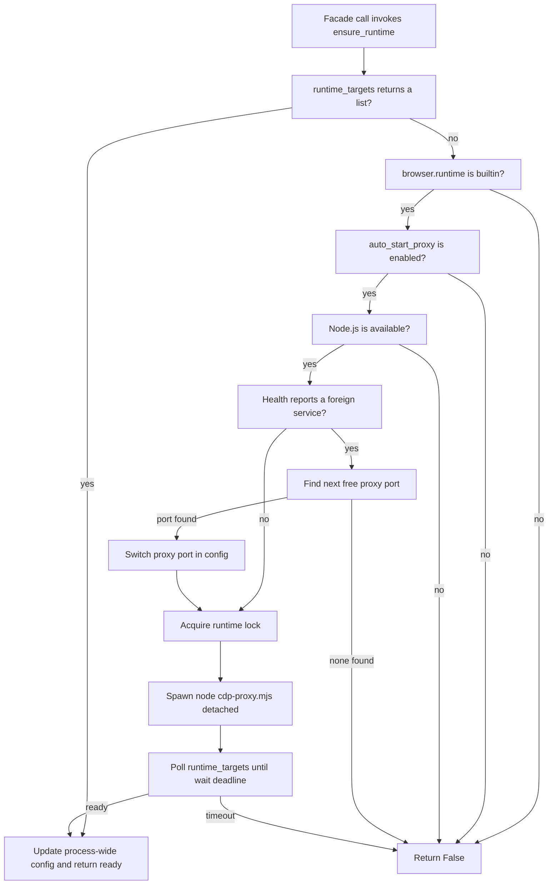
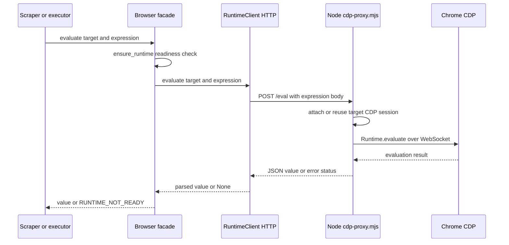

# Browser Runtime and CDP Automation

BossHunter automates BOSS直聘 through the user's already-logged-in Chrome session rather than by storing platform credentials. The Python side is deliberately thin: `src/bosshunter/browser/` exposes a facade over `RuntimeClient`, a small HTTP client that talks to a bundled Node.js proxy (`src/bosshunter/browser/runtime/cdp-proxy.mjs`). The proxy attaches to the user's daily Chrome over the Chrome DevTools Protocol (CDP), so login cookies, sessions, and QR-code state live only in Chrome, never in BossHunter's configuration or data store.

The same facade is shared by scraping, sending, monitoring, and resume PDF generation. `pipeline.py` refuses to proceed unless `check_chrome_connection()` and `find_boss_tab()` both succeed, so the runtime is a precondition of the whole job-hunt loop, not an optional dependency.

## Component map

| Component | Module | Responsibility |
| --- | --- | --- |
| Browser facade | `src/bosshunter/browser/__init__.py` | process-wide `configure()`, readiness gate, high-level tab/JS/input operations, `RUNTIME_NOT_READY` sentinel |
| HTTP facade | `src/bosshunter/browser/client.py` | typed wrapper over the proxy's local HTTP endpoints |
| Runtime manager | `src/bosshunter/browser/runtime/__init__.py` | Node discovery, proxy auto-start, config/env, port fallback, lock |
| Node CDP proxy | `src/bosshunter/browser/runtime/cdp-proxy.mjs` | local HTTP-to-CDP bridge, Chrome discovery, per-target CDP sessions, port guard |
| Readiness checker | `src/bosshunter/browser/runtime/check-runtime.mjs` | standalone `node check-runtime.mjs` diagnostic and detached start |
| Browser launcher | `src/bosshunter/browser/launcher.py` | find Chrome/Edge and launch the one-click isolated profile |
| Diagnostics | `src/bosshunter/browser/diagnostics.py` | `bosshunter connect` readiness report |
| Site patterns | `src/bosshunter/browser/runtime/site-patterns/` | documented, versioned selector contract for zhipin.com |

The `.mjs` runtime scripts and `site-patterns/*.md` documents are declared as hatch wheel artifacts in `pyproject.toml` (`[tool.hatch.build.targets.wheel] artifacts`). They must ship with the wheel and must not be relocated; the Python runtime manager resolves the proxy via `importlib.resources` with a source-tree fallback, but installed runs depend on the packaged files.

## Runtime lifecycle and auto-start

Every facade operation first calls `ensure_runtime()`. The readiness check is not a simple "is the process up" test: it only treats the runtime as ready when `runtime_targets()` returns a list, which itself requires both that `/health` identifies the service as `bosshunter` and that `/targets` answers with an array. This means a foreign HTTP service squatting on the proxy port is never mistaken for the BossHunter runtime.

_Figure 1: `ensure_runtime` decision path. Readiness is proven by an authenticated `/targets` array, not by process liveness, and a foreign service on the port triggers a fallback-port switch before the proxy is spawned._

The spawn path is serialized under `_runtime_lock`. Without the lock, concurrent tasks racing into `ensure_runtime` could each spawn their own Node proxy, and the last writer would overwrite the global process handle, leaving earlier processes orphaned. The lock wraps the whole "start then poll until ready" window, and the poll uses `runtime_targets()` as its success condition, with a configurable `wait_seconds` deadline defaulting to 15 seconds.

`start_runtime()` launches the proxy detached (`CREATE_NEW_PROCESS_GROUP | DETACHED_PROCESS` on Windows, `start_new_session` on POSIX) with stdio discarded, and passes three environment variables that drive the proxy's behavior:

- `BOSSHUNTER_BROWSER_PROXY_PORT` — the local HTTP port (default `3456`).
- `BOSSHUNTER_CHROME_PORTS` — comma-separated candidate Chrome debug ports (default `9222,9229,9333`).
- `BOSSHUNTER_ENABLE_PORT_GUARD` — `"true"`/`"false"` switch for the Fetch-based port guard.

`get_runtime_url()` derives the base URL from `proxy_host` and `proxy_port`, so both the facade and `RuntimeClient` always target the same address, including after a fallback-port switch updates the process-wide config.

## Python facade and RUNTIME_NOT_READY semantics

The facade (`src/bosshunter/browser/__init__.py`) exposes `new_tab`, `close_tab`, `navigate`, `evaluate`, `click`, `click_at`, `type_text`, `set_files`, `scroll`, `screenshot`, `print_pdf`, `get_page_info`, `wait_for_load`, `get_page_targets`, `find_boss_tab`, and `check_chrome_connection`. Each checks `_ready()` first and returns a safe falsy default (`None`, `False`, or `[]`) when the runtime is unavailable.

`evaluate()` is the exception that matters operationally. Instead of returning `None` for "the local runtime could not be reached", it returns the falsy sentinel `RUNTIME_NOT_READY`. The sentinel is falsy (`__bool__` returns `False`), so existing `if not result` guards still treat it as "no result", but callers can distinguish it with `result is RUNTIME_NOT_READY`. The sender does exactly this: `_parse_js_result` maps it to `{"success": False, "error": "runtime_not_ready"}`, which is classified as a retryable infrastructure error that does not pollute the progressive-backoff circuit breaker, unlike genuine page/business failures.

`new_tab()` also compensates for a Chrome quirk: some Chrome versions ignore the URL passed to `Target.createTarget` for background tabs and return `about:blank`. After creating the tab, the facade reads `/info` and, if the URL is blank, issues a follow-up `navigate()` so scrape/completion logic does not misclassify the job as closed.

## RuntimeClient HTTP facade

`RuntimeClient` (`src/bosshunter/browser/client.py`) is the only thing that speaks to the proxy. It uses `httpx` with `trust_env=False` for all calls so local proxy traffic is never routed through ambient HTTP proxies, and it converts transport failures into the same falsy defaults the facade promises. It maps to these endpoints:

| Method | Endpoint | Returns |
| --- | --- | --- |
| `health` | `GET /health` | JSON dict or `None` |
| `targets` | `GET /targets` | page-target list or `[]` |
| `new_tab` | `GET /new` | `targetId` or `None` |
| `close_tab` | `GET /close` | boolean |
| `navigate` | `GET /navigate` | boolean |
| `back` | `GET /back` | boolean |
| `evaluate` | `POST /eval` | `value` from JSON, or `None` |
| `click` | `POST /click` | boolean |
| `click_at` | `POST /clickAt` | boolean |
| `type_text` | `POST /type` | boolean |
| `set_files` | `POST /setFiles` | boolean |
| `scroll` | `GET /scroll` | boolean |
| `screenshot` | `GET /screenshot` | boolean |
| `print_pdf` | `GET /pdf` | boolean |
| `info` | `GET /info` | JSON dict or `None` |

`evaluate` is the exception to the boolean convention: it POSTs the JavaScript expression as the raw request body and, on a 200 response, returns the parsed `value` field; on a non-200 it attempts to return the JSON error body so callers can see why the evaluation failed.

The request flow from a caller down to Chrome is:

_Figure 2: A single evaluate call crosses the Python facade, the HTTP facade, the Node proxy, and the Chrome CDP WebSocket, with each layer translating failure into its own falsy contract._

## Node CDP proxy

`cdp-proxy.mjs` is a local HTTP server bound to `127.0.0.1` that holds one WebSocket connection to Chrome and multiplexes per-target CDP sessions over it. It supports Node.js 22's built-in `WebSocket`, or falls back to the `ws` module for older Node versions.

### Chrome discovery

On first use, the proxy finds the Chrome debugging endpoint in two stages. First it reads the platform-specific `DevToolsActivePort` file that Chrome writes when remote debugging is enabled (macOS/Linux/Windows paths under the user profile), taking the port from the first line and the optional WebSocket path from the second. If no file is readable and open, it probes each port in `BOSSHUNTER_CHROME_PORTS` and validates candidates through `GET /json/version`, requiring a `webSocketDebuggerUrl`. This means a merely open port is not enough; it must be a genuine Chrome DevTools endpoint. Discovery results are cached in `chromePort`/`chromeWsPath`/`chromeWsUrl` and cleared on connection error or close, so a closed Chrome triggers re-discovery on the next request.

### Endpoints and CDP translation

Every endpoint except `/health` first ensures the WebSocket is connected, then translates the HTTP request into CDP commands. Page targets are filtered to `type === 'page'` for `/targets`; `/new` creates a background target and, for non-`about:blank` URLs, waits for `document.readyState` to become complete; `/close` closes the target and drops the cached session; `/navigate` and `/back` wait for load before returning.

The DOM/input endpoints are thin CDP wrappers: `/eval` runs `Runtime.evaluate` with `returnByValue` and `awaitPromise`, returning the value, the raw result, or a 400 with `exceptionDetails.text`; `/click` and `/clickAt` evaluate `document.querySelector` and either call `el.click()` or dispatch `Input.dispatchMouseEvent` at the element center (or at explicit `x,y` coordinates); `/type` uses `Input.insertText`; `/setFiles` resolves the node via `DOM.querySelector` and calls `DOM.setFileInputFiles`; `/scroll` evaluates `window.scrollTo`/`scrollBy` and waits 800ms; `/screenshot` and `/pdf` use `Page.captureScreenshot` and `Page.printToPDF`, writing to a file when the `file` parameter is supplied; `/info` returns a JSON string of title, URL, and `readyState`. Unknown paths return a 404 listing the supported endpoints, and any thrown error becomes a 500 JSON body.

### Port guard

The proxy can optionally block pages from probing Chrome's own debug port, closing a reconnaissance vector that page JavaScript could otherwise use. When `BOSSHUNTER_ENABLE_PORT_GUARD` is enabled, `ensureSession()` calls `Fetch.enable` on each newly attached session with request-stage patterns for `http://127.0.0.1:{chromePort}/*` and `http://localhost:{chromePort}/*`. A `Fetch.requestPaused` event for those patterns is answered with `Fetch.failRequest` using `errorReason: ConnectionRefused`. The guard is per-session and only active when a Chrome port is known.

## Browser launcher and isolated profile

The `bosshunter start` command uses `launcher.py` to open a visible Chrome or Edge for the one-click workflow. `find_browser_executable()` gives priority to an explicit `browser.executable_path`, then searches PATH command names (`chrome`/`google-chrome`/`msedge`/etc.), then conventional per-platform install locations. `build_browser_command()` deliberately opens only the local dashboard URL and passes:

- `--remote-debugging-port=<debug_port>`
- `--user-data-dir=<isolated profile>` (default `./data/browser-profile`)
- `--no-first-run` and `--no-default-browser-check`

The isolated `--user-data-dir` keeps the BOSS login session separate from the user's normal browsing profile, and the command opens the dashboard rather than a zhipin.com URL directly. The launcher starts the browser with `subprocess.Popen` and discarded stdio, after the web server begins accepting local connections. Because login state is held by the browser profile and CDP attaches to that live session, BossHunter stores no platform credentials of its own.

## Site patterns: the fragile selector boundary

`browser/runtime/site-patterns/zhipin.com.md` is the maintained contract for the platform's DOM. It records the verified selectors for job title (`h1`), salary (`.salary`), city (`.text-city`), experience (`.text-experiece`, which is the platform's own spelling), education (`.text-degree`), company (`.sider-company`), HR info (`.job-boss-info`), JD body (`.job-sec-text`), and the company sidebar, plus known traps such as `.company-name` occasionally matching an unrelated company and the HR name (`.name`) being polluted by "在线"/"刚刚活跃" status words.

This is the fragile boundary of the whole system: platform CSS class changes are expected, and the fix location matters. Selector corrections belong in the scraper/executor code and in these site-pattern documents, and they require deterministic regression tests — never a silent in-place edit in a page script. The pattern file is documentation that ships with the wheel, but the enforcing JavaScript selectors live in `scraper/jobs.py` and `executor/sender.py`/`executor/monitor.py` where the tests can pin them.

## Diagnostics and operations

`bosshunter connect` renders `print_browser_diagnostics()`, which reports four facts and actionable remediation:

- Node.js availability (and version), with a Node 22+ install hint when missing.
- BossHunter CDP runtime readiness, including the resolved `runtime_url`.
- Chrome connection (proven by a target list, not merely an open port).
- Presence of a BOSS直聘 tab.

A key diagnostic distinction is the occupied-port case: when `/health` answers but `runtime` is not `bosshunter`, the report says the port is occupied by a non-BossHunter service and points the user at stopping the old CDP proxy or changing `browser.proxy_port`. When the runtime is genuinely absent, the message is the simpler "Browser Runtime is not ready". `print_browser_diagnostics()` returns `True` only when both the runtime and Chrome are ready, and the `connect` command exits non-zero otherwise.

`bosshunter start` is the one-click launcher path: it resolves the browser executable, selects `browser.chrome_ports[0]` (or `--debug-port`), resolves the profile directory against the runtime base directory, and opens the dashboard plus the browser. Closing the terminal stops the web server but does not clear the browser login state.

## Configuration

Browser behavior is controlled by the `browser:` block merged from `DEFAULTS` in `src/bosshunter/config.py`:

| Key | Default | Effect |
| --- | --- | --- |
| `runtime` | `builtin` | must be `builtin` for `ensure_runtime` to auto-start the proxy |
| `proxy_host` | `127.0.0.1` | host for the proxy HTTP API |
| `proxy_port` | `3456` | proxy HTTP port; may be switched on foreign-service conflict |
| `chrome_ports` | `[9222, 9229, 9333]` | candidate Chrome remote-debugging ports |
| `preferred_browser` | `auto` | `auto`, `chrome`, or `edge` for the launcher |
| `executable_path` | `""` | optional explicit browser path, checked before discovery |
| `user_data_dir` | `./data/browser-profile` | isolated profile for the launcher |
| `auto_start_proxy` | `True` | whether `ensure_runtime` may spawn the proxy |
| `enable_port_guard` | `True` | whether the proxy blocks page probes of the Chrome debug port |
| `site_patterns` | `True` | feature flag for the site-pattern boundary |

The CLI group and the backend both call `configure(...)` after loading config, so the facade's process-wide browser config and the web API read one consistent value.

## Invariants and failure semantics

- The runtime is only considered ready when `/health` proves `runtime == "bosshunter"` and `/targets` returns a list; a foreign service on the port is never accepted.
- `evaluate()` returns the falsy `RUNTIME_NOT_READY` sentinel for an unreachable runtime, letting the sender retry infrastructure hiccups separately from business failures without advancing progressive backoff.
- Concurrent auto-start is serialized by `_runtime_lock`, preventing orphan Node proxies.
- Fallback-port switching mutates both the passed config and the process-wide config so `get_runtime_url()` and subsequent clients use the new port.
- No platform credentials are stored; login state lives in the user's Chrome profile (or the isolated launcher profile).
- `.mjs` runtime artifacts and `site-patterns/*.md` files ship with the wheel and must not be relocated.
- Selector fixes belong in `scraper/`, `executor/`, or site patterns and require deterministic regression tests.

## Focused tests

Browser behavior is covered by flat `tests/test_*.py` modules that mock the network and CDP boundaries rather than launching a real browser:

- `tests/test_browser_runtime.py` — config defaults/overrides, runtime URL and script path, Node detection, `runtime_targets` identity rejection, `ensure_runtime` auto-start and next-free-port fallback, and the environment passed to `start_runtime`; plus source-level assertions that the proxy fetches `webSocketDebuggerUrl` and only reuses an existing runtime when it identifies as `bosshunter`.
- `tests/test_browser_facade.py` — facade delegation to `RuntimeClient`, falsy returns when the runtime is unavailable, `evaluate` passthrough, `wait_for_load` polling, `check_chrome_connection`, `find_boss_tab` zhipin matching, and `print_pdf`.
- `tests/test_browser_launcher.py` — configured-path priority, `auto` fallback to Edge, the isolated-profile command construction (no zhipin URL), and the visible process launch.
- `tests/test_browser_diagnostics.py` — ready-runtime reporting, post-fallback URL reporting, missing-Node reporting, and the non-BossHunter occupied-port message.
