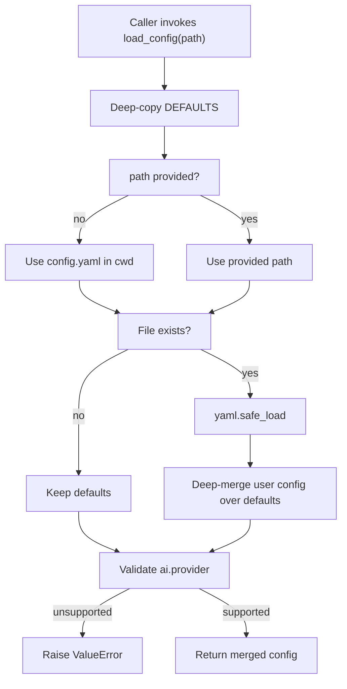

# Configuration and Environment

BossHunter splits configuration into two deliberately different layers. The first is `config.yaml`, a user-editable YAML file that is deep-merged over a built-in `DEFAULTS` map in `src/bosshunter/config.py`. The second is `.env`, a plain `KEY=VALUE` file for process-level secrets such as LangSmith tracing and the Web auth token, loaded by `src/bosshunter/environment.py`. `config.example.yaml` is the canonical documented schema that users copy to `config.yaml`, while `src/bosshunter/web/config_schema.json` describes the subset of fields the Web dashboard edits. Neither `config.yaml` nor `.env` is committed: `.gitignore` excludes both and keeps only `config.example.yaml` and `.env.example` (`repo://.gitignore#L22-L26`).

_Figure 1: `load_config` always starts from a deep copy of `DEFAULTS`, recursively merges only the keys the user overrode, and fails fast when the AI provider is unsupported._

## Config loading and merge semantics

`load_config(config_path=None)` in `src/bosshunter/config.py` is the single entry point used by the CLI, the Web server, the assistant service, and the database layer. It deep-copies `DEFAULTS`, optionally loads `config.yaml` (defaulting to `config.yaml` in the current working directory), then recursively merges the user map into the defaults and validates the AI provider (`repo://src/bosshunter/config.py#L148-L158`).

The merge is structural, not a flat key override. `_deep_merge` recurses when both sides hold a dict for the same key, and otherwise lets the override replace the base value (`repo://src/bosshunter/config.py#L180-L186`). This means a user can set only `throttle.daily_limit` without redeclaring the rest of the `throttle` block, and every key in the returned config is guaranteed to exist with a default even when `config.yaml` is absent. The default is deep-copied first so list and dict defaults are never mutated in place (`repo://src/bosshunter/config.py#L168-L177`).

`_validate_ai_provider` enforces `ai.provider ∈ {"anthropic", "openai_compatible"}` and raises `ValueError` otherwise, so an unsupported provider fails at load time rather than producing confusing runtime errors (`repo://src/bosshunter/config.py#L34`, `repo://src/bosshunter/config.py#L161-L165`).

## Runtime base directory resolution

Config and data are relative to a runtime base directory, not necessarily the process working directory. Three entry points resolve it consistently:

- `backend.resolve_base_dir` (Web/backend process) prefers an explicit `base_dir` argument, then the `BOSSHUNTER_BASE_DIR` environment variable; otherwise it falls back to the source root if that root contains `config.yaml`, and finally the current working directory (`repo://src/bosshunter/backend.py#L16-L32`).
- `main._runtime_base_dir` (CLI) returns the parent of an explicit `--config` path, else the project root if it has `config.yaml`, else the current directory (`repo://src/bosshunter/main.py#L27-L36`).
- `web.server` keeps a module-level `BASE_DIR` / `CONFIG_PATH` that `set_base_dir` rewrites when `run_backend` starts (`repo://src/bosshunter/web/server.py#L94-L104`).

`run_backend` ties this together: resolve the directory, load that instance's `.env`, call `set_base_dir`, configure the browser runtime from `load_config(config_path)`, and only then start the HTTP server (`repo://src/bosshunter/backend.py#L35-L59`). The comment in the code emphasizes that the browser runtime and Web API must read the same config file to avoid divergent behavior between entry points.

## Environment file loading

`load_local_environment(path=None)` in `src/bosshunter/environment.py` is a deliberately small parser. It reads a `.env` file, skips blank lines, comments, and lines without `=`, validates that keys are alphanumeric/underscore identifiers, strips one layer of surrounding single or double quotes from values, and applies each key with `os.environ.setdefault` (`repo://src/bosshunter/environment.py#L17-L37`). The `setdefault` semantics make already-set process variables authoritative: the test suite verifies a process-level `LANGSMITH_PROJECT` is not overwritten by the `.env` value (`repo://tests/test_environment.py#L11-L29`).

When no path is given, `_environment_path()` resolves `BOSSHUNTER_BASE_DIR/.env` if that variable is set, otherwise `cwd/.env` (`repo://src/bosshunter/environment.py#L9-L14`). Loading happens early and twice by design:

- `bosshunter/__init__.py` calls `load_local_environment()` at import time so LangSmith/LangGraph tracing variables exist before any business module is imported (`repo://src/bosshunter/__init__.py#L9-L10`).
- `run_backend` calls `load_local_environment(runtime_dir / ".env")` again for the specific instance directory before importing the Web server, which needs `BOSSHUNTER_AUTH_TOKEN` to be available during import (`repo://src/bosshunter/backend.py#L50-L53`).

`.env.example` documents the supported variables: LangSmith tracing (`LANGSMITH_TRACING`, `LANGSMITH_ENDPOINT`, `LANGSMITH_API_KEY`, `LANGSMITH_PROJECT`) and the optional `BOSSHUNTER_AUTH_TOKEN` used only when binding the Web server to a non-loopback address (`repo://.env.example#L1-L10`).

## Config domains and defaults

`DEFAULTS` in `src/bosshunter/config.py` defines the complete key space, grouped into domains (`repo://src/bosshunter/config.py#L37-L145`). `config.example.yaml` mirrors this structure with explanatory comments and is the canonical schema to copy (`repo://config.example.yaml#L1-L148`).

| Domain | Purpose and notable keys |
| --- | --- |
| `profile` | Job-seeker identity: `resume_path`, `resume_output_dir`, `target_roles`, `target_cities`, `salary_min`/`salary_max` (K), `allow_internship`, `deal_breakers`, optional `avatar_path`, `extra_highlights`, `portfolio_url`. |
| `search` | Batch collection: `keywords`, `cities` (empty falls back to `profile.target_cities`), `max_pages`, `sort`. |
| `scoring` | Candidate gate: `threshold`, `max_candidates`, `concurrency`, `min_registered_capital_wan`. |
| `throttle` | Anti-detection and send pacing: `daily_limit`, `interval_min`/`interval_max`, `browse_before_greet`, `only_send_when_hr_online`, `browse_duration_*`, `send_windows`, `day_off_probability`, plus the send self-healing keys `send_max_retries`, `send_retry_backoff_*`, `auto_recover_send_errors`, `send_error_recover_seconds`, `send_error_max_retries`. |
| `ai` | Model routing: `provider`, `model`, `greeting_review_threshold`, `greeting_max_iterations`, `greeting_concurrency`, `request_timeout`, `http_max_retries`, `resume_max_pages`, optional `api_key`/`base_url`/`auth_token`. |
| `assistant` | Token-budgeted context (`context.*`) and long-term memory (`memory.*`), including `default_context_window_tokens`, `output_reserve_tokens`, and memory capture/retrieval limits. |
| `resume` | PDF presentation: `template` (`modern`/`executive`/`ats`), `theme_color`, `show_avatar`, `generate_ats_version`. |
| `monitor` | HR conversation monitoring: `interval` (minutes), `chat_url`, `max_resume_sends_per_cycle`, `auto_reply_hr_questions`, `auto_generate_resume`. |
| `follow_up` | Automatic follow-ups: `enabled`, `interval_hours`, `skip_weekends`. |
| `dedup` | Cross-run job dedup: `history_file`. |
| `browser` | Browser runtime wiring: `runtime`, `proxy_host`, `proxy_port`, `chrome_ports`, `preferred_browser`, `executable_path`, `user_data_dir`, `auto_start_proxy`, `enable_port_guard`, `site_patterns`. |
| `database` | Production database URL; empty means local SQLite. |
| `runtime` | Process coordination: `redis_url`, `redis_required`, `worker_enabled`, `max_concurrency`. |
| `artifacts` | Artifact storage backend: `backend` (`local`/`s3`), `local_path`, `bucket`, `endpoint_url`. |

The `search.cities` empty-value fallback to `profile.target_cities` is implemented in the scraper, which builds city × keyword combinations and skips unrecognized city names with a warning (`repo://src/bosshunter/scraper/jobs.py#L236-L256`). The preflight check in the Web server further requires a Markdown resume for full/collect/score/import tasks and a non-empty `search.keywords` for batch collection (`repo://src/bosshunter/web/server.py#L289-L316`).

## City codes

`CITY_CODES` in `src/bosshunter/config.py` maps Chinese city names to BOSS直聘 city codes (`北京` → `101010100`, `深圳` → `101280600`, and so on) (`repo://src/bosshunter/config.py#L10-L31`). The scraper uses it to build search URLs, and targeted search falls back to `100010000` ("全国") when no city is configured or recognized (`repo://src/bosshunter/scraper/jobs.py#L724-L729`). The map is also exposed to the frontend at `GET /api/config/cities` so the city multi-select is populated from the same source of truth (`repo://src/bosshunter/web/server.py#L1926-L1928`). The focused test pins the Guangzhou and Shenzhen codes (`repo://tests/test_city_codes.py#L5-L9`).

## Web config API and schema

The Web dashboard reads and writes `config.yaml` through a small API in `src/bosshunter/web/server.py`:

- `GET /api/config` returns the redacted merged config for display (`repo://src/bosshunter/web/server.py#L1867-L1873`).
- `POST /api/config` sanitizes the posted body, validates that `profile.salary_min <= profile.salary_max` (when a max is set), and writes YAML with `allow_unicode=True` and `sort_keys=False`. The backend exclusively owns YAML serialization so the frontend never assembles the file itself (`repo://src/bosshunter/web/server.py#L1876-L1899`).
- `GET /api/config/schema` returns `config_schema.json` (`repo://src/bosshunter/web/server.py#L1902-L1909`).
- `GET /api/config/download` returns a redacted YAML copy for export, never plaintext keys (`repo://src/bosshunter/web/server.py#L1912-L1923`).
- `GET /api/config/cities` returns `CITY_CODES`.

`config_schema.json` is the frontend form contract: a `sections` array of typed `fields` with labels, defaults, validation ranges, and `options_from: cities` for the city selector (`repo://src/bosshunter/web/config_schema.json#L1-L111`). It covers `profile`, `search`, `scoring`, `throttle`, `ai`, `resume`, `monitor`, `follow_up`, and `dedup`. The infrastructure domains (`assistant`, `browser`, `database`, `runtime`, `artifacts`) are not in the Web schema; they live only in `DEFAULTS` and `config.example.yaml` and are edited directly in YAML.

This is the extension contract for new fields: a new field must be added to `DEFAULTS` (so it always resolves), to `config.example.yaml` (so it is documented), and — when it should be editable from the dashboard — to `config_schema.json` (so the frontend renders and validates it), plus covered by a focused test.

## Secret handling and redaction rules

Secrets can enter `config.yaml` (for example `ai.api_key`) or the environment. The Web layer guarantees they never round-trip to the browser in plaintext:

- `_redact_config_dict` deep-copies the config, removes `ai.api_key` and `ai.auth_token`, and replaces them with `api_key_masked` / `auth_token_masked` (`repo://src/bosshunter/web/server.py#L221-L235`).
- `_mask_api_key` returns `first4***last4` for keys longer than 8 characters and `***` otherwise (`repo://src/bosshunter/web/server.py#L238-L244`).
- `_sanitize_config_for_write` strips browser-only display fields (`api_key_masked`, `has_api_key`, `auth_token_masked`, `has_auth_token`) and preserves the existing stored secret when the browser posts a blank value or the mask unchanged; a genuinely new key is accepted. It also normalizes the provider, keeping the already-configured provider when the frontend submits a legacy `openai` value rather than silently switching to the default (`repo://src/bosshunter/web/server.py#L252-L286`).

The Web auth token is itself environment-only. `_AUTH_TOKEN` is read from `BOSSHUNTER_AUTH_TOKEN` at import time, and `run_server` refuses to start when bound to a non-loopback host without it (`repo://src/bosshunter/web/server.py#L23`, `repo://src/bosshunter/web/server.py#L2170-L2180`). When the token is set, a `before_request` hook enforces `Authorization: Bearer <token>` on `/api/*` routes using constant-time comparison; loopback binding remains zero-config (`repo://src/bosshunter/web/server.py#L124-L150`).

## Provider validation and AI credential resolution

Beyond the `load_config` provider check, credential resolution lives in `src/bosshunter/ai/credentials.py`. The Anthropic path resolves `ANTHROPIC_API_KEY` or `ANTHROPIC_AUTH_TOKEN` first, then `ai.api_key` / `ai.auth_token`, and takes `base_url` from `ANTHROPIC_BASE_URL` or `ai.base_url` (`repo://src/bosshunter/ai/credentials.py#L116-L148`). The OpenAI-compatible path likewise prefers `OPENAI_API_KEY`, then `ANTHROPIC_API_KEY`, then `ai.api_key` (`repo://src/bosshunter/ai/credentials.py#L254`). Environment variables therefore outrank YAML, which is why `.env` is the safer place for credentials and why the Web preflight accepts either an environment key or `ai.api_key` (`repo://src/bosshunter/web/server.py#L305-L314`).

## Focused tests

Configuration and environment behavior is guarded by a focused test set:

- `tests/test_environment.py` verifies `.env` parsing, comment/quote handling, and that process variables are not overwritten.
- `tests/test_city_codes.py` pins representative BOSS city codes.
- `tests/test_web_config_api.py` covers redaction of `api_key`/`auth_token`, secret preservation on blank/masked posts, acceptance of new keys, and provider normalization.
- `tests/test_backend_entry.py` covers base-dir precedence and `run_backend` ordering (set base dir, load env, configure browser, start server).
- `tests/test_ai_credentials.py` covers the environment-then-config credential precedence and retry/timeout behavior for AI calls.
