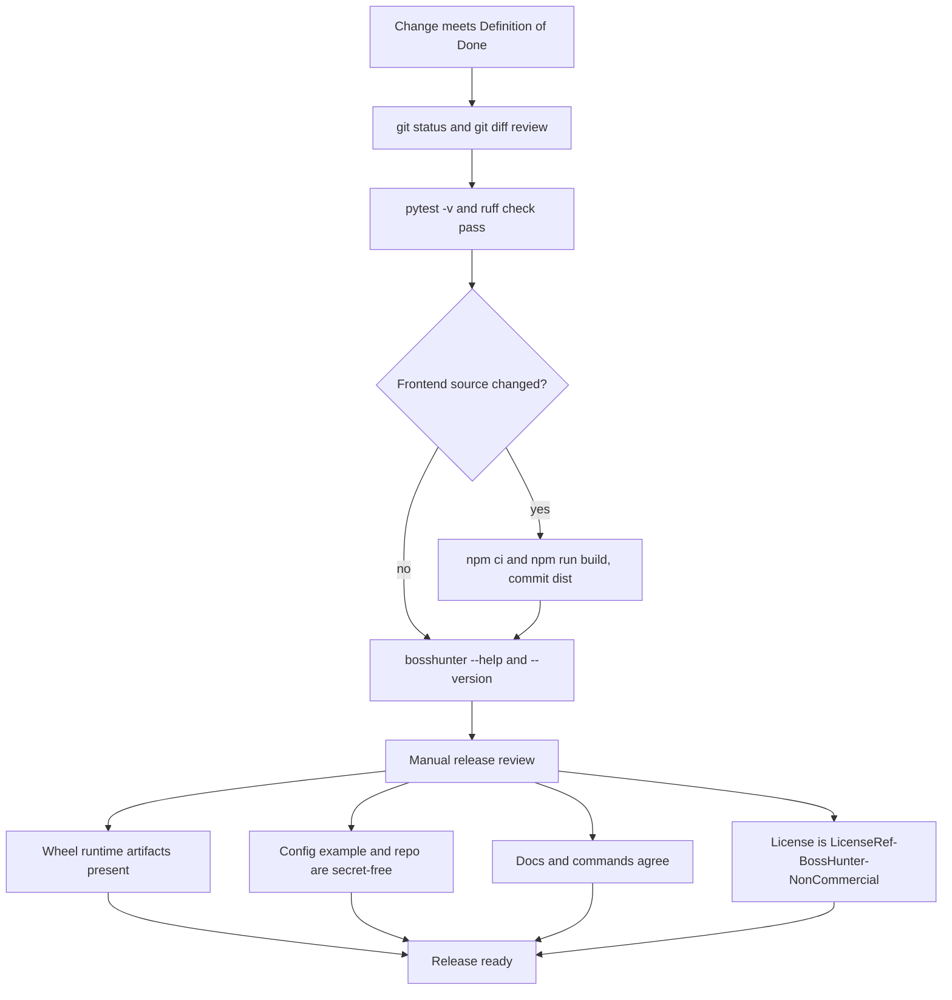

# Release, Maintenance, and Governance

BossHunter is maintained as a stable product, not measured by feature count. `docs/技术手册.md` (§12–§16) is the authoritative governance document, and it defines one completion bar for every change, one release gate, one freeze condition, one maintenance ordering, and one failure-response table. `AGENTS.md`, `CONTRIBUTING.md`, and `pyproject.toml` encode the same rules at the repository level: what is acceptable to merge, how the wheel is built, how the frontend artifact is produced, how Python is formatted, and what the license actually is.

The release gate is a sequence of deterministic checks plus a manual security review. A change is not "done" until the Definition of Done passes, and it is not releasable until every gate below closes.



_Figure 1: a change passes automated verification first, gets a frontend rebuild only when frontend source changed, and then passes four manual release-review checks before it is releasable._

## Definition of Done

A change is finished only when every condition in `docs/技术手册.md#L549-L559` holds simultaneously:

- All acceptance criteria pass, and no out-of-scope requirement was smuggled in.
- Focused tests and the full test suite pass, and `ruff check src/ tests/` passes.
- Any frontend change passes `npm run build` and the `dist/` artifact is synced into the commit.
- The change does not weaken human confirmation, throttling, privacy, or task mutual exclusion.
- New config, commands, or behavior have been documented.
- Logs and API responses do not leak sensitive data.
- `git diff` has been reviewed and contains no unrelated files, runtime data, or keys.

This is the shared bar for all change types, including selector fixes, pipeline changes, Web/API changes, and the assistant agent. The assistant agent has an additional completion contract on top of it (Agent change completion conditions), which is documented on the assistant architecture page rather than re-listed here.

## Requirement admission and small-step changes

Governance starts before code. `docs/技术手册.md#L522-L539` gates every new requirement with five admission questions: does it directly improve the scrape/screen/confirm/communicate/monitor loop; is it a real user problem or reproducible defect; can config, docs, or an existing capability solve it; does it enlarge account, privacy, legal, or maintenance risk; and is there a clear acceptance standard, test approach, and maintainer. The same section defines a default-reject list: bypassing human confirmation, platform safety controls, or captchas; raising default frequency or concurrency purely to increase application volume; generic platform capabilities unrelated to the personal job-hunt loop; features with no writable acceptance criteria or no stable way to test; long-term infrastructure cost without a clear use case; and duplicates that only add a new entrypoint or abstraction layer.

Accepted work follows a small-step discipline (`docs/技术手册.md#L541-L547`): open an issue first with problem, out-of-scope items, risk, and acceptance criteria; for a bug add a failing test first, for a refactor lock existing behavior first; split into independently verifiable steps; touch only files relevant to the task; and finish code, tests, docs, and release artifacts before closing the task.

`CONTRIBUTING.md#L18-L30` narrows the same boundary at the PR level. Accepted PRs are bug fixes, selector adaptations, documentation improvements, and new features that were first discussed in an issue. Rejected PRs are those that raise the default send frequency (raising ban risk for all users), bypass human confirmation (the core safety mechanism), add new methods to evade platform safety detection, or reduce the conservatism of anti-detection strategy such as shortening intervals or widening send windows.

## Feature freeze

Feature freeze is entered once the product reaches the stability bar in `docs/技术手册.md#L565-L573`:

- The core loop completes once from both the CLI and the Web dashboard.
- Key safety tests cover human confirmation, daily limit, send windows, and duplicate sends.
- Install, first-time configuration, stop, and recovery flows are documented and reproducible.
- Known P0/P1 defects are cleared, and P2 defects have an explicit disposition.
- The release check can be executed repeatedly and produces stable results.

During freeze the project accepts only serious bug fixes, security fixes, selector adaptations, and documentation updates. New functionality waits outside the freeze boundary.

## Maintenance priorities and WIP limits

Maintenance is ordered by risk, not by feature count (`docs/技术手册.md#L575-L580`):

```text
security/privacy issues > data corruption or duplicate sends > core flow unavailable
> platform selector adaptation > observability and documentation > experience polish > new features
```

Work in progress is bounded by `docs/技术手册.md#L582-L587`:

- Only one product feature is advanced at a time.
- A feature without completed tests and documentation blocks starting the next feature.
- New ideas enter Issue/Backlog, not code directly.
- Experimental features with low usage and high maintenance cost for two consecutive versions are evaluated for deletion or freezing.

## Stop-development triggers

Development stops and re-enters review when any condition in `docs/技术手册.md#L589-L597` appears: the requirement starts changing product positioning or bypassing safety boundaries; fixing one problem introduces multiple new services or a long-term operational burden; implementation is repeatedly adjusted while acceptance criteria remain unclear or unchanged; tests cannot reproduce the problem stably and real effect depends only on subjective judgment; or the benefit of the change is smaller than its account, privacy, compatibility, or maintenance risk.

## The release gate

`docs/技术手册.md#L599-L610` lists the deterministic pre-release commands:

```bash
git status
git diff
pytest -v
ruff check src/ tests/
bosshunter --help
bosshunter --version
```

The CI workflow runs the entrypoint smoke checks on Python 3.11 and 3.12: it installs the package, then verifies `bosshunter --help`, `bosshunter --version`, and `python -c "import bosshunter"` (`repo://.github/workflows/ci.yml#L9-L40`). Its `ruff check src/` step is marked `continue-on-error: true`, so lint is advisory in CI and the Definition of Done's local `ruff check src/ tests/` remains the hard lint gate.

### Frontend rebuild and `dist/` commit

Frontend source changes are not complete until the production bundle is rebuilt and committed. `npm run build` is defined as `tsc && vite build` in `src/bosshunter/web/frontend/package.json#L7-L9`, so it type-checks and produces the production bundle in one command. `docs/技术手册.md#L499` states that `dist/` is an in-repository release artifact and must be kept in sync after frontend source changes; `AGENTS.md#L37` repeats the same rule. `.gitignore` normally excludes `dist/` but explicitly re-includes the frontend artifact with `!src/bosshunter/web/frontend/dist/` (`repo://.gitignore#L6-L7`), which is why the rebuilt directory shows up in `git diff` and must be committed rather than ignored.

### Wheel artifacts

The wheel must carry the browser runtime files that the Python HTTP facade delegates to. `pyproject.toml` declares `src/bosshunter/browser/runtime/*.mjs` and `src/bosshunter/browser/runtime/site-patterns/*.md` as hatch build artifacts (`repo://pyproject.toml#L39-L44`). The release review therefore verifies the wheel contains `browser/runtime/*.mjs` and `site-patterns/*.md` (`repo://docs/技术手册.md#L622`). These files must not be relocated or dropped from the package.

### Redaction and data hygiene

The release review checks that `config.example.yaml` contains no real API key, personal resume, or internal domain, and that `data/`, `config.yaml`, resumes, and browser session data never entered the commit (`repo://docs/技术手册.md#L624`). `.gitignore` is the enforcement layer: it excludes `config.yaml`, `.env`, and `data/` plus `*.db`, `*.db-shm`, `*.db-wal` (`repo://.gitignore#L22-L32`). `.github/PUBLISH_CHECKLIST.md` adds the pre-publish sweep that supports this check: search for hardcoded keys, confirm `data/` is empty, and confirm every `config.example.yaml` value is a sample (`repo://.github/PUBLISH_CHECKLIST.md#L22-L25`). Secret redaction at the Web API boundary is covered separately on the configuration page.

### Doc/command consistency

The release review requires README, the operations manual, and the technical manual to match the actual commands (`repo://docs/技术手册.md#L625`). Dashboard changes must attach screenshots or recordings, and the PR must list its verification commands (`repo://docs/技术手册.md#L627`).

### License and formatting invariants

The project license is **`LicenseRef-BossHunter-NonCommercial`** as declared in `pyproject.toml#L10`, and `LICENSE` is the "BossHunter Non-Commercial License" (`repo://LICENSE#L1-L5`). It is **not MIT**: `AGENTS.md#L4` calls out a stray README reference, and `README.md#L376` still says "MIT License", so the release check explicitly requires writing the license as `LicenseRef-BossHunter-NonCommercial` and never reproducing the MIT wording (`repo://docs/技术手册.md#L626`).

Python formatting is likewise pinned. `pyproject.toml` sets `line-length = 120` and, in the `[tool.ruff.format]` table, `indent-style = "tab"` (`repo://pyproject.toml#L50-L55`); `AGENTS.md#L41` reinforces that Python source uses tabs, not four spaces. Format only files intentionally changed, and do not run repository-wide reformatting on unrelated files (`repo://docs/技术手册.md#L501`).

## Failure grades P0–P3

Failures are triaged into four grades with matching response obligations (`docs/技术手册.md#L629-L638`):

| Grade | Examples | Response |
| --- | --- | --- |
| P0 | Key or resume leak, confirmation bypass, duplicate bulk send | Stop service immediately, isolate data, revoke credentials, fix first |
| P1 | Core flow unavailable, database corruption, wrong state that risks mis-send | Stop the affected feature, preserve evidence, release a fix after regression tests |
| P2 | Single selector failure, partial AI-provider anomaly, PDF template problem | Degrade or operate manually, schedule a fix |
| P3 | Copy, styling, small experience issues | Enter Backlog and ship with a maintenance release |

During any failure, do not delete the database or browser configuration. Stop tasks first, back up related files, record the version and minimal reproduction steps, and then perform read-only diagnosis (`repo://docs/技术手册.md#L638`).

## Documentation maintenance responsibility

Each documentation surface has an owner (`docs/技术手册.md#L640-L648`):

- User-visible operations or command changes update the operations manual (`docs/操作手册.md`) and CLI help.
- Architecture, state, config, or release-process changes update the technical manual (`docs/技术手册.md`).
- Product-intro changes update `README.md`.
- Contribution-boundary changes update `CONTRIBUTING.md`.
- Security and interaction-behavior changes also review `CLAUDE.md` and `SKILL.md`.

When documentation and implementation conflict, the stricter safety boundary wins, and the document or code is corrected promptly (`repo://docs/技术手册.md#L648`).

## See also

- [System Architecture Overview](/openwiki/architecture/overview.md)
- [Configuration and Environment](/openwiki/operations/configuration.md)
- [Data Layer and Production Infrastructure](/openwiki/operations/data-and-infrastructure.md)
- [Testing strategy](/openwiki/testing/strategy.md)
- [Job hunt pipeline](/openwiki/workflows/job-hunt-pipeline.md)
