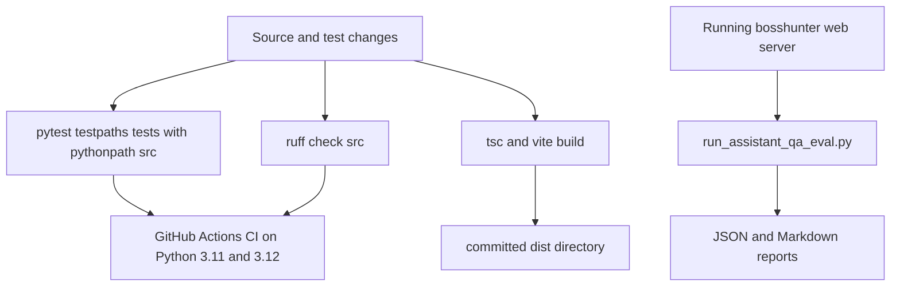

# Testing Strategy and Regression Coverage

BossHunter's test suite is a flat collection of regression modules that protect the system's fragile and safety-critical behavior rather than mirror the source tree one-for-one. There is no live browser, network call, or AI provider in the automated suite: the deterministic tests exercise pure functions, SQLite-in-tempdir state, the Bottle WSGI application directly, and the JavaScript selector/script strings embedded in the sender and monitor. Live automation is validated separately by the assistant QA evaluation script, which replays the documented question-answering cases against a running web server.

The verification layers are layered as follows.

_Figure 1: Deterministic pytest regression suites and static checks run in CI, while the assistant QA script separately replays documented cases against a live local server._

## Discovery and layout

Pytest discovers tests from the repository root with `testpaths = ["tests"]` and imports the package from the `src` layout via `pythonpath = ["src"]` (`pyproject.toml#L46-L48`). Tests are therefore flat modules named `test_<behavior>.py` directly under `tests/`, and they import `bosshunter` without requiring an editable install to have completed. The suite currently contains 45 such modules.

Two styles coexist and are both discovered normally: most files are `unittest.TestCase` classes, while a subset (for example the assistant, semantic-layer, and infrastructure tests) use pytest fixtures such as `tmp_path` and `monkeypatch`. This matters when adding coverage — either style is acceptable, and focused runs use `pytest tests/test_<file>.py -v`.

The Python quality gate is `ruff` with `line-length = 120`, `indent-width = 4`, and `indent-style = "tab"` for formatting (`pyproject.toml#L50-L55`). The authoritative local check is `ruff check src/ tests/`. In CI, `ruff check src/` runs with `continue-on-error: true` (`.github/workflows/ci.yml#L36-L40`), so lint is advisory there and does not by itself block a merge.

## Frontend build gate

The React/TypeScript dashboard has its own validation gate in `src/bosshunter/web/frontend/package.json`: `npm run build` executes `tsc && vite build`, i.e. a strict TypeScript type-check followed by a Vite production bundle. The build emits into `dist/`, and Vite is configured with `outDir: "dist"` and `emptyOutDir: true` (`src/bosshunter/web/frontend/vite.config.ts#L22-L25`). The generated `dist/` directory is committed as a build artifact so the Bottle server can serve the dashboard without a Node toolchain at runtime (`src/bosshunter/web/frontend/dist/index.html`).

## Determinism and mock boundaries

The rule for automated tests is that network, browser/CDP, and AI-provider boundaries must be mocked, and the preferred check is the narrowest quiet validation that proves the changed behavior while preserving complete failure output. The existing suites implement this with `unittest.mock.patch` / `Mock` and pytest `monkeypatch`:

- **Browser/CDP**: sender and monitor tests patch the runtime facade entrypoints — `new_tab`, `evaluate`, `close_tab`, and `time.sleep` — so no real tab or CDP connection is opened. JavaScript selection logic is often asserted directly on the embedded script strings (`CHAT_BUTTON_SCRIPT_FOR_TESTS`, `JS_EXTRACT_CHAT_LIST`, `JS_EXTRACT_CONVERSATION`) rather than executed in a browser.
- **AI providers**: greeter, scorer, monitor, and SQL tool tests patch `_call_claude`, `_send_greeting_once`, `call_anthropic_text`, and similar functions to return canned responses, letting tests assert prompt contents and call counts deterministically.
- **State**: SQLite state is created in `tempfile.TemporaryDirectory()` paths or `sqlite3.connect(":memory:")`, never against the repository's real `data/` database.

## Regression suite map

| Area | Primary modules | What the regression protects |
| --- | --- | --- |
| Web API routes | `tests/test_web_api_routes.py` | Drives the Bottle `server.app(environ, start_response)` WSGI callable directly (no socket). Covers JSON 404s for unknown `/api/*` routes instead of SPA HTML, UTC timestamp serialization, task control, workbench reads, and database-backed route behavior. |
| Web config API | `tests/test_web_config_api.py` | Secret redaction (`api_key_masked`) and config sanitization on read/write paths. |
| Send retry | `tests/test_send_retry.py` | Error classification (`retryable` vs `permanent` vs `stopped`), transient retry short-circuiting, `no_chat_button` diagnostics, `recover_send_errors` re-queueing, and backoff pollution avoidance. |
| Monitor reply detection | `tests/test_monitor_reply_detection.py` | The user's own outgoing message must not be misdetected as an HR reply; `sent → replied` only advances after `_handle_conversation` confirms a real unreplied HR message. |
| Monitor dismiss and navigation | `tests/test_monitor_reply_dismiss.py`, `tests/test_monitor_conversation_navigation.py` | Reply refinement prompt contents, dismissed pending replies not being recreated, and conversation-extraction JS dedup direction (drop container wrappers, keep leaf messages, resolve sender from ancestor without defaulting to HR). |
| Resume PDF and templates | `tests/test_resume_pdf_runtime.py`, `tests/test_resume_templates.py` | Prompt forbids tailoring artifacts; artifact/placeholder phrase detection; modern template base64 avatar and theme, ATS template never embeds an avatar, unknown-template fallback, and resume presentation defaults. |
| Greeter quality and concurrency | `tests/test_greeter_quality.py`, `tests/test_greeter_concurrency.py` | Banned template phrasing, prompt few-shot requirements, no cross-talk between concurrent greeting generations, configurable `greeting_concurrency`, and the deterministic quality gate skipping AI review on obvious failures. |
| Greeting failure recovery | `tests/test_greeting_failure_recovery.py` | `ready` jobs with an empty greeting roll back to `approved` and write an error history row so they stay visible and regenerable. |
| Scorer | `tests/test_scorer_intent.py`, `tests/test_scorer_parallel.py` | Job-intent assembly from profile, score clamping to `[0, 100]`, provider retry, and bounded concurrency where only provider calls overlap while SQLite writes stay safe. |
| Job selection and enrichment | `tests/test_job_selection.py`, `tests/test_job_enrichment.py`, `tests/test_reenrich.py` | Chat-button script anchor preference, unavailable-job-page reporting, real-click fallback, district extraction, company background storage, enrichment filling only missing values, and reenrich failure tolerance. |
| City codes | `tests/test_city_codes.py` | Pins the BOSS city codes for Guangzhou and Shenzhen. |
| Assistant architecture | `tests/test_assistant_architecture.py`, `tests/test_general_agent_architecture.py`, `tests/test_dag_scheduler.py` | Pure-function regression for capability matching, planning, react loop, routing, context resolution, and DAG scheduling; verifies read-only capability recall and negative send constraints. |
| Assistant memory | `tests/test_assistant_memory.py` | Versioned long-term memory: conflict creates an auditable superseding version, same-value writes deduplicate, and restore works. |
| Evidence routing | `tests/test_evidence_routing.py` | Evidence-domain isolation — a direct question enables no read tool, analytics enables only `job_database`, resume analysis only `resume_read`, and web questions only web research. |
| Semantic layer and SQL approval | `tests/test_semantic_layer.py`, `tests/test_sql_approval.py` | Business catalog definitions, query compilation, readonly-SQL validation, and re-validation after approval restore. |

## Assistant QA evaluation

The live assistant behavior is specified in `docs/问答流程测试用例.md`, which enumerates 31 cases (Q01–Q31) across single-turn intent/routing, multi-turn clarification, and high-risk approval flows such as greeting send, HR reply send, and approval resume. The expected outcomes record intent type, route (`direct`, `clarification`, `capability`, `planner`), mode, missing fields, approval, and tool usage.

`scripts/run_assistant_qa_eval.py` turns those cases into an executable black-box check against a running server. It creates an isolated conversation per case, posts each turn to the assistant messages endpoint, infers the effective route from the returned structured intent (mirroring the backend's complex-goal and confidence rules), and stops a multi-turn case as soon as an approval or `interrupted` status appears so it never auto-confirms a side effect. Results are written as timestamped JSON and Markdown reports under `data/assistant-evals`, and the script exits non-zero when any case fails. It first checks `GET /api/health` and returns exit code 2 with a "start `bosshunter web` first" hint if the server is not running.

## CI wiring

The GitHub Actions CI workflow (`github/workflows/ci.yml`) runs on Python 3.11 and 3.12, installs the package with `pip install -e .`, verifies the CLI entry point via `bosshunter --help` and `bosshunter --version`, checks `import bosshunter`, and then runs `ruff check src/` as an advisory step. This is a smoke gate for packaging and entrypoint integrity rather than the full pytest suite; the full suite is run locally with `pytest -v` before opening a PR.

## Adding coverage

A change to scraping selectors, sending, monitoring, greeting generation, resume rendering, the web API, or the assistant's routing/evidence boundaries should ship with a focused regression test in the corresponding flat module. Follow the existing pattern: assert on pure functions or embedded script/prompt strings where possible, patch the outer browser/AI boundary instead of the function under test, and use a temporary database for any stateful check. The narrower and quieter the assertion, the easier it is to trace a failure back to the specific behavior that regressed.
