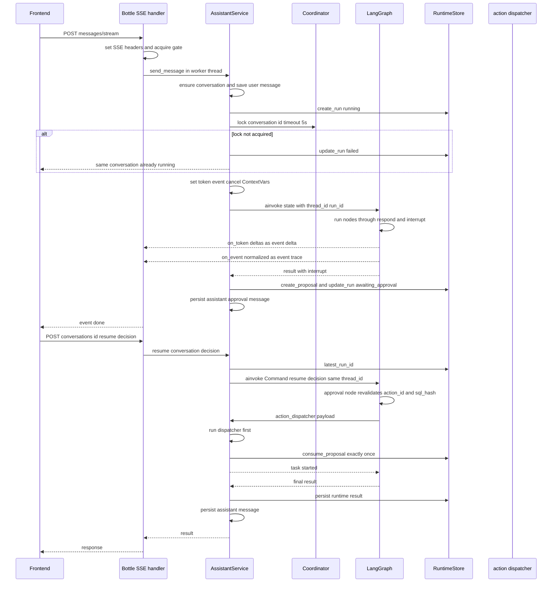
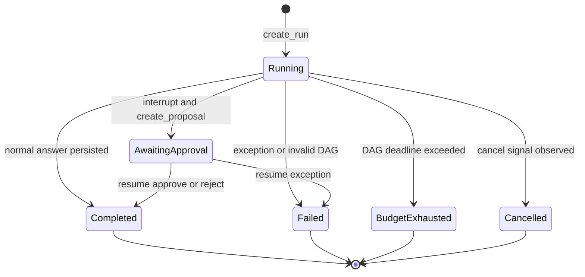

# Assistant Question-Answer and Approval Flow

This page traces a single user message through the assistant from HTTP ingestion to a persisted answer or a persisted approval proposal, and then traces a human decision back through resume and dispatch. It focuses on the **runtime lifecycle** — the boundary code in `AssistantService`, the streaming contract, cancellation, checkpoint recovery, and exactly-once side-effect dispatch. The node-level architecture and the capability/approval model are documented on the [Controlled Assistant Agent Architecture](/openwiki/architecture/assistant-agent.md) and [Capability Registry and Approval Boundary](/openwiki/concepts/capabilities-and-approval.md) pages respectively.

## End-to-end request lifecycle

`AssistantService.send_message()` (`src/bosshunter/assistant/service.py#L108-L150`) is the only entrypoint into LangGraph from the Web API. Its sequence is fixed:

1. **Ingest and persist the user message.** It idempotently ensures the conversation row exists (`ensure_conversation_row`, healing stale browser `conversation_id`s from before the database migration) and persists the user message through `add_message`.
2. **Create the run.** It calls `self._runtime_store.create_run(conversation_id, goal)` to create a unique `run_id` that is also the LangGraph `thread_id`.
3. **Acquire the per-conversation lock.** It opens `self._coordinator.lock(f"conversation:{conversation_id}", timeout_seconds=5)`. If the lock is not acquired, it marks the run `failed` and raises `RuntimeError("同一会话已有 Agent 任务运行")`, so two concurrent messages can never interleave a conversation's state.
4. **Invoke the graph.** `_run_message()` (`src/bosshunter/assistant/service.py#L152-L203`) installs three context-variable callbacks — `TOKEN_CALLBACK`, `EXECUTION_EVENT_CALLBACK`, and `CANCEL_CHECK_CALLBACK` — then runs `self.graph.ainvoke(...)` with `config={"configurable": {"thread_id": run_id, "user_id": "local"}}`.
5. **Persist and return.** After `ainvoke` returns, the result is normalized into the runtime store and the business message store, then returned to the API.

The graph runs on a dedicated `asyncio.SelectorEventLoop` created at service construction (`src/bosshunter/assistant/service.py#L43-L64`), because the async PostgreSQL checkpoint connection does not support the Windows Proactor event loop. The checkpoint saver itself is an `AsyncPostgresSaver` created inside that loop (`src/bosshunter/assistant/graph.py#L2029-L2045`), so every node transition is persisted against `thread_id = run_id`.

_Figure 1: A message run from ingestion through streaming, approval interrupt, and resume with exactly-once dispatch. Cancellation is omitted for clarity and covered below._

### Inside the graph

The graph is a fixed 15-node `StateGraph` (`src/bosshunter/assistant/graph.py#L1959-L2024`). Every run starts at `context_resolver → goal_extractor → ambiguity_checker`; `route_after_understanding` then selects `clarification`, `sql_prepare`, `execution_engine` (direct answer), `capability_matcher`, or `planner`. Read-only work terminates in the `execution_engine` (`respond`); a side effect becomes a `pending_action` and `route_after_response` diverts it to the `approval` node, which pauses on LangGraph `interrupt()`. The `result_processor` normalizes the final summary and ends the turn.

Two special edges matter for the flow:

- `sql_prepare` routes directly to `approval` (`src/bosshunter/assistant/graph.py#L1989`). A `job_query` intent generates read-only SQL, freezes it with a `sql_hash`, and pauses **before** any business data is read.
- After `approval`, `route_after_approval` returns to `execution_engine` only when `sql_execution_completed` is set (the approved SQL produced evidence to answer with); every other approval decision ends at `result_processor` (`src/bosshunter/assistant/graph.py#L1955-L1957`).

## Streaming contract

The streaming path is the `POST /api/assistant/conversations/<id>/messages/stream` endpoint (`src/bosshunter/web/server.py#L1530-L1625`). It sets SSE headers, acquires a per-conversation gate, and starts a daemon thread running the blocking `send_message` with three callbacks wired to an in-process queue. The generator emits:

| SSE event | Payload | Source |
| --- | --- | --- |
| `start` | `{"run_id": ...}` | `on_run` callback |
| `delta` | `{"delta": "<token>"}` | `TOKEN_CALLBACK` |
| `trace` | a normalized execution event | `EXECUTION_EVENT_CALLBACK` |
| `done` | message metadata plus `status` | the returned `send_message` result |
| `error` | an error message, then the stream ends | any raised exception |
| `ping` | empty keepalive | 15s idle or while paused |

Token deltas come from the `respond` node, which streams `stream_ai_text` chunks directly to `TOKEN_CALLBACK` (`src/bosshunter/assistant/graph.py#L1805-L1809`). Cached answers (the deterministic smalltalk reply, or a cached ReAct answer) are replayed through `_emit_answer_as_stream`, which paces the text out in small chunks at a near-reading rhythm instead of dumping it at once (`src/bosshunter/assistant/graph.py#L111-L123`).

Pause and resume are a forwarding gate, not a cancellation: `POST .../stream/pause` clears a per-conversation `threading.Event` and `POST .../stream/resume` reopens it, while the worker keeps generating and the generator keeps yielding `ping` keepalives (`src/bosshunter/web/server.py#L1628-L1645`).

### Execution-event normalization

Every `_emit_execution_event` call becomes a version-2 event before it is forwarded. `normalize_execution_event`/`upsert_execution_event` (`src/bosshunter/assistant/execution_events.py#L46-L104`) derive a `kind`, `phase`, and `parent_id` from the stable event ID, stamp UTC `started_at`/`finished_at` timestamps, and compute `duration_ms` only for terminal statuses. `upsert_execution_event` updates an event in place by ID while preserving first-seen ordering. `handle_event` in the service publishes the normalized event to the coordinator and to the SSE `trace` channel (`src/bosshunter/assistant/service.py#L135-L141`).

## Persistence and run states

After the graph returns, `_run_message` calls `_persist_runtime_result` and then `_persist_result` (`src/bosshunter/assistant/service.py#L152-L203`).

`_persist_runtime_result` (`src/bosshunter/assistant/service.py#L233-L259`) writes the audit facts:

- every `execution_plan` step is saved idempotently with its DAG result;
- every `react_observation` is saved; observations whose serialized JSON exceeds 16 KiB are written to the artifact store and replaced in the run state by a `data_ref`;
- if the result contains `__interrupt__`, the frozen proposal is persisted via `create_proposal` and the run is marked `awaiting_approval`;
- otherwise the run is marked with the DAG status, mapped to `failed` for `failed`/`invalid`.

`_persist_result` (`src/bosshunter/assistant/service.py#L261-L327`) saves the final assistant message with rich metadata (run id, citations, approval, task, tool trace, execution plan, execution events, intent, result summary, evidence route/tasks/results/coverage, plan evaluation, DAG result, replan count, context usage, and memory updates), and clears the cross-run pending intent for non-clarification turns.

Run statuses are `running`, `awaiting_approval`, `completed`, `failed`, `cancelled`, and `budget_exhausted`. The store records `finished_at` only for terminal statuses (`src/bosshunter/infrastructure/runtime_store.py#L133-L141`).

_Figure 2: Run lifecycle. `Cancelled` is written directly by `cancel()`; a cancelled run never reaches assistant-message persistence._

## Cooperative cancellation

Cancellation never kills a worker thread or a model call. `AssistantService.cancel(run_id)` (`src/bosshunter/assistant/service.py#L228-L231`) writes a cancel signal and marks the run `cancelled`. In multi-instance mode `RedisCoordinator.request_cancel` sets a Redis key with a one-hour TTL (`src/bosshunter/infrastructure/coordination.py#L127-L133`); `is_cancelled` reads that key. The graph checks the signal through `CANCEL_CHECK_CALLBACK`, which is wired to `lambda: self._coordinator.is_cancelled(run_id)`.

The safe checkpoint is the `DagScheduler` loop: between dependency batches it consults `cancel_check`, marks all still-pending steps `skipped` with `"用户取消任务"`, and returns a `cancelled` run result (`src/bosshunter/assistant/dag_scheduler.py#L100-L105`). When `ainvoke` returns, `_run_message` checks `is_cancelled` again and, if set, returns a `{"status": "cancelled", "message": None}` envelope **without** calling `_persist_runtime_result` or `_persist_result` (`src/bosshunter/assistant/service.py#L194-L201`). A cancelled partial answer is therefore not persisted as a complete assistant message.

The frontend owns the partial-answer save: `POST /api/assistant/conversations/<id>/messages/partial` stores the accumulated content as an assistant message marked `interrupted`, so it remains available as context for follow-up questions (`src/bosshunter/web/server.py#L1648-L1666`).

## Checkpoint recovery and resume

Resume is checkpoint recovery, not a fresh run. `AssistantService.resume(conversation_id, decision)` (`src/bosshunter/assistant/service.py#L205-L226`) looks up the conversation's latest run with `latest_run_id`, then re-invokes the graph with `Command(resume=decision)` and the **same** `thread_id`. Because the checkpoint is PostgreSQL-backed and keyed by run ID, the graph resumes exactly at the `interrupt()` call in the `approval` node with its full `AssistantState` intact.

The Web API validates the decision envelope before calling resume: `action` must be `approve`, `edit`, or `reject`, and `edit` requires `edited_reply` (`src/bosshunter/web/server.py#L1679-L1700`). The resume exception path updates the run to `failed`, so a broken resume cannot leave a run permanently stuck in `awaiting_approval` (`src/bosshunter/assistant/service.py#L214-L220`).

## Approval resume and exactly-once dispatch

Inside the resumed `approval` node (`src/bosshunter/assistant/graph.py#L1836-L1949`), the proposal is re-validated before anything runs:

- The returned `action_id` must equal the paused proposal's `action_id`; a stale or missing match is rejected with no side effect.
- For read-only SQL, an `edit` re-runs `validate_readonly_sql`, recomputes the `sql_hash`, and calls `interrupt()` a second time so the edited SQL needs a fresh confirmation. On `approve`, the client-supplied hash must match the current hash before `execute_database_query` runs.
- `send_greetings`/`send_hr_reply` approvals require at least one `selected_item_id`.
- On `reject`, no side effect runs and the plan's approve/execute steps are marked `stopped`.

Side-effect approvals are handed to the fixed `action_dispatcher`, guarded by `AssistantService._dispatch_action` (`src/bosshunter/assistant/service.py#L66-L79`). External actions must re-validate the proposal and business state before dispatch, and proposals must be consumed exactly once:

1. An empty or already-consumed `action_id` raises `ValueError`.
2. The dispatcher must be available.
3. The dispatcher runs **first**; if it raises (for example, a missing resume), the proposal stays `pending` so the user can fix and re-approve instead of losing the proposal to a permanent `consumed` mark.
4. Only after a successful dispatch does the service call `consume_proposal()` and record the action ID in the in-memory `_consumed_actions` set.

`consume_proposal` is the persistent exactly-once primitive: both stores atomically transition only a `pending` proposal to `consumed` and return whether exactly one row changed (`src/bosshunter/infrastructure/runtime_store.py#L186-L194`, `src/bosshunter/infrastructure/runtime_store.py#L309-L317`). The `action_proposals` row retains the frozen arguments, the approved arguments, `expires_at`, and `consumed_at` for audit.

## Invariants and failure semantics

- **A conversation serializes its runs.** The coordinator lock is the truth boundary; a concurrent same-conversation request fails rather than interleaving graph state.
- **The model cannot authorize its own side effect.** Every side-effect path terminates in `interrupt()` and a persisted proposal; autonomous executors (`DagScheduler` and the ReAct loop) refuse non-read-only capabilities.
- **Resume re-validates, never trusts storage.** `action_id` and the SQL hash are rechecked at the paused node, and read-only SQL is re-validated on both `edit` and `approve`.
- **Dispatch is transactional and exactly-once.** Consumption follows a successful dispatch and uses a conditional `UPDATE ... WHERE status = 'pending'` with `rowcount == 1`; the in-memory set is a secondary guard, not the source of truth.
- **A failed dispatch preserves the proposal.** Consumption is ordered after dispatch, so a transient or validation failure leaves the proposal `pending` for correction.
- **Cancellation is cooperative and non-destructive to the conversation.** A cancelled run is marked terminal but its partial answer is never persisted as a complete assistant message; the frontend may persist the partial text separately as `interrupted`.

## Configuration and operations

- Runtime infrastructure requires a PostgreSQL `database.url`; `create_runtime_store()` fails fast rather than silently downgrading to SQLite, and `build_assistant_graph()` uses `AsyncPostgresSaver` for the checkpoint that makes resume possible (`src/bosshunter/infrastructure/runtime_store.py#L355-L361`, `src/bosshunter/assistant/graph.py#L2029-L2045`).
- The coordinator is selected by `create_coordinator`: with `runtime.redis_url` it uses `RedisCoordinator` (auto-renewing distributed locks, TTL cancel signals, Redis Stream events); without Redis it falls back to `LocalCoordinator` unless `runtime.redis_required=true` (`src/bosshunter/infrastructure/coordination.py#L141-L157`).
- The SSE stream runs on the threaded Bottle server, so a long-lived stream does not starve other API endpoints (`src/bosshunter/web/server.py#L2129-L2167`).
- Over-sized observations (greater than 16 KiB) are offloaded to the artifact store with a `data_ref` in run state, bounding model context, database rows, and SSE payloads.

## Focused tests

The flow is locked by regression tests rather than end-to-end model assertions:

- `tests/test_agent_infrastructure.py` proves runs, DAG steps, and observations persist, proposals are idempotent, and a proposal can be consumed exactly once (`repo://tests/test_agent_infrastructure.py#L13-L33`). It also locks local/Redis coordinator cancel, lock, and factory behavior.
- `tests/test_dag_scheduler.py` covers parallel readiness, dependency-result passing, failure propagation to descendants only, cycle rejection, step timeout, and the approval branch stopping without execution. It also asserts a multi-company plan flows through the generic DAG end to end (`repo://tests/test_dag_scheduler.py#L78-L101`, `repo://tests/test_dag_scheduler.py#L133-L183`).
- `tests/test_sql_approval.py` verifies SQL is planned but not executed before approval, is re-validated on the resume path, and rejects writes and multi-statement payloads (`repo://tests/test_sql_approval.py#L14-L46`).
- `tests/test_assistant_agent.py` covers the entrypoint-adjacent pieces: the intent contract, answer-mode side-effect rejection, the local fast smalltalk answer, and multi-turn message and explicit-memory persistence (`repo://tests/test_assistant_agent.py#L63-L120`).
- `tests/test_web_api_routes.py` exercises the HTTP contract for the assistant message send, stream, cancel, resume, and partial-persistence routes.

## Related pages

- [Controlled Assistant Agent Architecture](/openwiki/architecture/assistant-agent.md)
- [Capability Registry and Approval Boundary](/openwiki/concepts/capabilities-and-approval.md)
- [Web API Surface and Local Access](/openwiki/integrations/web-api.md)
- [Data and Infrastructure](/openwiki/operations/data-and-infrastructure.md)
- [Testing Strategy](/openwiki/testing/strategy.md)
