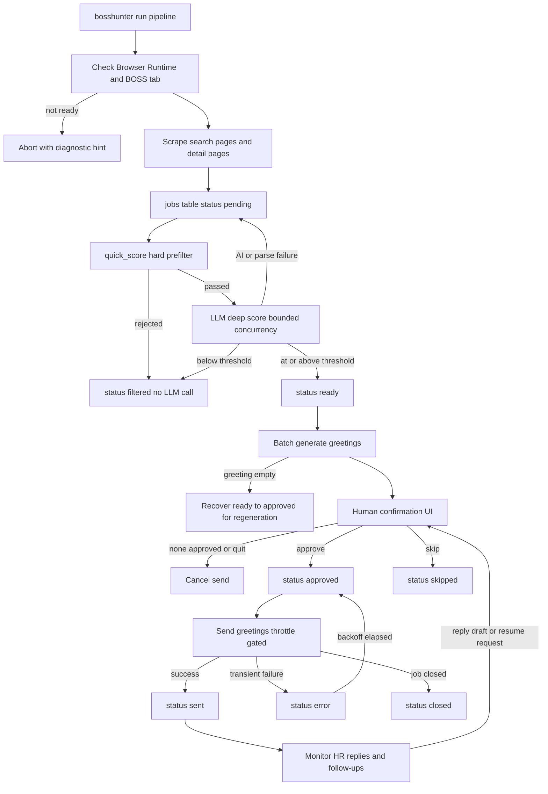

# Job Hunt Pipeline (Scrape to Monitor)

The job-hunt pipeline is the top-level loop BossHunter runs to move a job from a
BOSS直聘 search result to a sent greeting and an actively monitored
conversation. It is orchestrated by `run_pipeline` in
`src/bosshunter/pipeline.py`, and its individual stages are also exposed as
separate CLI subcommands so a user can resume a half-finished run without
re-scraping. The pipeline is human-in-the-loop by design: AI and browser
automation can collect, score, and draft, but a job is never sent until a human
explicitly approves it.

## Canonical stage order

The stage order is fixed and must not be reordered when editing:

```text
scrape → prefilter → score → confirm → greet → send → monitor
```

Two details reconcile this list with the code as written:

- **`prefilter` is the first half of the scoring stage.** `score_jobs` runs the
  free `quick_score` hard filter before any LLM call, then deep-scores only the
  survivors (`src/bosshunter/ai/scorer.py#L401-L415`).
- **`greet` is folded into scoring in the one-shot path.** Passing jobs are set
  to `ready` and their greetings are batch-generated during the scoring stage,
  so the confirmation UI can preview and regenerate them
  (`src/bosshunter/pipeline.py#L37-L48`). The standalone `greet` command and the
  confirmation UI's `r` action cover regeneration and the recovery of jobs whose
  greeting generation failed.

Both readings share one invariant: a greeting is never sent before human
confirmation, and an `approved` job with an empty greeting is invisible to the
sender until it is regenerated.

## Entrypoints

- `bosshunter run` invokes `run_pipeline(config)` and drives the whole loop end
  to end (`src/bosshunter/main.py#L235-L245`).
- The individual stage commands are `scrape`, `reenrich`, `score`, `confirm`,
  `greet`, `send`, and `monitor`, each mapping to the stage functions described
  below (`src/bosshunter/main.py#L120-L304`).
- The web dashboard runs the same stage functions through a single-active
  `WorkbenchTaskRunner`; the assistant proposes side effects that enter the same
  confirmation and task gates rather than driving the loop directly
  (`/openwiki/architecture/overview.md`).

## End-to-end flow



_Figure 1: The fixed scrape → prefilter → score → confirm → greet → send →
monitor order, with the failure paths that keep jobs retryable and the human
confirmation gate in the middle. Greeting generation is drawn inside the score
stage to match the one-shot path; regeneration after confirm re-enters the same
`ready` → confirmation surface._

## Stage 1: Scrape

`scrape_jobs(config, keywords, limit=None)` in
`src/bosshunter/scraper/jobs.py` is the collection stage. It:

- Resolves cities from `search.cities`, then `profile.target_cities`, then
  `["北京"]`, maps them through `CITY_CODES`, and builds a city × keyword
  search matrix. Unknown cities are skipped, and pagination is bounded by
  `search.max_pages` (hard-capped at 10), with `sort: newest` adding
  `&sortType=2` (`src/bosshunter/scraper/jobs.py#L232-L285`).
- Drives the browser runtime through the `new_tab` / `wait_for_load` / `scroll`
  / `evaluate` facade, extracting job cards with `JS_EXTRACT_LIST` and full
  detail pages with `JS_EXTRACT_DETAIL`
  (`src/bosshunter/scraper/jobs.py#L42-L184`).
- Derives a stable job id from the detail URL path
  (`/job_detail/{id}.html`, `/share/job/{id}`, extensionless), falling back to
  an md5-derived id so the platform changing path shapes does not break imports
  (`src/bosshunter/scraper/jobs.py#L187-L203`).
- Deduplicates on that id: an existing job whose `district`,
  `company_background`, and `registered_capital` are all populated is skipped;
  otherwise the detail page is re-opened and only blank enrichment fields are
  filled via `update_job_enrichment`. New jobs are inserted with the schema
  default `status = 'pending'` (`src/bosshunter/scraper/jobs.py#L343-L416`,
  `src/bosshunter/db.py#L300-L331`).
- Applies a light collection-time skip for deal-breaker titles and
  agency/headhunter company names, and paces itself with a `PageThrottle`
  (2–5 s) plus a random 3–6 s page pause to stay under the radar
  (`src/bosshunter/scraper/jobs.py#L349-L420`).

The same module also owns `reenrich_jobs` (re-open pages to fill missing
metadata without touching score, status, greeting, or JD),
`import_job_by_url` (targeted one-shot collection that deliberately skips
automated filtering), and `search_jobs_by_company_title` (cheap list-only search
for the dashboard import tab).

### Selector fragility

`JS_EXTRACT_LIST` and `JS_EXTRACT_DETAIL` encode the current BOSS直聘 DOM
(`.job-card-wrap`, `.job-name`, `.info-primary .name h1`, `.sider-company`, and
friends). These selectors are the most fragile part of the pipeline: a site
redesign silently yields empty extraction rather than an exception. Any selector
change must be accompanied by a deterministic regression test; the relevant
suites are `tests/test_job_selection.py`, `tests/test_job_enrichment.py`,
`tests/test_reenrich.py`, and `tests/test_import_job.py`
(`/openwiki/operations/browser-runtime.md`).

## Stage 2: Prefilter

`quick_score(job, config)` in `src/bosshunter/ai/prefilter.py` is the free hard
filter that runs before the LLM. It returns `(100, "预筛通过")` or
`(0, reason)` and rejects on:

- a `profile.deal_breakers` keyword in the job title,
- an agency/headhunter company name via `is_agency_company`,
- an internship/management-trainee title signal unless
  `profile.allow_internship` is true,
- a parsed salary maximum below `profile.salary_min`, and
- a parsed registered capital below `scoring.min_registered_capital_wan`
  (default 50) — only when a value was actually parsed, so un-enriched jobs are
  kept rather than wrongly dropped (`src/bosshunter/ai/prefilter.py#L11-L41`).

A zero quick score is persisted as `score = 0` and `status = 'filtered'` without
spending an API call; the scorer prints how many LLM calls the prefilter saved
(`src/bosshunter/ai/scorer.py#L454-L455`).

## Stage 3: Score

`score_jobs(config)` in `src/bosshunter/ai/scorer.py` selects only `pending`
jobs whose title is non-empty and not the `HR主动沟通` placeholder and whose JD
is non-empty, then runs the two-stage evaluation
(`src/bosshunter/ai/scorer.py#L373-L381`):

- **Prefilter loop** (caller thread): `quick_score` first, writing
  `quick_score`, and moving a zero score straight to `filtered`
  (`src/bosshunter/ai/scorer.py#L401-L415`).
- **Deep LLM scoring** (bounded thread pool): survivors are scored with
  `SCORING_PROMPT`, which feeds the resume (first 3000 chars), a built
  job-intent summary, and the job's company/location/capital/salary/JD fields.
  Concurrency is `scoring.concurrency` (default 3, clamped to 5); the cheap
  prefilter and all SQLite writes stay on the caller thread so connections are
  never shared across threads (`src/bosshunter/ai/scorer.py#L366-L372`,
  `src/bosshunter/ai/scorer.py#L417-L452`).

The outcomes are:

- score clamped to 0–100 at or above `scoring.threshold` (default 60) →
  `pending -> ready`, collected for greeting generation;
- below threshold → `pending -> filtered`;
- AI call failure or JSON parse failure → the job stays `pending` so it is
  retryable after an AI configuration fix
  (`src/bosshunter/ai/scorer.py#L434-L457`).

The scorer also honors cooperative cancellation through
`config["_workbench_stop_event"]`, checking it between prefilter iterations and
cancelling pending futures (`src/bosshunter/ai/scorer.py#L401-L403`,
`src/bosshunter/ai/scorer.py#L421-L452`).

## Stage 4: Greet (batch generation inside scoring)

After the scoring loop, the scorer batch-generates greetings for every passed
job with `generate_greetings_batch(..., with_review=True)` and writes the
results back to `jobs.greeting` (`src/bosshunter/ai/scorer.py#L459-L468`). The
greeter itself lives in `src/bosshunter/ai/greeter.py`:

- `GREETING_PROMPT` asks for a three-sentence IM message of 55–110 characters
  that opens with "您好，", anchors on one job-specific signal, cites one
  verifiable resume fact, and ends with an easy-to-answer question; it forbids
  template openers and fabricating resume facts
  (`src/bosshunter/ai/greeter.py#L28-L65`).
- The self-review loop regenerates against `REVIEW_PROMPT` feedback until the
  average passes `ai.greeting_review_threshold` (default 7.0), `truthfulness`
  ≥ 8, and `replyability` ≥ 7, bounded by `ai.greeting_max_iterations`
  (default 2) (`src/bosshunter/ai/greeter.py#L224-L276`).
- Deterministic `_quality_issues` checks (length 45–120 chars, "您好，" opening,
  banned-phrase list, first-person overuse, sentence punctuation, question
  ending) run first and can short-circuit the AI review when they already
  surface a fixable critique (`src/bosshunter/ai/greeter.py#L138-L156`).
- Concurrency is `ai.greeting_concurrency` (default 4, clamped to ≥1); AI calls
  run in a `ThreadPoolExecutor` while DB writes and Rich progress updates stay
  on the main thread to avoid cross-thread SQLite and interleaved output
  (`src/bosshunter/ai/greeter.py#L279-L376`).

### Greeting-failure recovery

Greeting generation is deliberately non-fatal to scoring. `score_jobs` calls
`_recover_jobs_with_failed_greetings` after the batch whether or not it
succeeded: any passed job whose `greeting` is still empty is rolled back from
`ready` to `approved` and gets an `error` history row
(`src/bosshunter/ai/scorer.py#L28-L48`,
`src/bosshunter/ai/scorer.py#L459-L468`).

This rollback exists because the sender filters empty greetings and the
confirmation UI only lists `ready` jobs. Without it, an empty-greeting `ready`
job would be permanently invisible. After rollback it is selectable by
`get_jobs_needing_greeting` (status in `approved`/`ready` with an empty
greeting) and can be regenerated by `bosshunter greet`, which writes the
greeting and returns the job to `ready` for confirmation
(`src/bosshunter/db.py#L557-L570`,
`src/bosshunter/ai/greeter.py#L324-L376`).

## Stage 5: Confirm (the human gate)

`show_confirmation(config)` in `src/bosshunter/ui/confirm.py` is the mandatory
review point. It selects `get_jobs_pending_confirmation` (status `ready`, ordered
by score descending), renders a table with the score reason and greeting
preview, and offers `a` (approve all), `s` (individual selection), or `q`
(cancel) (`src/bosshunter/ui/confirm.py#L24-L90`).

Individual selection walks each job with actions `y` (approve), `n` (skip),
`e` (edit greeting then approve), `r` (regenerate then re-decide), and `q`
(quit). The default is deliberately `n`, so a blind Enter or empty scripted
input can never approve a sensitive send; `y` must be an explicit choice
(`src/bosshunter/ui/confirm.py#L92-L149`). Approving writes `ready -> approved`
plus a history row; skipping writes `ready -> skipped`.

The send-side counterpart of this gate is `get_jobs_ready_to_send`, which
returns only `approved` jobs with a non-empty greeting — `ready` jobs have a
generated greeting but have not been reviewed, so the sender can never pick
them up (`src/bosshunter/db.py#L512-L535`).

## Stage 6: Send

`send_greetings(config, force=False)` in `src/bosshunter/executor/sender.py`
sends only `approved` jobs with greetings and enforces the anti-ban throttle
(`/openwiki/concepts/throttling-and-safety.md`):

- random day off (`day_off_probability`, default 0.05) and send-window check,
  both skippable with `--force`;
- backoff-window auto-recovery of stale `error` jobs back to `approved`
  (`auto_recover_send_errors`, default true) via `recover_send_errors`;
- a daily quota from `daily_limit` (default 30) counted from
  `history.action='sent'`, and randomized intervals (`interval_min`/`interval_max`)
  (`src/bosshunter/executor/sender.py#L718-L780`).

Per job, the sender retries transient errors (runtime not ready, slow page,
selector drift) with a short backoff, then classifies the final result
(`src/bosshunter/executor/sender.py#L146-L182`,
`src/bosshunter/executor/sender.py#L793-L908`):

- success → `history(action='sent')` is written *before* the status update, so
  the daily quota stays accurate across a crash, then `approved -> sent` and the
  `conversation_id` is persisted;
- `job_closed` / `job_page_unavailable` → `approved -> closed`;
- `already_sent` idempotency guard → converged to `sent` instead of re-sending;
- other failures → `approved -> error` with `error_retry_count` incremented and
  progressive backoff, stopping on captcha/rate-limit/blocked signals.

`recover_send_errors` moves stale `error` jobs back to `approved` (never
`ready`) after the backoff window, preserving the fact that they were already
human-confirmed; jobs that exhaust `send_error_max_retries` stay in `error`
until explicitly retried from the workbench (`src/bosshunter/db.py#L414-L451`).

## Stage 7: Monitor

After sending, `run_pipeline` enters an interruptible loop that calls
`monitor_and_send_resumes(config)` every `monitor.interval` minutes (default
30) (`src/bosshunter/pipeline.py#L61-L88`). The monitor
(`src/bosshunter/executor/monitor.py`) first checks the 09:00–16:00 send
window, then:

1. detects HR replies from the chat list and opens each conversation to
   classify the action; a job advances `sent -> replied` only when the action is
   `reply_pending` or `auto_replied` **and** the prior status is `sent`, so a
   message the user themselves sent is never counted as an HR reply
   (`src/bosshunter/executor/monitor.py#L1656-L1720`);
2. generates reply suggestions saved for manual confirmation (or auto-sent when
   enabled), and records resume-request flags for the manual
   resume-send queue;
3. runs follow-ups only on jobs with no HR reply this cycle
   (`src/bosshunter/executor/monitor.py#L1738-L1744`).

Reply drafts and resume-request cards only classify and generate — they never
auto-click or auto-send — and re-enter human approval through the workbench
rather than through the CLI pipeline loop.

## Configuration and operations

The stage behavior is driven by `config.yaml` (canonical semantics in
`config.example.yaml`):

- collection: `search.keywords`, `search.cities`, `search.max_pages`,
  `search.sort`;
- filtering/scoring: `profile.deal_breakers`, `profile.salary_min`,
  `profile.allow_internship`, `scoring.threshold`, `scoring.concurrency`,
  `scoring.min_registered_capital_wan`;
- greeting: `ai.greeting_review_threshold`, `ai.greeting_max_iterations`,
  `ai.greeting_concurrency`, plus `profile.extra_highlights` and
  `profile.portfolio_url`;
- sending: `throttle.daily_limit`, `throttle.send_windows`,
  `throttle.day_off_probability`, `throttle.send_max_retries`,
  `throttle.auto_recover_send_errors`, `throttle.send_error_recover_seconds`,
  `throttle.send_error_max_retries`;
- monitoring: `monitor.interval`, `monitor.auto_reply_hr_questions`,
  `follow_up.enabled`.

The pipeline can be resumed stage-by-stage: `bosshunter scrape` for collection,
`bosshunter reenrich` to fill missing company metadata, `bosshunter score` to
score and generate greetings, `bosshunter confirm` to approve, `bosshunter
greet` to regenerate missing greetings, `bosshunter send` to deliver, and
`bosshunter monitor` for reply handling.

## Focused tests

- Selector/collection regression:
  `tests/test_job_selection.py`, `tests/test_job_enrichment.py`,
  `tests/test_reenrich.py`, `tests/test_import_job.py`.
- Prefilter rules: `tests/test_job_filters.py`.
- Scoring behavior: `tests/test_scorer_parallel.py`,
  `tests/test_scorer_intent.py`.
- Greeting quality, concurrency, and recovery: `tests/test_greeter_quality.py`,
  `tests/test_greeter_concurrency.py`,
  `tests/test_greeting_failure_recovery.py`.
- Send retry and idempotency: `tests/test_send_retry.py`.
- Monitor reply detection and navigation: `tests/test_monitor_reply_detection.py`,
  `tests/test_monitor_reply_dismiss.py`,
  `tests/test_monitor_conversation_navigation.py`,
  `tests/test_monitor_manual_chat.py`.

## Relationships

- `/openwiki/architecture/overview.md` — system map, the fixed loop, and the
  safety invariants this page elaborates.
- `/openwiki/concepts/job-state-machine.md` — the status vocabulary and legal
  transitions each stage performs.
- `/openwiki/integrations/ai-providers.md` — provider dispatch used by the
  scorer, greeter, and monitor.
- `/openwiki/operations/browser-runtime.md` — the CDP facade and login
  assumptions behind scraping, sending, and monitoring.
- `/openwiki/workflows/sending-and-monitoring.md` — the send and monitor phases
  in depth.
