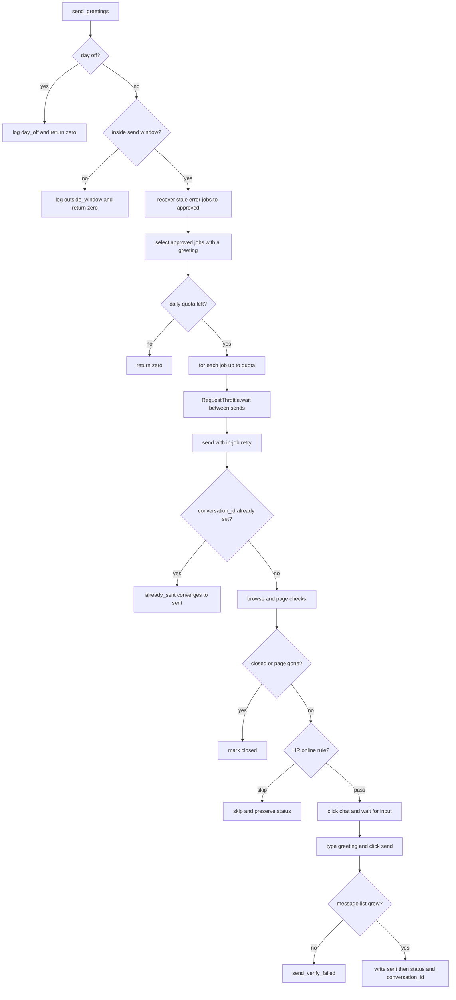
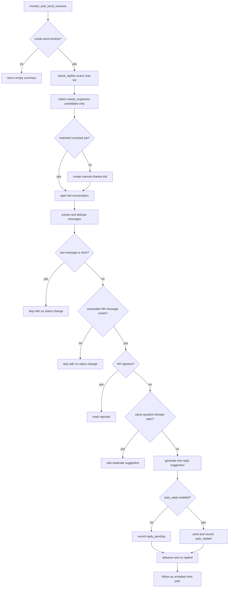

# Sending, Reply Monitoring, and Follow-up

This page covers the two outbound phases that touch BOSS直聘 after a job has
been human-approved: the greeting sender and the reply monitor/follow-up loop.
Both live under `src/bosshunter/executor/`, reuse the throttle and safety
primitives from `/openwiki/concepts/throttling-and-safety.md`, and advance the
job statuses defined in `/openwiki/concepts/job-state-machine.md`.

The sender (`src/bosshunter/executor/sender.py`) turns `approved` jobs with a
non-empty greeting into `sent` jobs, with in-job retry, backoff-window recovery,
and an idempotency guard against duplicate greetings. The monitor
(`src/bosshunter/executor/monitor.py`) scans the chat list, opens each candidate
conversation to verify that HR really sent an unanswered message, and only then
generates a reply suggestion or auto-reply and advances `sent -> replied`. The
monitor also classifies resume-request cards and runs one follow-up per job that
never got an HR reply.

## Send flow

### Entrypoint and pre-flight gates

`send_greetings(config, force=False)` is the entrypoint
(`repo://src/bosshunter/executor/sender.py#L709-L717`). Before touching any job
it runs the same pre-flight gates documented in
`/openwiki/concepts/throttling-and-safety.md`:

1. Random day-off roll (`day_off_probability`) and send-window check, both
   bypassable with `force`.
2. Optional auto-recovery of stale `error` jobs via `recover_send_errors`, which
   re-queues them to `approved` (never `ready`) after the backoff window.
3. Selection through `get_jobs_ready_to_send`, which returns only `approved`
   jobs with a non-empty greeting; `ready` jobs are invisible to the sender
   (`repo://src/bosshunter/db.py#L512-L535`). Workbench runs may restrict this
   further to an explicit job-id list or explicitly include `error` jobs.
4. A daily quota counted against `history.action='sent'` rows for today, which
   slices the queue to `daily_limit - already_sent`
   (`repo://src/bosshunter/executor/sender.py#L760-L780`).

A job that reaches the sender with an empty greeting is moved to `error` rather
than being sent blank (`repo://src/bosshunter/executor/sender.py#L798-L802`).

### Per-job send attempt

Each job is processed by `_send_greeting_with_retry`, which wraps one or more
`_send_greeting_once` attempts (`repo://src/bosshunter/executor/sender.py#L669-L706`).
The single-attempt path (`repo://src/bosshunter/executor/sender.py#L402-L666`)
performs, in order:

1. **Idempotency guard**: if the job already has a `conversation_id`, return
   `already_sent` without opening a page. The send path persists
   `conversation_id` immediately after a verified send, so this closes the
   "send succeeded but accounting crashed" window.
2. **Open the job page** in a new tab, and optionally simulate reading it with a
   random `browse_duration_min`-`browse_duration_max` pause.
3. **Page checks**: detect `job_closed` / `job_page_unavailable` before
   sending, and optionally (`only_send_when_hr_online`) skip offline HR with
   `preserve_status`.
4. **Click "立即沟通"** using a scored selector list and a chat-button probe
   (`CHAT_BUTTON_SELECTOR`, `_click_chat_button`), then confirm any
   greet popup and wait until the chat input is visible
   (`_wait_for_chat_page`). BOSS may navigate the same tab via SPA rather than
   opening a new target, so the wait primarily checks for a visible input while
   a new-target scan remains a fallback
   (`repo://src/bosshunter/executor/sender.py#L255-L316`).
5. **Fill the input and click send** with a native value setter plus
   `input`/`change`/keyboard events, then detect the disabled state from the
   BOSS `disable`/`disabled` class token before clicking.
6. **Verify the send**: poll the message list until a message bubble appears
   (`_verify_message_sent`). A click that does not grow the list becomes
   `send_verify_failed`, never a success
   (`repo://src/bosshunter/executor/sender.py#L365-L399`).

On success the sender extracts the `conversation_id` from the chat redirect URL,
after verifying the URL's `jobId` matches the current job
(`repo://src/bosshunter/executor/sender.py#L226-L252`).

### Error classification and retry/recovery

Send errors are classified into retryable, permanent, or stopped
(`repo://src/bosshunter/executor/sender.py#L146-L182`):

- **Retryable** (`runtime_not_ready`, `no_response`, `open_page_failed`,
  `chat_navigation_timeout`, `no_chat_button`, `no_chat_input`,
  `no_send_button`) is retried inside the job up to `send_max_retries` with a
  short random backoff.
- **Permanent** (`job_closed`, `job_page_unavailable`, `send_button_disabled`,
  `captcha`, `rate_limit`, `blocked`, `send_verify_failed`) short-circuits
  retry. `send_verify_failed` is permanent because the message may already have
  been delivered; retrying could duplicate the greeting.
- **Stopped** aborts for a workbench stop request.

Final failures are written with `update_job_status_with_retry`, which increments
`error_retry_count` on `error` and resets it to zero on any success status
(`repo://src/bosshunter/db.py#L384-L411`). After a batch, stale `error` jobs
below `send_error_max_retries` are re-queued to `approved` by
`recover_send_errors` once `send_error_recover_seconds` have elapsed; jobs that
exhaust the count stay in `error` for an explicit workbench retry
(`repo://src/bosshunter/db.py#L414-L451`). Normal batch sends never pick up
prior `error` jobs automatically; only a workbench-selected retry includes them.

### Accounting order and terminal branches

On a verified success the accounting order is deliberate
(`repo://src/bosshunter/executor/sender.py#L825-L846`):

1. `throttle.mark()`;
2. `add_history(..., action='sent', ...)` **before** the status update so the
   daily quota stays accurate across a crash;
3. persist `conversation_id`;
4. `update_job_status(..., 'sent')`;
5. persist the observed HR activity string.

The failure branches are:

- `job_closed` / `job_page_unavailable` -> `closed`, with a `closed` history row;
- `already_sent` -> converged to `sent` without re-sending;
- `preserve_status` (HR-offline skip) -> history `skipped`, status unchanged;
- runtime-unavailable errors record a `runtime_unavailable` risk event and skip
  progressive backoff so infrastructure flakiness does not pollute the circuit
  breaker;
- everything else -> `error` plus progressive backoff, stopping immediately on
  `captcha` / `rate_limit` / `blocked`.

### Send flow diagram

_Figure 1: The greeting send path, including pre-flight gates, the per-job
idempotency guard, page-level checks, and the post-click verification that
separates a real send from a fake success._

## Conversation navigation

Both the sender (to extract `conversation_id`) and the monitor (to open a known
conversation) navigate BOSS chats, but the monitor owns the robust multi-strategy
path `_open_conversation` (`repo://src/bosshunter/executor/monitor.py#L869-L937`).
It tries, in order:

1. **Stable conversation id**: build
   `https://www.zhipin.com/web/geek/chat?id=<conversation_id>&jobId=<job_id>`
   from the stored `conversation_id` and open it directly.
2. **Job-page redirect recovery**: open the job URL, read the visible
   "继续沟通" button's `redirect-url`, validate that its `jobId` matches the
   job, navigate to the precise chat URL, and persist the recovered
   `conversation_id` (`_parse_job_chat_redirect`, `_remember_conversation_id`).
3. **Chat-list text fallback**: open the chat list and click by HR name +
   company, then company-only, dispatching pointer events and waiting for the
   selected contact to match the job (`_open_conversation_from_chat_list`,
   `_wait_for_selected_conversation`).

Waiting for a concrete conversation to be ready is keyed on the visible
`#chat-input` and the selected `.friend-content.selected` text, not merely on the
chat-list page URL (`_wait_for_conversation_ready`,
`_conversation_state_matches_job`).

## Monitor flow

### Chat-list candidate scan

`check_replies(config)` opens the chat list and extracts a lightweight preview
with `JS_EXTRACT_CHAT_LIST` (`repo://src/bosshunter/executor/monitor.py#L1105-L1201`).
The preview is intentionally permissive: a conversation is a candidate when it
has real last-message text that is not the system placeholder
`您正在与Boss...沟通`. The `is_our_message` field is kept only as a diagnostic;
it is **never** used to filter candidates, because the list preview cannot
reliably distinguish "I sent and it is read" from "HR replied and I read it but
have not answered" (`repo://src/bosshunter/executor/monitor.py#L52-L70`).

The candidate collection phase must not mutate state: `check_replies` only
matches conversations to tracked jobs and returns `{job, conversation}` pairs.
It never writes a fake `HR回复: <preview>` history row and never advances
`sent -> replied` from the preview. Unmatched conversations are materialized as
shadow `manual` jobs via `_ensure_manual_job`, with a stable `manual_`-prefixed
id, so HR-initiated chats are monitored too without entering the scrape/score
pipeline (`repo://src/bosshunter/executor/monitor.py#L1242-L1293`).

### Candidate vs verified detection

`_handle_conversation` is the only place that turns a candidate into a verified
HR reply (`repo://src/bosshunter/executor/monitor.py#L1296-L1399`). It opens the
full conversation, extracts and deduplicates messages with
`JS_EXTRACT_CONVERSATION`, then applies three checks in order:

1. **Already replied**: if the last message is from `me`
   (`_check_if_i_already_replied`), skip with `skipped_user_replied` and no
   status change.
2. **Actionable HR message**: if there is no HR message or resume-request card
   after the user's last reply (`_get_actionable_messages_after_last_reply`),
   skip without calling the AI.
3. **Rejection**: if HR rejection keywords appear in HR messages after the
   user's last reply (ignoring non-rejection action cards), mark `rejected` and
   stop tracking (`_detect_rejection`).

Only after all three pass does the monitor treat the conversation as a real HR
reply and generate a reply suggestion.

### Reply dedup and the single suggestion

Before generating, `_handle_conversation` consults the history fingerprints to
avoid duplicate suggestions for the same HR question
(`repo://src/bosshunter/executor/monitor.py#L1350-L1368`):

- a dismissed pending reply (`_has_dismissed_pending_reply`),
- a question already replied/dismissed (`_has_resolved_same_question`), or
- an identical question already holding an open `reply_pending`
  (`_has_pending_same_question`)

all skip the round. The fingerprint is the normalized text of the last three
actionable HR messages and is stored in the structured history detail.

Then `_generate_auto_reply` builds a single reply covering every intent in the
latest HR messages. If `monitor.auto_reply_hr_questions` is false (the default),
the reply is recorded as `history(action='reply_pending')` with a structured
`reply_pending.v1` detail and waits for workbench confirmation. If enabled, the
reply is sent via `_send_message_in_chat` and recorded as `auto_replied`.

`_send_message_in_chat` reuses the same native-setter + event pattern and the
same post-send verification as the greeting sender: it never reports success
from "JS did not throw", and instead polls for a cleared input or a growing
message list (`repo://src/bosshunter/executor/monitor.py#L702-L770`).

### Status advancement

`monitor_and_send_resumes` is the only place that advances `sent -> replied`,
and it does so only after `_handle_conversation` confirms an actionable HR
message (`repo://src/bosshunter/executor/monitor.py#L1694-L1709`). The
transition requires the action to be `reply_pending` or `auto_replied` **and**
the prior status to be `sent`. A `skipped_user_replied` or
`skipped_dismissed_reply` result never advances status, which is what prevents a
user's own outgoing message from being miscounted as an HR reply. Shadow
`manual` jobs do not advance to `replied` because their prior status is not
`sent`.

### Monitor flow diagram

_Figure 2: The monitor cycle, from permissive chat-list candidates through full
conversation verification, reply generation, and the guarded sent-to-replied
advance, ending with follow-ups for jobs that still have no HR reply._

## Resume-request card classification

BOSS can render an attachment-resume request as a rich card rather than a plain
text message. The monitor classifies these in two layers and only ever turns
them into a flag plus a reply suggestion — it never clicks the card's
agree/refuse/send buttons.

- In `JS_EXTRACT_CONVERSATION`, `isResumeRequestCard(text)` tags a message as
  `resume_request_card` when it contains attachment wording (`附件简历` /
  `您的附件简历`) plus an intent signal (`是否同意` / `同意` / `想要一份` /
  `请求` / `获取` / `发送` / `发给`)
  (`repo://src/bosshunter/executor/monitor.py#L122-L126`).
- The Python-side `_looks_like_resume_request_card` is stricter: it requires the
  same attachment + intent signals but returns false when rejection context
  words are present, so a rejection that happens to mention 简历 is not treated
  as a request (`repo://src/bosshunter/executor/monitor.py#L333-L347`).
- `_detect_resume_request` checks HR messages after the user's last reply,
  skipping rejection context, and also treats short standalone acknowledgements
  (`好` / `好的` / `可以`) and resume keywords as request intent
  (`repo://src/bosshunter/executor/monitor.py#L350-L382`).

The result is recorded as the `resume_requested` boolean inside the structured
`reply_pending.v1` history detail (`repo://src/bosshunter/executor/monitor.py#L462-L486`),
so the workbench can surface "HR wants a resume" without the monitor writing a
`needs_resume` status directly.

### Manual resume sending

Resume delivery is a manual, human step. The monitor only classifies the request
and generates a reply suggestion; it does not auto-send a resume. The browser
helper `_deliver_resume_to_chat` exists in `executor/monitor.py` but is not
called by any production path. The supported flow is:

- a tailored resume is generated by `generate_tailored_resume` /
  `generate_all_resumes`, which write `jobs.resume_path` without changing status
  (`repo://src/bosshunter/ai/resume.py#L631-L650`);
- the user sends the resume in BOSS manually, then the web dashboard marks it
  sent through `POST /api/jobs/<job_id>/mark-resume-sent`, which sets
  `resume_sent` and records `history(action='resume_sent')`
  (`repo://src/bosshunter/web/server.py#L1223-L1231`).

The card classification itself has no auto-click path: it never auto-agrees,
auto-refuses, or auto-sends, and it never sends without confirmation.

## Follow-up

`_check_follow_ups` runs after reply handling and sends at most one follow-up
per job (`repo://src/bosshunter/executor/monitor.py#L1518-L1605`). It:

- requires `follow_up.enabled` (default false);
- skips weekends when `follow_up.skip_weekends` is true;
- selects `sent` jobs whose `updated_at` is older than
  `follow_up.interval_hours`;
- always skips jobs that had an HR reply this cycle (`replied_job_ids`);
- skips any job that already has a `follow_up_sent` history row, enforcing the
  single-follow-up invariant (`_has_follow_up_history`).

For each stale job it generates a short message via `_generate_follow_up`, opens
the conversation, sends it with the same verified send helper, then records
`history(action='follow_up_sent')` and moves the job to `follow_up_sent`.

## Safety boundaries

- **Human confirmation is upstream**: the sender only consumes `approved` jobs
  via `get_jobs_ready_to_send`; nothing in `executor/` bypasses confirmation.
- **Card detection never acts**: resume-request cards are classified and turned
  into suggestions only. They are never auto-clicked, and no resume is sent
  without a human.
- **Reply drafts require confirmation**: unless `monitor.auto_reply_hr_questions`
  is explicitly true, generated replies are only `reply_pending` drafts that
  enter the workbench confirmation task (`POST /api/history/<id>/reply`).
- **Status advances only after verification**: the chat-list preview cannot
  change state; only `_handle_conversation` verification can lead to
  `sent -> replied`.
- **Duplicate sends are idempotent**: the `conversation_id` guard and the
  history-before-status accounting order prevent duplicate greetings and keep
  the quota accurate across crashes.

## Selector fixes and tests

The DOM selectors in `executor/sender.py` and `executor/monitor.py` are the most
fragile part of these flows; a BOSS redesign silently changes behavior rather
than raising. Selector changes must stay in `executor/` and must come with
deterministic regression tests. The chat-button probe already collects
candidate elements' text/ka/class into the history detail so drift is diagnosable
without a re-run (`_describe_no_chat_button`,
`repo://src/bosshunter/executor/sender.py#L337-L358`).

Focused suites:

- `tests/test_send_retry.py` — error classification, in-job retry, permanent
  short-circuit, stop-event abort, disabled-send-button detection, anti-fake
  success verification, `recover_send_errors`, and retry-counter behavior.
- `tests/test_monitor_reply_detection.py` — permissive chat-list candidates, no
  premature `sent -> replied`, read-but-unanswered replies, and the guarded
  status advance.
- `tests/test_monitor_conversation_navigation.py` — conversation opening and
  selected-contact matching.
- `tests/test_monitor_manual_chat.py` — shadow-job creation and HR-initiated
  conversation handling.
- `tests/test_monitor_reply_dismiss.py` — reply fingerprint dedup and dismiss
  behavior.

## Configuration and operations

Send behavior is governed by `throttle.*` (`daily_limit`, `send_windows`,
`send_max_retries`, `auto_recover_send_errors`, `send_error_recover_seconds`,
`send_error_max_retries`, `only_send_when_hr_online`, `browse_before_greet`).
Monitor behavior is governed by `monitor.interval`, `monitor.chat_url`,
`monitor.auto_reply_hr_questions`, and `follow_up.enabled`,
`follow_up.interval_hours`, `follow_up.skip_weekends`. Canonical semantics and
defaults are in `config.example.yaml`; the throttle defaults may only stay the
same or become more conservative (`/openwiki/concepts/throttling-and-safety.md`).

## Relationships

- `/openwiki/concepts/job-state-machine.md` — the status vocabulary and the
  legal `approved -> sent -> replied` transitions these flows perform.
- `/openwiki/concepts/throttling-and-safety.md` — the throttle, window, backoff,
  and confirmation primitives reused here.
- `/openwiki/workflows/job-hunt-pipeline.md` — where send and monitor sit in the
  overall scrape-to-monitor loop.
- `/openwiki/operations/browser-runtime.md` — the CDP facade and login
  assumptions behind tab navigation and `evaluate`.
- `/openwiki/integrations/ai-providers.md` — the AI dispatch used to generate
  reply and follow-up text.
